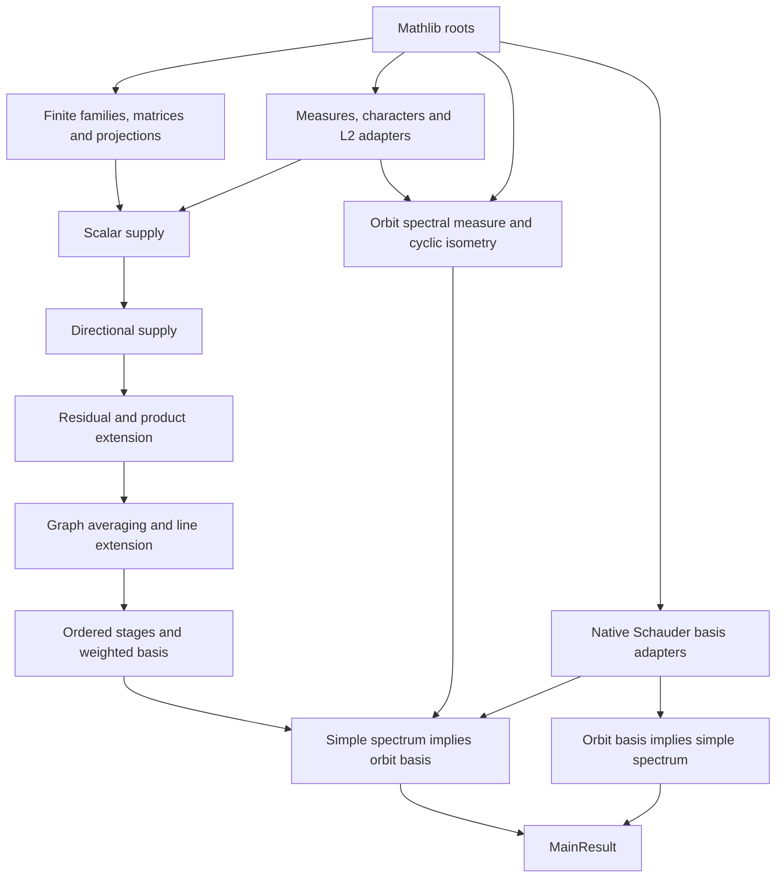

# Prompt 4: formalization blueprint

## 1. Objective, scope, and evidence

The target is the existing `MainResult` in `Showcase.lean`. This blueprint turns the argument in `refactored.tex` into explicit project definitions and theorem contracts, with proof strategies, file placement, and a complete dependency manifest.

The mathematical work described here remains to be implemented. A project node is a required lemma or an explicitly enumerated small bundle of routine adapters, **not an assumed theorem**. The substantial finite-system and projection infrastructure identified by the audit is included as work in the graph; it is not silently promoted to a Mathlib fact. There is no claim of a short formalization or of kernel verification from the existence of this blueprint.

Only Lean/Mathlib and newly proved project declarations are permitted. **The FLT paper's Lean development is excluded from reuse, copying, imports, and implementation recommendations.** No Lean source was written or modified in this prompt. The original statement still contains its existing placeholder, which is not a usable dependency.

### Pinned inputs

- `refactored.tex` at repository commit `ba2ace35d3ffc9c354173c762d6571511bfc10cf`; SHA-256 `fb0609bfb4e763e689c3e351cd174b232227e4664826c6438bf7b0c48e2a87de`.
- The exact existing `Showcase.lean`; its definitions and final proposition are to be preserved.
- Mathlib commit `1ddfaa9548e05b343be9248ae08b73c3425b446e`, toolchain `leanprover/lean4:v4.36.0`. The source archive was already available locally and was re-inspected for this blueprint.

Availability verification means reading the actual declarations, source implementations and hypotheses at that immutable revision, including generated additive declarations where noted. The Mathlib catalogue below links to the inspected source. Neither the proposed project nor new Lean probes were compiled; proposed project names and contracts are not presented as existing Mathlib declarations.

### Exact endpoint

The following is the target signature, with ambient variables made explicit for readability; its proof is deliberately not supplied as executable Lean code here:

```lean
variable {H : Type*} [ComplexHilbertSpace H]
variable (U : ℝ → UnitaryOperator H)

theorem MainResult
    [SeparableSpace H]
    (hH : ¬ FiniteDimensional ℂ H)
    (hU : IsStronglyContinuousGroup U) :
    HasSimpleContinuousSpectrum U ↔
      ∃ (g : H) (t : ℕ → ℝ), Injective t ∧
        ∃ b : SchauderBasis ℂ H, ∀ n, b n = U (t n) g
```

The future entry point imports the completed library and proves this statement from the internal theorem. Library files must never import `Showcase.lean`. Move only its original definitions, verbatim, into `Target/Definitions.lean` when implementation is authorized; do not duplicate their global names or turn its old `MainResult` into an axiom supplying the proof.

## 2. Representation contract

### 2.1 Common mathematical types

Contracts use precise mathematical shorthand rather than pretending to be already elaborated Lean declarations. All free objects below are universally quantified with these conventions; extra conditions are stated in each node.

| Notation | Required representation and meaning |
| --- | --- |
| `H`, `K` | Universe-polymorphic complete complex Hilbert spaces, unless a finite-matrix/geometric node explicitly uses `𝕜 ∈ {ℝ,ℂ}`. Never specialize the target's abstract `H` to a concrete function space. |
| `Euc 𝕜 n` | `EuclideanSpace 𝕜 (Fin n)`. Raw coefficient functions `Fin n → 𝕜` are converted with the `WithLp` maps when a norm is taken. |
| `Tι`, `Haarι` | `UnitAddTorus ι` for a finite coordinate type; the product of normalized period-one `AddCircle.haarAddCircle` measures. Empty and singleton products have explicit adapters. |
| `Xι` | `ℝ × Tι`, with its product Borel measurable structure. |
| `MixedFreq ι` | `ℚ × (ι → ℤ)`. A mode means its auxiliary component; a real frequency means its rational component. These are distinct injectivity requirements. |
| `RealPoly`, `TorusPoly ι`, `MixedPoly ι` | The additive monoid algebras in C06, evaluated as actual bounded continuous character sums. Real-valued weights retain a polynomial witness and equality of its evaluation with the complex cast of the real weight. |
| `LP μ` | `MeasureTheory.Lp ℂ 2 μ`. Actual measurable functions, their a.e. classes, and their classes under different measures are never silently identified. |
| `μ[w]` | `μ.withDensity (fun x => ENNReal.ofReal (w x))`, defined for any μ,w. Finiteness/positivity conclusions have the additional hypotheses in W01/W04. |
| `lift₂ μ f` | W02's L² class for a bounded measurable function under a finite measure μ, with agreement and proof-independence lemmas. Arbitrary-measure/unbounded-input operations use the separate adapters W09/W10. |
| `gram μ f` | The complex integral Gram matrix with entry `∫conj(f_i)*f_j dμ`, equal to Mathlib's `Matrix.gram` of the L² vectors. |
| `HPrefix`, `PrefixBound`, `PB(G,K)` | The Hilbert norm predicate, its raw integral version, and its matrix quadratic-form version from F01/F03. All require `K ≥ 0`. Conversion is proved, not definitional across measures. |
| `distSq μ f A` | F11's squared orthogonal residual in `LP μ`, with an explicit minimizing-coefficient theorem; it is not an undefined infimum across changing spaces. |
| `P_E` | The orthogonal endomorphism `Submodule.starProjection E`. Coordinate prefixes are generally oblique idempotents and must not be replaced by `P_E`. |
| `A†`, `opNorm(A)`, `A ⪯ B` | Hilbert adjoint/conjugate transpose, Euclidean operator norm, and Loewner order. A real matrix in a complex quadratic expression is explicitly complexified entrywise. |
| `aI` | Real scalar multiplication of the identity matrix/operator. Scalar inequalities use real parts of Hermitian quadratic forms, not an ordered-field structure on ℂ. |
| `a^(−n)` for natural n | The real reciprocal of `a^n` when `a>0`. Fractional powers are real powers with stated nonnegative/positive domains. Do not encode these as natural-number subtraction. |

Every project vertex has B00 as an explicit ancestor. Each Lean file must repeat the scoped openings it needs, especially `ComplexOrder`, `MatrixOrder` and `Matrix.Norms.L2Operator`; importing a conventions file does not automatically reopen scopes. Prefer the explicit `opNorm` wrapper to an ambiguous matrix norm.

Generic helpers use the ordinary Mathlib normed-group, inner-product-space and completeness classes. The custom `ComplexHilbertSpace` abbreviation is used only by files that import D01; the common description of H above is not an implicit import of the target definitions.

The nontrivial finite inverse/square-root calculations use nonempty coefficient spaces. Empty prefixes, zero subspaces, and empty-coordinate tori are handled in their named zero cases. In particular, I07 handles a zero finite support without invoking the nonzero-space formula `‖I+A‖=1+‖A‖`.

### 2.2 Construction data and shared hypotheses

- **Raw finite-family interfaces F:** whenever a node uses raw integral Gram/energy/distance or `lift₂`, its measure is finite and every input function has the measurable and uniform boundedness certificates of F01. The pure finite-matrix and finite-Hilbert-vector versions require no measure. These are separate versions, not implicit identifications of raw functions with L² classes. In particular, the spectral density on Lebesgue ℝ uses its separately proved integrability; it does not use a bounded-function finite-measure shortcut.
- **Scalar nodes S/J/N/FJ/SS:** S01 supplies bounded-below even measurable scalar data, with a nonempty ordered nonconstant list. S02/S03 derive real augmented and centered Grams, mass, loss and gain. SS00 adds precisely the certified estimates, not an existence assumption. In N-nodes, the iteration index and `nChars` are different naturals; all B, C, ε and Z values are derived from the stored datum.
- **Directional nodes SD/SC/DS:** fix the input of SD01: a probability on `Xι`, an ordered independent mixed-character basis of a finite V, bound `KV ≥ 1`, and a specified bounded polynomial representative e of norm one. In SC-nodes also fix a GoodScalar(δ,z), `Ks>1` with `1+δ<Ks`, and seed parameters `L≥1`, `0<m≤2^(−L)`. The stronger scale hypotheses are used only where explicitly supplied by SD07. `ι_ref` and `ι_W` denote different isometric pullbacks into the reference and weighted spaces.
- **Residual/product nodes RS/PX:** fix a singleton-null probability ρ on ℝ, a nonempty Nodup rational list A, a rational q absent from A, an old bound `K≥1` where needed, and `0<u≤1/100`. Define `K*=1+10u` and `c=u/(1+2u)`. Tolerances δ,τ are positive. Product outputs are PX00's explicit records.
- **Line-step nodes LX:** fix singleton-null probability μ, a measurable pointwise `0<v≤1`, nonempty Nodup A with its old PB bound under μ[v], and q absent from A. Use the same u-range and positive δ,τ. This pointwise representative version suffices for the iteration; final limiting weights use the a.e. adapters.
- **Graph averaging GA:** GA00 and GA03 use a finite Borel measure on ℝ; GA04 and GA06 additionally require singleton-nullity, stated in those contracts. The abstract numerical subsequence lemma GA05 has no measure hypothesis. The line-step application supplies all these certificates.
- **Iteration nodes IT/WB:** fix a singleton-null probability μ and outer `εGoal>0`. IT02 defines all stage constants. StageState is independent of LineStepData, so the line-step file does not import the iteration file.
- **Spectral/target nodes SP/TR/GOAL:** use the exact target definitions D01. A unit vector is assumed only after it has been supplied or normalized; absence of common eigenvectors is used to prove singleton nullity only after the cyclic isometry exists.

All existential auxiliary spaces produced by constructions are packaged with natural dimensions, hence coordinates `Fin r`. Temporary products/sums of finite coordinate types are transported by C05/I13/F15, preserving the family order. This avoids storing a changing arbitrary universe of coordinate types in a sequence. In a varying scalar-packet sequence, matrices may have different sizes, but quantities ε, Φ(β), λ and the final base-space information operators have the fixed types in their contracts.

### 2.3 No silent missing-theorem leaves

The only leaves of the graph are the explicitly verified M-nodes. Every other node is new project work with a stated contract and proof route. The most substantial new components are K13/T07 (infinite tuple bridges), the sharp row calculation, scalar packet induction, directional partial-column estimates, and ordered assembly. Their work is enumerated rather than assumed.

Two interfaces receive particular care:

1. RP01/SC04 prove the strict scalar response denominators even if `V∩e⊥` is zero. Positivity cannot be inferred from an eigenvalue on a nonexistent direction.
2. N01 stores cumulative budgets U,V and a block certificate. The upper Q bound is derived from those budgets after each update; it is not assumed to survive an increment.

The coefficient-space lemmas in the paper are unnecessary on the native Lean route: the input type `SchauderBasis` already has continuous coordinates, and the output uses its existing rank-one constructor. Their deliberate omission is recorded in the coverage table.

## 3. Incremental Lean project structure

The following paths are proposed, not created in this prompt. Pin the stated `lean-toolchain` and Mathlib commit in the future Lake project. During initial implementation it is acceptable to import `Mathlib` for availability; internal file imports must follow the acyclic table below. Imports may later be narrowed to the verified source modules.

Within each file, implement its node IDs in the topological order listed. A contract may be split into the explicitly described routine helper declarations, but no omitted mathematical result may be assumed to finish it. Keep a node-to-declaration index as implementation proceeds.

The public `Showcase.lean` is an entry point only. The original global definitions move verbatim into `SchauderBasisOrbits/Target/Definitions.lean`, and the original theorem statement remains in `Showcase.lean` with its new proof from the library.

| Build order | Proposed file | Direct project imports (transitively reduced) | Nodes in implementation order |
| --- | --- | --- | --- |
| 1 | `SchauderBasisOrbits/Core/Conventions.lean` | Mathlib only | `B00`, `B01` |
| 2 | `SchauderBasisOrbits/Finite/Matrix.lean` | `SchauderBasisOrbits/Core/Conventions.lean` | `K01`, `K07`, `K09`, `K05`, `K02`, `K03`, `K13`, `K11`, `K08`, `K10`, `K12`, `K06`, `K04`, `K14`, `K15` |
| 3 | `SchauderBasisOrbits/Fourier/Characters.lean` | `SchauderBasisOrbits/Core/Conventions.lean` | `C02`, `C01`, `C04`, `C05`, `C08`, `C03`, `C06`, `C07`, `C09` |
| 4 | `SchauderBasisOrbits/Measure/Weights.lean` | `SchauderBasisOrbits/Fourier/Characters.lean` | `W01`, `W02`, `W03`, `W09`, `W08`, `W04`, `W06`, `W07`, `W05`, `W10` |
| 5 | `SchauderBasisOrbits/Finite/Families.lean` | `SchauderBasisOrbits/Finite/Matrix.lean`, `SchauderBasisOrbits/Measure/Weights.lean` | `F01`, `F02`, `F05`, `F03`, `F04`, `F16`, `F07`, `F11`, `F06`, `F12`, `F15`, `F17`, `F18`, `F08`, `F09`, `F10`, `F13`, `F14` |
| 6 | `SchauderBasisOrbits/Basis/Criterion.lean` | `SchauderBasisOrbits/Finite/Families.lean` | `BS00`, `BS01`, `BS02`, `BS03`, `BS04`, `BS05`, `BS06`, `BS07`, `BS08`, `BS09`, `BS10` |
| 7 | `SchauderBasisOrbits/Fourier/RealTotality.lean` | `SchauderBasisOrbits/Finite/Families.lean` | `CH01`, `CH02`, `CH03`, `CH04`, `CH05`, `CH06` |
| 8 | `SchauderBasisOrbits/Target/Definitions.lean` | `SchauderBasisOrbits/Core/Conventions.lean` | `D01` |
| 9 | `SchauderBasisOrbits/Target/Group.lean` | `SchauderBasisOrbits/Target/Definitions.lean` | `SP01`, `SP02` |
| 10 | `SchauderBasisOrbits/Spectral/Approximation.lean` | `SchauderBasisOrbits/Fourier/Characters.lean`, `SchauderBasisOrbits/Target/Group.lean` | `SP03`, `SP04`, `SP05`, `SP06`, `SP07`, `SP08`, `SP09` |
| 11 | `SchauderBasisOrbits/Spectral/Measure.lean` | `SchauderBasisOrbits/Spectral/Approximation.lean` | `SP10`, `SP11` |
| 12 | `SchauderBasisOrbits/Spectral/Realization.lean` | `SchauderBasisOrbits/Fourier/RealTotality.lean`, `SchauderBasisOrbits/Spectral/Measure.lean` | `TR01`, `TR02`, `TR03`, `TR04`, `TR05` |
| 13 | `SchauderBasisOrbits/Basis/WeightedIsometry.lean` | `SchauderBasisOrbits/Basis/Criterion.lean`, `SchauderBasisOrbits/Spectral/Realization.lean` | `TR06`, `TR07` |
| 14 | `SchauderBasisOrbits/Measure/Products.lean` | `SchauderBasisOrbits/Finite/Families.lean` | `I01`, `I02`, `I03`, `I04`, `I05`, `I06`, `I07`, `I08`, `I11`, `I12`, `I13`, `I10`, `I15`, `I14`, `I09` |
| 15 | `SchauderBasisOrbits/Scalar/Data.lean` | `SchauderBasisOrbits/Finite/Families.lean` | `S01`, `S02`, `S03`, `S05`, `S04`, `S06`, `S07` |
| 16 | `SchauderBasisOrbits/Scalar/Fejer.lean` | `SchauderBasisOrbits/Scalar/Data.lean` | `FJ01`, `FJ02`, `FJ03`, `FJ04`, `FJ05` |
| 17 | `SchauderBasisOrbits/Finite/Tuples.lean` | `SchauderBasisOrbits/Finite/Matrix.lean`, `SchauderBasisOrbits/Measure/Weights.lean` | `T01`, `T02`, `T03`, `T07`, `T06`, `T04`, `T05` |
| 18 | `SchauderBasisOrbits/Finite/Projection.lean` | `SchauderBasisOrbits/Finite/Families.lean`, `SchauderBasisOrbits/Finite/Tuples.lean` | `P02`, `P03`, `P01`, `P04`, `P05` |
| 19 | `SchauderBasisOrbits/Finite/RowMatrix.lean` | `SchauderBasisOrbits/Finite/Projection.lean` | `R01`, `R06`, `R02`, `R03`, `R04`, `R05`, `R07`, `R08`, `R09` |
| 20 | `SchauderBasisOrbits/Scalar/Activation.lean` | `SchauderBasisOrbits/Finite/RowMatrix.lean`, `SchauderBasisOrbits/Scalar/Data.lean` | `A01`, `A02`, `A03`, `A04`, `A05`, `A06`, `A07`, `A08` |
| 21 | `SchauderBasisOrbits/Scalar/Copies.lean` | `SchauderBasisOrbits/Finite/Projection.lean`, `SchauderBasisOrbits/Scalar/Data.lean` | `J00`, `J01`, `J02`, `J03` |
| 22 | `SchauderBasisOrbits/Scalar/Induction.lean` | `SchauderBasisOrbits/Scalar/Activation.lean`, `SchauderBasisOrbits/Scalar/Copies.lean` | `N01`, `N03`, `N02`, `N04`, `N05`, `N06`, `N07`, `N08`, `N09`, `N10` |
| 23 | `SchauderBasisOrbits/Scalar/Supply.lean` | `SchauderBasisOrbits/Scalar/Fejer.lean`, `SchauderBasisOrbits/Scalar/Induction.lean` | `SS00`, `SS01` |
| 24 | `SchauderBasisOrbits/Construction/Residual.lean` | `SchauderBasisOrbits/Fourier/RealTotality.lean`, `SchauderBasisOrbits/Measure/Products.lean`, `SchauderBasisOrbits/Scalar/Supply.lean` | `RS01`, `RS02`, `RS03`, `RS04`, `RS05` |
| 25 | `SchauderBasisOrbits/Directional/Response.lean` | `SchauderBasisOrbits/Scalar/Supply.lean` | `RP01`, `RP02`, `RP03`, `RP04`, `RP05`, `RP06` |
| 26 | `SchauderBasisOrbits/Directional/Seed.lean` | `SchauderBasisOrbits/Directional/Response.lean`, `SchauderBasisOrbits/Measure/Products.lean` | `SD01`, `SD02`, `SD03`, `SD04`, `SD05`, `SD06`, `SD07` |
| 27 | `SchauderBasisOrbits/Directional/Selection.lean` | `SchauderBasisOrbits/Directional/Seed.lean` | `SC01`, `SC02`, `SC03`, `SC04`, `SC05`, `SC10`, `SC06`, `SC07`, `SC08`, `SC09`, `SC11` |
| 28 | `SchauderBasisOrbits/Directional/Supply.lean` | `SchauderBasisOrbits/Directional/Selection.lean` | `DS00`, `DS01`, `DS02`, `DS03` |
| 29 | `SchauderBasisOrbits/Construction/ProductStep.lean` | `SchauderBasisOrbits/Construction/Residual.lean`, `SchauderBasisOrbits/Directional/Supply.lean` | `PX00`, `PX01`, `PX02`, `PX03`, `PX04`, `PX05`, `PX06` |
| 30 | `SchauderBasisOrbits/Fourier/Graph.lean` | `SchauderBasisOrbits/Measure/Weights.lean` | `GA00`, `GA01`, `GA02`, `GA03`, `GA04`, `GA05`, `GA09`, `GA06`, `GA07`, `GA08` |
| 31 | `SchauderBasisOrbits/Construction/LineStep.lean` | `SchauderBasisOrbits/Construction/ProductStep.lean`, `SchauderBasisOrbits/Fourier/Graph.lean` | `LX01`, `LX02`, `LX03`, `LX00`, `LX04` |
| 32 | `SchauderBasisOrbits/Construction/Iteration.lean` | `SchauderBasisOrbits/Basis/Criterion.lean`, `SchauderBasisOrbits/Construction/LineStep.lean` | `IT02`, `IT03`, `IT01`, `IT04`, `IT05`, `IT08`, `IT09`, `IT11`, `IT06`, `IT07`, `IT12`, `IT10`, `IT13` |
| 33 | `SchauderBasisOrbits/Construction/WeightedBasis.lean` | `SchauderBasisOrbits/Construction/Iteration.lean` | `WB01`, `WB02` |
| 34 | `SchauderBasisOrbits/Main.lean` | `SchauderBasisOrbits/Basis/WeightedIsometry.lean`, `SchauderBasisOrbits/Construction/WeightedBasis.lean` | `GOAL00`, `GOAL01`, `GOAL02` |
| 35 | `Showcase.lean` | `SchauderBasisOrbits/Main.lean` | `GOAL03` |

## 4. How the full graph is specified

Every node below lists its direct prerequisites. Those lists, including definition dependencies and B00, are the authoritative graph and are repeated in the machine-readable manifest. Mathlib declarations named in an M-node are external roots; project names are proposed new declarations. A long Mathlib import is not permission to use an unnamed external mathematical oracle.

The overview is only navigation; the manifest is the complete graph.



## 5. Verified Mathlib catalogue

The linked source locations and their surrounding implementations were inspected at the pin. Where several declarations share a module, the link points to a representative declaration in that module. Hypotheses below are part of the interface. Source availability is not an assertion that the new project contracts have been elaborated.

### M00 — Logic, scalar algebra, and finite data

**Available declarations:** Lean classical choice; ℕ, ℤ, ℚ, ℝ, ℂ; Fin, Finset, Finsupp, List; AddMonoidAlgebra and its finite-support algebra.

**Hypotheses and limits:** This root permits only ordinary logic, definitional simplification, finite reindexing and scalar/ordered-field algebra. Analytic and project-specific claims require the other roots or explicit project nodes. Tactics are not theorem substitutes.

**Inspected sources:** [Mathlib/Algebra/MonoidAlgebra/Basic.lean:593](https://github.com/leanprover-community/mathlib4/blob/1ddfaa9548e05b343be9248ae08b73c3425b446e/Mathlib/Algebra/MonoidAlgebra/Basic.lean#L593), [Mathlib/Analysis/Complex/Trigonometric.lean:988](https://github.com/leanprover-community/mathlib4/blob/1ddfaa9548e05b343be9248ae08b73c3425b446e/Mathlib/Analysis/Complex/Trigonometric.lean#L988).

### M01 — Complex exponential

**Available declarations:** Complex.exp_add; Complex.norm_exp_ofReal_mul_I; Complex.exp_pi_mul_I, with continuity of exp from the same library.

**Hypotheses and limits:** Real phase arguments are cast to ℂ. Norm one applies to x*I with x real; do not apply it to an arbitrary complex phase.

**Inspected sources:** [Mathlib/Analysis/Complex/Exponential.lean:110](https://github.com/leanprover-community/mathlib4/blob/1ddfaa9548e05b343be9248ae08b73c3425b446e/Mathlib/Analysis/Complex/Exponential.lean#L110), [Mathlib/Analysis/Complex/Trigonometric.lean:988](https://github.com/leanprover-community/mathlib4/blob/1ddfaa9548e05b343be9248ae08b73c3425b446e/Mathlib/Analysis/Complex/Trigonometric.lean#L988), [Mathlib/Analysis/SpecialFunctions/Trigonometric/Basic.lean:1231](https://github.com/leanprover-community/mathlib4/blob/1ddfaa9548e05b343be9248ae08b73c3425b446e/Mathlib/Analysis/SpecialFunctions/Trigonometric/Basic.lean#L1231).

### M02 — Circle characters and Haar measure

**Available declarations:** AddCircle.haarAddCircle, its probability instance, fourier/fourier_add/fourier_neg, orthonormal_fourier, span_fourierLp_closure_eq_top; UnitAddTorus.mFourier. Additive versions generated by to_additive of Haar inversion invariance and measurePreserving_inv give negation invariance. AddCircle.injective_toCircle, volume_eq_smul_haarAddCircle, and UnitAddTorus.measurePreserving_equivPiIoc provide the kernel and interval adapters.

**Hypotheses and limits:** Fix period one and exponent two. The Haar measure is normalized. Haar negation invariance uses the compact abelian, regular Borel circle; the source explicitly generates the additive declarations.

**Inspected sources:** [Mathlib/Analysis/Fourier/AddCircle.lean:84](https://github.com/leanprover-community/mathlib4/blob/1ddfaa9548e05b343be9248ae08b73c3425b446e/Mathlib/Analysis/Fourier/AddCircle.lean#L84), [Mathlib/Analysis/Fourier/AddCircle.lean:259](https://github.com/leanprover-community/mathlib4/blob/1ddfaa9548e05b343be9248ae08b73c3425b446e/Mathlib/Analysis/Fourier/AddCircle.lean#L259), [Mathlib/Analysis/Fourier/AddCircleMulti.lean:53](https://github.com/leanprover-community/mathlib4/blob/1ddfaa9548e05b343be9248ae08b73c3425b446e/Mathlib/Analysis/Fourier/AddCircleMulti.lean#L53), [Mathlib/MeasureTheory/Measure/Haar/Unique.lean:981](https://github.com/leanprover-community/mathlib4/blob/1ddfaa9548e05b343be9248ae08b73c3425b446e/Mathlib/MeasureTheory/Measure/Haar/Unique.lean#L981), [Mathlib/MeasureTheory/Group/Measure.lean:337](https://github.com/leanprover-community/mathlib4/blob/1ddfaa9548e05b343be9248ae08b73c3425b446e/Mathlib/MeasureTheory/Group/Measure.lean#L337).

### M03 — Finite product measures and coordinate maps

**Available declarations:** MeasureTheory.measurePreserving_piCongrLeft; measurePreserving_sumPiEquivProdPi and its inverse; integral_prod.

**Hypotheses and limits:** Coordinate product results use finite indices and sigma-finite factors. Circle Haar factors are probabilities; Lebesgue ℝ is sigma-finite but not finite. A measurable equivalence alone does not imply measure preservation.

**Inspected sources:** [Mathlib/MeasureTheory/Constructions/Pi.lean:734](https://github.com/leanprover-community/mathlib4/blob/1ddfaa9548e05b343be9248ae08b73c3425b446e/Mathlib/MeasureTheory/Constructions/Pi.lean#L734), [Mathlib/MeasureTheory/Constructions/Pi.lean:798](https://github.com/leanprover-community/mathlib4/blob/1ddfaa9548e05b343be9248ae08b73c3425b446e/Mathlib/MeasureTheory/Constructions/Pi.lean#L798), [Mathlib/MeasureTheory/Integral/Prod.lean:443](https://github.com/leanprover-community/mathlib4/blob/1ddfaa9548e05b343be9248ae08b73c3425b446e/Mathlib/MeasureTheory/Integral/Prod.lean#L443).

### M04 — Lp and Hilbert-valued integration

**Available declarations:** MeasureTheory.memLp_two_iff_integrable_sq_norm; L2.inner_def; integral_inner; Lp.compMeasurePreserving, norm_compMeasurePreserving, Lp.compMeasurePreservingₗ and Lp.compMeasurePreservingₗᵢ.

**Hypotheses and limits:** Prove AEStronglyMeasurable and finite squared integral before toLp. The plain compMeasurePreserving is additive; the same source also provides its linear and linear-isometry forms. compMeasurePreservingₗᵢ requires Fact (1≤p), available here at p=2, together with the scalar module and bounded-scalar-action instances.

**Inspected sources:** [Mathlib/MeasureTheory/Function/L2Space.lean:45](https://github.com/leanprover-community/mathlib4/blob/1ddfaa9548e05b343be9248ae08b73c3425b446e/Mathlib/MeasureTheory/Function/L2Space.lean#L45), [Mathlib/MeasureTheory/Function/L2Space.lean:89](https://github.com/leanprover-community/mathlib4/blob/1ddfaa9548e05b343be9248ae08b73c3425b446e/Mathlib/MeasureTheory/Function/L2Space.lean#L89), [Mathlib/MeasureTheory/Function/LpSpace/Basic.lean:642](https://github.com/leanprover-community/mathlib4/blob/1ddfaa9548e05b343be9248ae08b73c3425b446e/Mathlib/MeasureTheory/Function/LpSpace/Basic.lean#L642).

### M05 — Weights and integration against densities

**Available declarations:** Measure.withDensity; withDensity_absolutelyContinuous; ae_withDensity_iff; integral_withDensity_eq_integral_smul and the toReal variants.

**Hypotheses and limits:** Use ENNReal.ofReal for nonnegative real weights, prove measurability and finite mass, and justify ofReal/toReal conversions. Strict positivity is required to infer equivalence of null sets.

**Inspected sources:** [Mathlib/MeasureTheory/Measure/WithDensity.lean:313](https://github.com/leanprover-community/mathlib4/blob/1ddfaa9548e05b343be9248ae08b73c3425b446e/Mathlib/MeasureTheory/Measure/WithDensity.lean#L313), [Mathlib/MeasureTheory/Integral/Bochner/ContinuousLinearMap.lean:251](https://github.com/leanprover-community/mathlib4/blob/1ddfaa9548e05b343be9248ae08b73c3425b446e/Mathlib/MeasureTheory/Integral/Bochner/ContinuousLinearMap.lean#L251).

### M06 — Hilbert projections, duality and finite subspaces

**Available declarations:** Submodule.starProjection, orthogonalProjectionOnto, orthogonalDecomposition; InnerProductSpace.toDual; Submodule.isClosed_of_finiteDimensional.

**Hypotheses and limits:** The ambient Hilbert spaces are complete. starProjection is an endomorphism; orthogonalProjectionOnto has submodule codomain. For finite subspaces provide the finite-dimensional/complete instance. Closed_of_finiteDimensional is a deprecated alias; prefer isClosed_of_finiteDimensional.

**Inspected sources:** [Mathlib/Analysis/InnerProductSpace/Projection/Basic.lean:131](https://github.com/leanprover-community/mathlib4/blob/1ddfaa9548e05b343be9248ae08b73c3425b446e/Mathlib/Analysis/InnerProductSpace/Projection/Basic.lean#L131), [Mathlib/Analysis/InnerProductSpace/ProdL2.lean:88](https://github.com/leanprover-community/mathlib4/blob/1ddfaa9548e05b343be9248ae08b73c3425b446e/Mathlib/Analysis/InnerProductSpace/ProdL2.lean#L88), [Mathlib/Analysis/InnerProductSpace/Dual.lean:136](https://github.com/leanprover-community/mathlib4/blob/1ddfaa9548e05b343be9248ae08b73c3425b446e/Mathlib/Analysis/InnerProductSpace/Dual.lean#L136), [Mathlib/Topology/Algebra/Module/FiniteDimension.lean:568](https://github.com/leanprover-community/mathlib4/blob/1ddfaa9548e05b343be9248ae08b73c3425b446e/Mathlib/Topology/Algebra/Module/FiniteDimension.lean#L568), [Mathlib/Analysis/InnerProductSpace/Projection/Submodule.lean:182](https://github.com/leanprover-community/mathlib4/blob/1ddfaa9548e05b343be9248ae08b73c3425b446e/Mathlib/Analysis/InnerProductSpace/Projection/Submodule.lean#L182).

### M07 — Adjoints and operator norms

**Available declarations:** ContinuousLinearMap.adjoint, adjoint_comp, norm_adjoint_comp_self; ContinuousLinearMap.norm_eq_iSup_rayleighQuotient. LinearMap.ext_inner_map supplies polarization/extensionality.

**Hypotheses and limits:** Domain and codomain are complete Hilbert spaces for adjoints. The Rayleigh norm formula assumes symmetry. Real parts are used for real-valued inequalities.

**Inspected sources:** [Mathlib/Analysis/InnerProductSpace/Adjoint.lean:280](https://github.com/leanprover-community/mathlib4/blob/1ddfaa9548e05b343be9248ae08b73c3425b446e/Mathlib/Analysis/InnerProductSpace/Adjoint.lean#L280), [Mathlib/Analysis/InnerProductSpace/Rayleigh.lean:120](https://github.com/leanprover-community/mathlib4/blob/1ddfaa9548e05b343be9248ae08b73c3425b446e/Mathlib/Analysis/InnerProductSpace/Rayleigh.lean#L120), [Mathlib/Analysis/InnerProductSpace/LinearMap.lean:98](https://github.com/leanprover-community/mathlib4/blob/1ddfaa9548e05b343be9248ae08b73c3425b446e/Mathlib/Analysis/InnerProductSpace/LinearMap.lean#L98).

### M08 — Euclidean matrix operator norms

**Available declarations:** Matrix.toEuclideanCLM; l2_opNorm_def; l2_opNorm_conjTranspose_mul_self; Matrix.gram and star_dotProduct_gram_mulVec. Matrix.posDef_gram_iff_linearIndependent is the Gram positive-definiteness/linear-independence equivalence in a normed inner-product space.

**Hypotheses and limits:** Use the L2 operator norm scope or explicitly take the CLM norm. The unqualified default matrix norm is entrywise supremum and is not interchangeable.

**Inspected sources:** [Mathlib/Analysis/CStarAlgebra/Matrix.lean:195](https://github.com/leanprover-community/mathlib4/blob/1ddfaa9548e05b343be9248ae08b73c3425b446e/Mathlib/Analysis/CStarAlgebra/Matrix.lean#L195), [Mathlib/Analysis/InnerProductSpace/GramMatrix.lean:40](https://github.com/leanprover-community/mathlib4/blob/1ddfaa9548e05b343be9248ae08b73c3425b446e/Mathlib/Analysis/InnerProductSpace/GramMatrix.lean#L40).

### M09 — Positive matrices and inverses

**Available declarations:** MatrixOrder; Matrix.PosDef.isUnit; Matrix.PosDef.fromBlocks₁₁/fromBlocks₂₂; Matrix.add_mul_mul_inv_eq_sub; continuousAt_matrix_inv.

**Hypotheses and limits:** Every inverse use carries PosDef/IsUnit. Schur complement lemmas additionally request an Invertible instance for their pivot. They conclude a PosSemidef equivalence. Inverse continuity is local at an invertible matrix.

**Inspected sources:** [Mathlib/Analysis/Matrix/Order.lean:54](https://github.com/leanprover-community/mathlib4/blob/1ddfaa9548e05b343be9248ae08b73c3425b446e/Mathlib/Analysis/Matrix/Order.lean#L54), [Mathlib/LinearAlgebra/Matrix/PosDef.lean:636](https://github.com/leanprover-community/mathlib4/blob/1ddfaa9548e05b343be9248ae08b73c3425b446e/Mathlib/LinearAlgebra/Matrix/PosDef.lean#L636), [Mathlib/LinearAlgebra/Matrix/PosDef.lean:698](https://github.com/leanprover-community/mathlib4/blob/1ddfaa9548e05b343be9248ae08b73c3425b446e/Mathlib/LinearAlgebra/Matrix/PosDef.lean#L698), [Mathlib/LinearAlgebra/Matrix/NonsingularInverse.lean:616](https://github.com/leanprover-community/mathlib4/blob/1ddfaa9548e05b343be9248ae08b73c3425b446e/Mathlib/LinearAlgebra/Matrix/NonsingularInverse.lean#L616), [Mathlib/Topology/Instances/Matrix.lean:246](https://github.com/leanprover-community/mathlib4/blob/1ddfaa9548e05b343be9248ae08b73c3425b446e/Mathlib/Topology/Instances/Matrix.lean#L246).

### M10 — Finite spectral theorem

**Available declarations:** LinearMap.IsSymmetric.eigenvectorBasis and its eigenvector/eigenvalue equations.

**Hypotheses and limits:** Finite-dimensional spaces over RCLike scalars. Infinite-rank operators cannot be diagonalized by this theorem; restrict to an explicitly finite invariant span.

**Inspected sources:** [Mathlib/Analysis/InnerProductSpace/Spectrum.lean:296](https://github.com/leanprover-community/mathlib4/blob/1ddfaa9548e05b343be9248ae08b73c3425b446e/Mathlib/Analysis/InnerProductSpace/Spectrum.lean#L296).

### M11 — Positive square roots

**Available declarations:** CFC.sqrt_nonneg; sqrt_mul_sqrt_self; sqrt_unique; isUnit_sqrt_iff; Matrix.PosSemidef.inv_sqrt.

**Hypotheses and limits:** The matrix CFC/order instances must match the chosen field and metric. Use a proved positive matrix and IsUnit to get an invertible positive root; do not use totalized inverse outside this domain.

**Inspected sources:** [Mathlib/Analysis/SpecialFunctions/ContinuousFunctionalCalculus/Rpow/Basic.lean:261](https://github.com/leanprover-community/mathlib4/blob/1ddfaa9548e05b343be9248ae08b73c3425b446e/Mathlib/Analysis/SpecialFunctions/ContinuousFunctionalCalculus/Rpow/Basic.lean#L261), [Mathlib/Analysis/Matrix/Order.lean:54](https://github.com/leanprover-community/mathlib4/blob/1ddfaa9548e05b343be9248ae08b73c3425b446e/Mathlib/Analysis/Matrix/Order.lean#L54).

### M12 — Schauder structures and constructor

**Available declarations:** GeneralSchauderBasis.coord/ortho/expansion/linearIndependent; SchauderBasis.tendsto_proj and exists_norm_proj_le; SchauderBasis.RankOneDecomposition.basis and basis_coe.

**Hypotheses and limits:** Conditional ℕ summation, not unconditional tsum. The constructor requires prefix ranks n, compatibility, convergence, nonzero specified vectors, and membership in each rank-one difference range.

**Inspected sources:** [Mathlib/Analysis/Normed/Module/Bases.lean:104](https://github.com/leanprover-community/mathlib4/blob/1ddfaa9548e05b343be9248ae08b73c3425b446e/Mathlib/Analysis/Normed/Module/Bases.lean#L104), [Mathlib/Analysis/Normed/Module/Bases.lean:464](https://github.com/leanprover-community/mathlib4/blob/1ddfaa9548e05b343be9248ae08b73c3425b446e/Mathlib/Analysis/Normed/Module/Bases.lean#L464).

### M13 — Bounded extension from dense subspaces

**Available declarations:** LinearMap.extendOfNorm and its norm/agreement lemmas; LinearEquiv.extendOfIsometry; ContinuousLinearEquiv.ofBijective.

**Hypotheses and limits:** Supply density and the stated norm inequality. Isometric equivalence requires dense images on both sides and complete ambient spaces. This does not by itself define a map on a dependent generating family.

**Inspected sources:** [Mathlib/Analysis/Normed/Operator/Extend.lean:305](https://github.com/leanprover-community/mathlib4/blob/1ddfaa9548e05b343be9248ae08b73c3425b446e/Mathlib/Analysis/Normed/Operator/Extend.lean#L305), [Mathlib/Analysis/Normed/Operator/Banach.lean:439](https://github.com/leanprover-community/mathlib4/blob/1ddfaa9548e05b343be9248ae08b73c3425b446e/Mathlib/Analysis/Normed/Operator/Banach.lean#L439).

### M14 — Character independence and analytic identity

**Available declarations:** linearIndependent_monoidHom; AnalyticOnNhd.eqOn_zero_of_preconnected_of_frequently_eq_zero; exists_accPt_of_nullSingletonClass.

**Hypotheses and limits:** Use Multiplicative ℝ for the additive real group, not a finite-group-only additive-character theorem. The analytic map may be real-analytic with complex values; the domain is the connected real line. The positive-measure zero set is separable.

**Inspected sources:** [Mathlib/LinearAlgebra/LinearIndependent/Basic.lean:516](https://github.com/leanprover-community/mathlib4/blob/1ddfaa9548e05b343be9248ae08b73c3425b446e/Mathlib/LinearAlgebra/LinearIndependent/Basic.lean#L516), [Mathlib/Analysis/Analytic/IsolatedZeros.lean:210](https://github.com/leanprover-community/mathlib4/blob/1ddfaa9548e05b343be9248ae08b73c3425b446e/Mathlib/Analysis/Analytic/IsolatedZeros.lean#L210), [Mathlib/MeasureTheory/Measure/Typeclasses/NullSingletonClass.lean:88](https://github.com/leanprover-community/mathlib4/blob/1ddfaa9548e05b343be9248ae08b73c3425b446e/Mathlib/MeasureTheory/Measure/Typeclasses/NullSingletonClass.lean#L88).

### M15 — Singleton-null measures

**Available declarations:** MeasureTheory.NullSingletonClass; Set.Countable.measure_zero and ae_notMem.

**Hypotheses and limits:** This is precisely absence of point masses. Do not silently replace it by the stronger general-space NoAtoms predicate.

**Inspected sources:** [Mathlib/MeasureTheory/Measure/Typeclasses/NullSingletonClass.lean:28](https://github.com/leanprover-community/mathlib4/blob/1ddfaa9548e05b343be9248ae08b73c3425b446e/Mathlib/MeasureTheory/Measure/Typeclasses/NullSingletonClass.lean#L28).

### M16 — Finite-measure Fourier uniqueness

**Available declarations:** MeasureTheory.Measure.ext_of_charFun.

**Hypotheses and limits:** Finite positive Borel measures on complete second-countable real inner-product spaces. Complex densities need reduction to their real/imaginary positive and negative parts. Mathlib charFun uses exp(i*t*x), not exp(2πi*t*x).

**Inspected sources:** [Mathlib/MeasureTheory/Measure/CharacteristicFunction/Basic.lean:256](https://github.com/leanprover-community/mathlib4/blob/1ddfaa9548e05b343be9248ae08b73c3425b446e/Mathlib/MeasureTheory/Measure/CharacteristicFunction/Basic.lean#L256).

### M17 — Gaussian transform and Fourier inversion

**Available declarations:** fourier_gaussian_pi; Continuous.fourierInv_fourier_eq.

**Hypotheses and limits:** Positive real Gaussian parameter, and both the function and Fourier transform integrable before inversion. The paper convention here uses 2π.

**Inspected sources:** [Mathlib/Analysis/SpecialFunctions/Gaussian/FourierTransform.lean:227](https://github.com/leanprover-community/mathlib4/blob/1ddfaa9548e05b343be9248ae08b73c3425b446e/Mathlib/Analysis/SpecialFunctions/Gaussian/FourierTransform.lean#L227), [Mathlib/Analysis/Fourier/Inversion.lean:175](https://github.com/leanprover-community/mathlib4/blob/1ddfaa9548e05b343be9248ae08b73c3425b446e/Mathlib/Analysis/Fourier/Inversion.lean#L175).

### M18 — Probability tightness and compactness

**Available declarations:** isTightMeasureSet_of_tendsto_charFun; isCompact_closure_of_isTightMeasureSet; ProbabilityMeasure.tendsto_iff_forall_integral_rclike_tendsto.

**Hypotheses and limits:** Approximants must already be probabilities. Tightness follows from a pointwise character limit continuous at zero. Compactness then supplies a cluster probability. The theorem with an already specified limiting probability is not an existence theorem.

**Inspected sources:** [Mathlib/MeasureTheory/Measure/LevyConvergence.lean:43](https://github.com/leanprover-community/mathlib4/blob/1ddfaa9548e05b343be9248ae08b73c3425b446e/Mathlib/MeasureTheory/Measure/LevyConvergence.lean#L43), [Mathlib/MeasureTheory/Measure/Prokhorov.lean:553](https://github.com/leanprover-community/mathlib4/blob/1ddfaa9548e05b343be9248ae08b73c3425b446e/Mathlib/MeasureTheory/Measure/Prokhorov.lean#L553), [Mathlib/MeasureTheory/Measure/ProbabilityMeasure.lean:374](https://github.com/leanprover-community/mathlib4/blob/1ddfaa9548e05b343be9248ae08b73c3425b446e/Mathlib/MeasureTheory/Measure/ProbabilityMeasure.lean#L374).

### M19 — Convergence and nonnegative integrals

**Available declarations:** MeasureTheory.tendsto_integral_of_dominated_convergence; lintegral_tsum/lintegral_iSup; integral_prod.

**Hypotheses and limits:** Each use proves measurability plus an integrable majorant or nonnegativity. Finite-dimensional matrix integration is entrywise Bochner integration with proved integrability.

**Inspected sources:** [Mathlib/MeasureTheory/Integral/DominatedConvergence.lean:57](https://github.com/leanprover-community/mathlib4/blob/1ddfaa9548e05b343be9248ae08b73c3425b446e/Mathlib/MeasureTheory/Integral/DominatedConvergence.lean#L57), [Mathlib/MeasureTheory/Integral/Lebesgue/Add.lean:362](https://github.com/leanprover-community/mathlib4/blob/1ddfaa9548e05b343be9248ae08b73c3425b446e/Mathlib/MeasureTheory/Integral/Lebesgue/Add.lean#L362), [Mathlib/MeasureTheory/Integral/Prod.lean:443](https://github.com/leanprover-community/mathlib4/blob/1ddfaa9548e05b343be9248ae08b73c3425b446e/Mathlib/MeasureTheory/Integral/Prod.lean#L443).

### M20 — Scalar logarithms, powers and intermediate value

**Available declarations:** Real.log_le_sub_one_of_pos; tendsto_log_atTop and the zero-side limit; Real.continuousAt_rpow_const; Real.tendsto_exp_div_pow_atTop; intermediate_value_Icc.

**Hypotheses and limits:** Positive arguments for logs and nonintegral negative powers. Floors/ceilings are natural-valued only on nonnegative inputs. Endpoints and positivity of denominators are separate proof obligations.

**Inspected sources:** [Mathlib/Analysis/SpecialFunctions/Log/Basic.lean:306](https://github.com/leanprover-community/mathlib4/blob/1ddfaa9548e05b343be9248ae08b73c3425b446e/Mathlib/Analysis/SpecialFunctions/Log/Basic.lean#L306), [Mathlib/Analysis/SpecialFunctions/Pow/Continuity.lean:213](https://github.com/leanprover-community/mathlib4/blob/1ddfaa9548e05b343be9248ae08b73c3425b446e/Mathlib/Analysis/SpecialFunctions/Pow/Continuity.lean#L213), [Mathlib/Analysis/SpecialFunctions/Exp.lean:249](https://github.com/leanprover-community/mathlib4/blob/1ddfaa9548e05b343be9248ae08b73c3425b446e/Mathlib/Analysis/SpecialFunctions/Exp.lean#L249), [Mathlib/Topology/Order/IntermediateValue.lean:586](https://github.com/leanprover-community/mathlib4/blob/1ddfaa9548e05b343be9248ae08b73c3425b446e/Mathlib/Topology/Order/IntermediateValue.lean#L586).

### M21 — Finite polynomial root bounds

**Available declarations:** Polynomial.eq_zero_of_natDegree_lt_card_of_eval_eq_zero, and finite root-set consequences in the same Roots module.

**Hypotheses and limits:** Work over ℝ, prove the polynomial is nonzero by a nonzero coefficient, and infer a finite exceptional set of integer roots.

**Inspected sources:** [Mathlib/Algebra/Polynomial/Roots.lean:757](https://github.com/leanprover-community/mathlib4/blob/1ddfaa9548e05b343be9248ae08b73c3425b446e/Mathlib/Algebra/Polynomial/Roots.lean#L757).

### M22 — Finite Hilbert tuples

**Available declarations:** PiLp.proj, PiLp.single, norm_single, continuousLinearEquiv; WithLp 2 products and Submodule.orthogonalDecomposition.

**Hypotheses and limits:** Finite index type; use p=2. The equivalence to an ordinary function space is continuous, not an isometry for its default supremum norm.

**Inspected sources:** [Mathlib/Analysis/Normed/Lp/PiLp.lean:1201](https://github.com/leanprover-community/mathlib4/blob/1ddfaa9548e05b343be9248ae08b73c3425b446e/Mathlib/Analysis/Normed/Lp/PiLp.lean#L1201), [Mathlib/Analysis/InnerProductSpace/ProdL2.lean:88](https://github.com/leanprover-community/mathlib4/blob/1ddfaa9548e05b343be9248ae08b73c3425b446e/Mathlib/Analysis/InnerProductSpace/ProdL2.lean#L88).

### M23 — Density, sequence continuity and cluster points

**Available declarations:** continuous_iff_seqContinuous; Rat.denseRange_cast; the Encodable ℚ instance; IsCompact.exists_clusterPt; ClusterPt.map; Submodule.topologicalClosure_eq_top_iff.

**Hypotheses and limits:** Normed spaces are metric/first-countable, hence sequential. Cluster-point uniqueness is in Hausdorff spaces. Rational density is for the real Archimedean ordered field. Encode/decode gives a surjective rational enumeration; no injective enumeration is required.

**Inspected sources:** [Mathlib/Topology/Sequences.lean:222](https://github.com/leanprover-community/mathlib4/blob/1ddfaa9548e05b343be9248ae08b73c3425b446e/Mathlib/Topology/Sequences.lean#L222), [Mathlib/Topology/Algebra/Order/Archimedean.lean:32](https://github.com/leanprover-community/mathlib4/blob/1ddfaa9548e05b343be9248ae08b73c3425b446e/Mathlib/Topology/Algebra/Order/Archimedean.lean#L32), [Mathlib/Data/Rat/Encodable.lean:23](https://github.com/leanprover-community/mathlib4/blob/1ddfaa9548e05b343be9248ae08b73c3425b446e/Mathlib/Data/Rat/Encodable.lean#L23), [Mathlib/Topology/Compactness/Compact.lean:39](https://github.com/leanprover-community/mathlib4/blob/1ddfaa9548e05b343be9248ae08b73c3425b446e/Mathlib/Topology/Compactness/Compact.lean#L39), [Mathlib/Topology/Continuous.lean:93](https://github.com/leanprover-community/mathlib4/blob/1ddfaa9548e05b343be9248ae08b73c3425b446e/Mathlib/Topology/Continuous.lean#L93), [Mathlib/Analysis/InnerProductSpace/Projection/Submodule.lean:182](https://github.com/leanprover-community/mathlib4/blob/1ddfaa9548e05b343be9248ae08b73c3425b446e/Mathlib/Analysis/InnerProductSpace/Projection/Submodule.lean#L182).

### M24 — Lebesgue interval calculations

**Available declarations:** Real.volume_Icc and its real-valued version; additive Haar translation/negation measure preservation; integral_prod.

**Hypotheses and limits:** Lebesgue measure on ℝ is sigma-finite, not finite or a probability. Compact interval restrictions are finite. Endpoints are null; orientation of interval integrals is fixed by T>0.

**Inspected sources:** [Mathlib/MeasureTheory/Measure/Lebesgue/Basic.lean:87](https://github.com/leanprover-community/mathlib4/blob/1ddfaa9548e05b343be9248ae08b73c3425b446e/Mathlib/MeasureTheory/Measure/Lebesgue/Basic.lean#L87), [Mathlib/MeasureTheory/Group/Measure.lean:337](https://github.com/leanprover-community/mathlib4/blob/1ddfaa9548e05b343be9248ae08b73c3425b446e/Mathlib/MeasureTheory/Group/Measure.lean#L337), [Mathlib/MeasureTheory/Integral/Prod.lean:443](https://github.com/leanprover-community/mathlib4/blob/1ddfaa9548e05b343be9248ae08b73c3425b446e/Mathlib/MeasureTheory/Integral/Prod.lean#L443).

### M25 — Summable deviations and nonzero infinite products

**Available declarations:** multipliable_one_add_of_summable; tprod_one_add_ne_zero_of_summable; nonnegative lintegral_tsum and standard summability/finite-sum characterizations.

**Hypotheses and limits:** Instantiate the product theorem in complete normed commutative ℝ. Every factor 1+f_n must be nonzero and Σ‖f_n‖ summable. Ordered finite products follow by composing HasProd with the cofinal Finset.range sequence; they are not asserted for an arbitrary conditional product.

**Inspected sources:** [Mathlib/Analysis/SpecialFunctions/Log/Summable.lean:213](https://github.com/leanprover-community/mathlib4/blob/1ddfaa9548e05b343be9248ae08b73c3425b446e/Mathlib/Analysis/SpecialFunctions/Log/Summable.lean#L213), [Mathlib/MeasureTheory/Integral/Lebesgue/Add.lean:362](https://github.com/leanprover-community/mathlib4/blob/1ddfaa9548e05b343be9248ae08b73c3425b446e/Mathlib/MeasureTheory/Integral/Lebesgue/Add.lean#L362).

### M26 — Fourier conventions and affine integral substitutions

**Available declarations:** fourier_real_eq_integral_exp_smul; MeasureTheory.integral_comp_mul_left; intervalIntegral.integral_comp_add_right; Complex.ofReal_cpow.

**Hypotheses and limits:** Whole-line scaling contributes the inverse absolute Jacobian. This blueprint uses only positive scales. Complex.ofReal_cpow requires a nonnegative real base; the Gaussian parameter is strictly positive. Interval orientations use T>0.

**Inspected sources:** [Mathlib/Analysis/Fourier/FourierTransform.lean:488](https://github.com/leanprover-community/mathlib4/blob/1ddfaa9548e05b343be9248ae08b73c3425b446e/Mathlib/Analysis/Fourier/FourierTransform.lean#L488), [Mathlib/MeasureTheory/Measure/Haar/NormedSpace.lean:151](https://github.com/leanprover-community/mathlib4/blob/1ddfaa9548e05b343be9248ae08b73c3425b446e/Mathlib/MeasureTheory/Measure/Haar/NormedSpace.lean#L151), [Mathlib/MeasureTheory/Integral/IntervalIntegral/Basic.lean:959](https://github.com/leanprover-community/mathlib4/blob/1ddfaa9548e05b343be9248ae08b73c3425b446e/Mathlib/MeasureTheory/Integral/IntervalIntegral/Basic.lean#L959), [Mathlib/Analysis/SpecialFunctions/Pow/Real.lean:282](https://github.com/leanprover-community/mathlib4/blob/1ddfaa9548e05b343be9248ae08b73c3425b446e/Mathlib/Analysis/SpecialFunctions/Pow/Real.lean#L282).


## 6. Project node ledger

All contracts below are proposed mathematical/Lean interfaces. A node's proof may use only its declared ancestors and the shared elementary convention root; it must not use the public target or a later unlisted project theorem. The dependency graph intentionally includes supporting definitions, not just headline theorem-to-theorem arrows.

### SchauderBasisOrbits/Core/Conventions.lean

#### B00 — `conventions`

**Depends on:** `M00`, `M08`, `M09`.

**Contract:** Fix inner products conjugate-linear in the first slot. Coefficients are Fin n → 𝕜; when normed they are EuclideanSpace 𝕜 (Fin n), 𝕜=ℝ or ℂ. For a square matrix, opNorm(A) means the norm of Matrix.toEuclideanCLM A. Define A ⪯ B by (B−A).PosSemidef and q_A(c)=re(cᴴ A c). Real scalar rI means r • (1 : Matrix _ _ 𝕜). All norm and order comparisons below use these conventions.

**Proof strategy:** This is the common definitional prelude, not a theorem that assumes a missing estimate. Supply explicit Fin/Fintype/DecidableEq instances, use ordinary finitary algebra, and make fields/casts visible. Every project node explicitly depends on this prelude.

#### B01 — `finite_index_equivalences`

**Depends on:** `B00`, `M00`, `M22`.

**Contract:** Provide the ordered augmented-index equivalence Fin(n+1)≃Unit⊕Fin n, prefix inclusions Fin j↪Fin n for j≤n, and lexicographic Fin(L*d)≃Fin L×Fin d for d>0. Coefficient reindexings by bijections are Euclidean linear isometry equivalences. Record their matrix-entry, sum and block-mask formulas.

**Proof strategy:** Define the equivalences by Fin cases and quotient/remainder. Check inverse laws with natural arithmetic and prove norm preservation by finite reindexing of squared coordinate norms. The empty product case is separate. These are routine but explicit type adapters, not arbitrary basis reorderings.

### SchauderBasisOrbits/Finite/Matrix.lean

#### K01 — `positive_root_and_coercivity`

**Depends on:** `B00`, `M09`, `M10`, `M11`.

**Contract:** For PosDef A over ℝ or ℂ, prove IsUnit A, Hermitian positive root R=CFC.sqrt A with R²=A, IsUnit R, and its inverse identities. For n>0 obtain a>0 with aI⪯A. Every use of A⁻¹ or R⁻¹ carries these certificates.

**Proof strategy:** Use PosDef.isUnit and CFC root equations/positivity; choose the minimum of finitely many positive eigenvalues for the coercivity floor. Handle the empty matrix separately when a later generic statement allows n=0.

#### K07 — `adjoint_and_synthesis_norms`

**Depends on:** `B00`, `M07`, `M08`.

**Contract:** For bounded maps between complete Hilbert spaces, use ‖A†‖=‖A‖ and ‖A†A‖=‖AA†‖=‖A‖²; supply rectangular-matrix/CLM bridge versions. For finite family synthesis X, the norm of XX† equals the operator norm of its Gram matrix X†X.

**Proof strategy:** Apply the verified adjoint isometry and norm_adjoint_comp_self, then the same result to A†. Convert rectangular coefficient maps through EuclideanSpace and preserve the field.

**Manuscript:** `lem:operator-norm`.

#### K09 — `finite_positive_spectral_bounds`

**Depends on:** `B00`, `K01`, `M10`, `M07`.

**Contract:** For finite self-adjoint A, relate quadratic-form bounds to spectral bounds. For A≥0 on a nonzero finite space, opNorm(A)=max eigenvalue; on the zero space its norm is zero. For nonzero ambient space, opNorm(I+A)=1+opNorm(A). For positive 2×2 A, opNorm(A)≤re(trace A), equal to trace A over ℝ. Adding h vvᴴ, h≥0, increases the largest eigenvalue by at most h‖v‖².

**Proof strategy:** Diagonalize in an orthonormal eigenbasis and take finite maxima; prove the last inequality on each unit-vector Rayleigh quotient. Explicitly exclude the zero space in the I+A formula.

#### K05 — `entrywise_to_operator_convergence`

**Depends on:** `B00`, `M08`.

**Contract:** For n>0, opNorm(E)≤n*max_ij ‖Eij‖. Consequently fixed-size entrywise convergence implies operator norm convergence. For n=0 all norms are zero.

**Proof strategy:** Apply Cauchy–Schwarz to each row on Euclidean coefficients and sum squares. Obtain the finite maximum or use a common entrywise ε bound; avoid the default matrix norm.

#### K02 — `inverse_variational_identity`

**Depends on:** `B00`, `K01`.

**Contract:** For A>0 and v,c in coefficient space, prove q_Ainv(v)−(2 re(vᴴc)−q_A(c))=q_A(c−A⁻¹v)≥0, with equality at c=A⁻¹v.

**Proof strategy:** Expand using Hermitian inverse and A A⁻¹=I. This exact identity supplies all maximum/supremum arguments below without postulating an optimizer theorem.

**Manuscript:** `lem:inverse-variational`.

#### K03 — `inverse_order_and_compression`

**Depends on:** `B00`, `K02`.

**Contract:** If 0<A⪯B then B⁻¹⪯A⁻¹. If E is a coordinate/isometric inclusion of a finite subspace and Eᴴ A E>0, prove (Eᴴ A E)⁻¹⪯Eᴴ A⁻¹ E.

**Proof strategy:** Apply K02 to each fixed v: increasing A decreases the tested expression, and restricting c to range E reduces its supremum. Prove both Loewner claims from the real quadratic-form inequalities.

**Manuscript:** `lem:inverse-variational`.

#### K13 — `inverse_compression_of_factorization`

**Depends on:** `B00`, `K02`, `K07`, `M06`.

**Contract:** For S:H≃L[ℂ]H, G=S†S, Ginv=S⁻¹(S⁻¹)† and an isometric finite-column inclusion U:Eucℂ n→ₗᵢH, prove A=U†GU>0 and A⁻¹⪯U†Ginv U.

**Proof strategy:** For h=Uv define Q_h(x)=2 re⟪h,x⟫−‖Sx‖². Verify G Ginv=Ginv G=I and Q_h(Ginv h)−Q_h(x)=‖S(x−Ginv h)‖². Restriction to x=Uc gives the finite variational expression K02, whose optimizer yields the inequality. This handles compression of the infinite-dimensional activated operator; finite-matrix compression alone is not enough.

#### K11 — `synthesis_dual_norm`

**Depends on:** `B00`, `K01`, `K07`, `M06`.

**Contract:** For finite-column CLMs R,S into H with R injective, C=R†R and D=S†S, prove ‖RS†‖²=opNorm(C^(1/2) D C^(1/2)). Biorthogonality is needed only when later identifying RS† as a coordinate projection.

**Proof strategy:** Construct V=R C^(−1/2), prove V†V=I, and compute RS†SR†=V(C^(1/2)DC^(1/2))V†. Norm is preserved on range V and the operator is zero on its orthogonal complement.

**Manuscript:** `lem:dual-gram`.

#### K08 — `rank_one_calculus`

**Depends on:** `B00`, `M06`, `M07`.

**Contract:** Define rankOne(v,w):x↦⟪w,x⟫v as a CLM over either ℝ or ℂ. Prove adjoint rankOne(v,w)=rankOne(w,v), positivity of rankOne(v,v), norm ‖v‖‖w‖, and for unit v that rankOne(v,v)=starProjection(span{v}).

**Proof strategy:** Use innerSL and smulRight, Cauchy–Schwarz for the upper norm, testing on w/‖w‖ for the lower norm when w≠0, and treat zero cases. Characterize the unit-vector map by its range and orthogonal residual.

#### K10 — `finite_Gram_projection`

**Depends on:** `B00`, `K01`, `K07`, `M06`.

**Contract:** For injective CLM X:Eucℂ n→H, G=X†X is positive definite and the orthogonal projection onto range X is X G⁻¹ X†. For f, g=X†f, prove dist(f,range X)²=‖f‖²−re(gᴴG⁻¹g).

**Proof strategy:** The candidate belongs to the finite closed range and its residual is killed by X†. Apply the orthogonal-projection characterization, then Pythagoras and the Gram norm identity.

**Manuscript:** `lem:gram-projection`.

#### K12 — `inverse_exhaustion_first_coordinate`

**Depends on:** `B00`, `K02`, `K10`, `M06`, `M13`, `K13`.

**Contract:** Let S:H≃L[ℂ]H be given, G=S†S and Ginv=S⁻¹(S⁻¹)†. Let z_N be finite orthonormal families with z_N(0)=e, ‖e‖=1, nested spans, and dense union. For A_N=Gram(S∘z_N), prove (A_N⁻¹)00 is nondecreasing and converges to re⟪e,Ginv e⟫. The cardinality may vary with N.

**Proof strategy:** For x in each finite span use q(x)=2 re⟪e,x⟫−‖Sx‖² and K02 to identify its maximum with the inverse entry. The global maximizer x*=Ginv e satisfies q(x*)−q(x)=‖S(x−x*)‖². Approximate x* by the nested dense union to get matching lower bounds. This is the precise special case of the paper’s general exhaustion used in activation.

**Manuscript:** `lem:inverse-exhaustion`.

#### K06 — `inverse_continuity_and_relative_order`

**Depends on:** `B00`, `K01`, `K05`, `M09`.

**Contract:** If Hermitian A_n→A>0 entrywise, then for every 0<η<1 eventually (1−η)A⪯A_n⪯(1+η)A, A_n>0, and A_n⁻¹→A⁻¹. State the fixed-size hypotheses and the quantitative condition opNorm(A_n−A)≤η*a for aI⪯A.

**Proof strategy:** Bound the error quadratic form by its operator norm times ‖c‖². The floor a proves positivity and a uniform inverse bound. Use the resolvent identity, or continuousAt_matrix_inv with determinant invertibility, for inverse convergence.

**Manuscript:** `lem:gram-stability`.

#### K04 — `inverse_probability_average`

**Depends on:** `B00`, `K02`, `K06`, `M19`, `K03`.

**Contract:** For a probability π and measurable integrable Hermitian matrix family A(s)≥aI with a>0, prove A(s)⁻¹ integrable, the average positive definite, and (∫A)⁻¹⪯∫A⁻¹.

**Proof strategy:** Continuity of inverse on PosDef gives measurability; K03 bounds inverse norms by 1/a. Integrate the K02 inequality for each fixed test c, then substitute the optimizer for the averaged matrix. Do not interchange an unproved measurable supremum.

**Manuscript:** `lem:inverse-variational`.

#### K14 — `Gram_coordinate_congruence`

**Depends on:** `B00`, `K01`, `M09`.

**Contract:** For invertible coefficient E and G>0, H=E†GE has inverse E⁻¹G⁻¹E^{−†}. A pairing column transforms as h=E†g, and re(h†H⁻¹h)=re(g†G⁻¹g). For block-diagonal changes E, masks for complete blocks commute with E.

**Proof strategy:** Verify inverse and capture identities by multiplication. Explicitly distinguish covariant Gram transformation from inverse-metric transformation. Arbitrary E does not preserve prefix order; only the stated commuting masks inherit a bound.

#### K15 — `selfadjoint_quadratic_ext`

**Depends on:** `B00`, `M07`.

**Contract:** If self-adjoint CLMs A,B on a complex Hilbert space satisfy re⟪x,Ax⟫=re⟪x,Bx⟫ for all x, prove A=B; provide a finite-subspace version with both maps zero on the orthogonal complement.

**Proof strategy:** Quadratic values are real for self-adjoint maps. Polarize using x±y and x±iy to recover all pairings, then use inner-product extensionality. This is the explicit bridge from projection norm formulas to operator identities.

### SchauderBasisOrbits/Fourier/Characters.lean

#### C02 — `torus_characters`

**Depends on:** `B00`, `M02`, `M03`.

**Contract:** For finite ι set Tι=UnitAddTorus ι, Haarι=Measure.pi(fun _ => AddCircle.haarAddCircle with period 1), and χ(k)=UnitAddTorus.mFourier k. Prove Haarι is a probability, χ algebra/continuity/norm-one, and ∫χ(k)=if k=0 then 1 else 0. Include ι empty.

**Proof strategy:** Expand the existing finite product character, apply one-circle orthogonality, and use finite Fubini. For the empty index type, the torus is a singleton and the empty product/integral is one.

**Manuscript:** `def:characters`, `lem:character-algebra`.

#### C01 — `real_character`

**Depends on:** `B00`, `M01`.

**Contract:** For t:ℝ define e(t)(x)=Complex.exp((2*Real.pi*t*x : ℝ)*Complex.I). Prove measurability, continuity, norm one, e(s+t)=e(s)*e(t), conj(e(t))=e(−t), and e(0)=1 pointwise. Prove t ↦ e(t)(x) continuous for fixed x.

**Proof strategy:** Use the complex exponential addition/norm identities, real arithmetic inside the phase, and continuity under multiplication/composition. Keep real frequency casting in one adapter.

**Manuscript:** `def:characters`, `lem:character-algebra`.

#### C04 — `mixed_character`

**Depends on:** `B00`, `C01`, `C02`.

**Contract:** On Xι=ℝ×Tι define χMix(b,k)(x,y)=e((b:ℝ))(x)*χ(k)(y) for b:ℚ. Prove boundedness by one, continuity/measurability, products/conjugates by frequency addition/negation, and integration over y equals the zero auxiliary mode.

**Proof strategy:** Combine C01 and C02; all real frequencies remain rational under the finite algebra operations.

**Manuscript:** `def:characters`, `lem:character-algebra`.

#### C05 — `coordinate_reindex_and_blocks`

**Depends on:** `B00`, `C02`, `C04`, `M03`.

**Contract:** For finite-coordinate equivalences ι≃κ and the sum split T(ι⊕κ)≃Tι×Tκ, give measurable measure-preserving maps and exact character evaluation formulas. Zero extension of a nonzero mode to one block is nonzero; disjoint blocks distinguish two nonzero modes. Include singleton and empty product identifications and dependent finite collections by iterated binary splitting. Preserve the order of any separately indexed character list.

**Proof strategy:** Use measurePreserving_piCongrLeft and measurePreserving_sumPiEquivProdPi. Prove mode identities by evaluation in each coordinate and function extensionality. Derive reindexing to Fin(card ι); do not treat a bare measurable equivalence as measure-preserving.

#### C08 — `circle_interval_model`

**Depends on:** `B00`, `C02`, `C05`, `M02`, `M03`, `M15`.

**Contract:** Give a measure-preserving interval representative for the unit circle on Ioc(−1/2,1/2), with Lebesgue measure, and prove endpoint singletons null. Provide the integration/measure formula for a closed subinterval strictly inside this interval.

**Proof strategy:** Specialize the existing AddCircle/UnitAddTorus measurable interval equivalence and its measure-preservation theorem to one coordinate; normalized Haar equals volume at period one. Use the singleton/empty-product identifications of C05. This supplies the precise interface for the symmetric rare arc, not an assumed measure-divisibility theorem.

#### C03 — `torus_reflection_and_translation`

**Depends on:** `B00`, `C02`, `M03`.

**Contract:** Negation and translation on Tι preserve Haarι. Consequently integrate f(−y) or f(y−z) by change of variables whenever integrable; parameter z is arbitrary.

**Proof strategy:** Use the additive Haar invariance instances (negation comes from the generated additive Haar-uniqueness declaration) coordinatewise, then product measure preservation. Record the applicable measurability/integrability before integral substitution.

#### C06 — `polynomial_evaluation`

**Depends on:** `B00`, `C02`, `C04`, `M00`, `C01`.

**Contract:** Define RealPoly as AddMonoidAlgebra ℂ ℚ, evaluated using C01. Define TorusPoly ι as AddMonoidAlgebra ℂ (ι→ℤ), MixedPoly ι as AddMonoidAlgebra ℂ (ℚ×(ι→ℤ)); evaluation is the finite supported sum of coefficients times characters. Prove evaluation of addition/product/scalar, finite conjugation by (frequency,coefficient)↦(−frequency,conj coefficient), continuity and the global bound ∑support |coefficient|.

**Proof strategy:** Construct the evaluation algebra homomorphism through AddMonoidAlgebra.lift into the pointwise function algebra, or prove its finite convolution formula explicitly. Conjugation is a defined finite-support operation, not an assumed star instance. Use the unit-modulus bound term by term.

**Manuscript:** `def:characters`, `lem:character-algebra`.

#### C07 — `polynomial_coordinate_operations`

**Depends on:** `B00`, `C05`, `C06`.

**Contract:** Define lifting a torus polynomial into a mixed polynomial with real frequency zero, lifting polynomials to disjoint coordinate blocks, and reindexing coordinates. Prove their evaluation identities and preservation of finite support, real-valuedness, positivity/bounds under pullback, and evenness when the reindexing commutes with negation.

**Proof strategy:** Apply finite-support mapping to frequencies, combine coefficients at collisions, and prove identities by finite sums. Pure coordinate injections are injective, so nonzero/distinct modes persist. These operations supply all later explicit weights.

#### C09 — `real_phase_kernel`

**Depends on:** `B00`, `C01`, `C02`, `M02`.

**Contract:** Prove exp(2πit)=1 iff t is an integer, for t:ℝ.

**Proof strategy:** Identify this exponential with the first circle character at the class of t. AddCircle.injective_toCircle identifies its kernel with zero in ℝ/ℤ; quotient-group equality says t lies in the integer multiples of 1. This supplies the exact nonzero denominator used by geometric averaging.

### SchauderBasisOrbits/Measure/Weights.lean

#### W01 — `weighted_measure`

**Depends on:** `B00`, `M04`, `M05`.

**Contract:** For any measure μ and real function w define μ[w]=μ.withDensity (ENNReal.ofReal ∘ w), mass μ w=∫w dμ, energy μ f=∫‖f‖² dμ. If μ is finite and w is measurable with 0≤w≤1 μ-almost everywhere, prove μ[w] finite and its real total mass equals mass μ w. The definition itself has no finiteness hypothesis.

**Proof strategy:** Use density integration, integrability of an almost-everywhere bounded measurable real function on a finite measure, and explicit ofReal/toReal identities. Keep raw w rather than an Lp equivalence class.

**Manuscript:** `lem:weighted-measures`.

#### W02 — `bounded_to_L2`

**Depends on:** `B00`, `W01`, `M04`.

**Contract:** For a finite measure μ and measurable f:α→ℂ and B≥0 with ∀x, ‖f x‖≤B, construct MemLp f 2 μ and its Lp class lift₂ μ f. Prove coeFn agrees a.e., norm squared equals energy μ f, and lift respects finite sums/scalar multiples and equality a.e.

**Proof strategy:** Derive AEStronglyMeasurable from complex-valued measurability; dominate the squared norm by the integrable constant B². Apply memLp_two_iff_integrable_sq_norm, then toLp and Lp extensionality. Prove independence of the chosen MemLp witness.

**Manuscript:** `def:characters`, `lem:weighted-measures`.

#### W03 — `weighted_pairing`

**Depends on:** `B00`, `W01`, `W02`, `M04`, `M05`.

**Contract:** For finite μ, bounded measurable complex f,g and measurable real w with 0≤w≤1 μ-almost everywhere, prove ⟪lift₂ μ[w] f,lift₂ μ[w] g⟫=∫conj(f)*g*w dμ and the squared-norm version. Under the same hypotheses, for a positive scalar m and normalized density w/m, prove the same formulas with factor 1/m whenever ∫w=m.

**Proof strategy:** Apply L2.inner_def and density integration; justify integrability by the a.e. bounds and finite μ. For the normalized case, density integration and ∫w=m>0 prove the weighted measure is a probability; alternatively use the scalar multiple m⁻¹•μ[w]. The bounded-function lifts therefore have a finite underlying measure in both cases. Explicitly commute the real scalar with complex multiplication.

**Manuscript:** `lem:weighted-measures`.

#### W09 — `bounded_L2_multiplier`

**Depends on:** `B00`, `M04`.

**Contract:** For measurable a:α→ℂ with uniform bound C≥0, define multiplication by a as a complex CLM on Lp ℂ 2 μ and prove norm≤C and the representative identity; μ is an arbitrary measure; complex L² is complete for exponent two.

**Proof strategy:** Multiply a measurable representative of each L² class, prove squared-integral domination by C² times its old squared norm, and use a.e. extensionality for well-definedness and linearity. This does not assume the input L² function is bounded.

#### W08 — `L2_finite_measure_L1`

**Depends on:** `B00`, `W02`, `M04`.

**Contract:** For finite μ and h:Lp ℂ 2 μ, prove Integrable h μ and ∫‖h‖ dμ≤sqrt(μ.real univ)*‖h‖. Supply the representative/measurability formulation used in fiber Fubini and Fourier uniqueness.

**Proof strategy:** Apply the L² inner-integrability/Cauchy–Schwarz statement to ‖h‖ and the constant function 1, or the existing finite-measure Lp integrability lemma. The mass-zero case is trivial. Do not assume h is bounded.

#### W04 — `positive_weight_null_sets`

**Depends on:** `B00`, `W01`, `M05`, `M15`.

**Contract:** For any measure μ and measurable real w with w>0 μ-almost everywhere, μ[w] and μ have identical null sets. Consequently singleton-nullity is preserved. For the separate mass-positivity conclusion, additionally assume μ is finite and nonzero and w≤1 μ-almost everywhere; then w is integrable and mass μ w>0. No positivity conclusion for the totalized real integral is asserted without integrability.

**Proof strategy:** The easy null-set direction is withDensity_absolutelyContinuous. For the converse cover the positive set by the measurable sets {w≥1/(n+1)}; a zero nonnegative weighted integral on A forces each μ(A∩{w≥1/(n+1)})=0. Remove the null exceptional set and use countable subadditivity. This works for arbitrary μ and implies singleton-nullity. For the real mass clause, finite μ and 0<w≤1 a.e. give integrability by bounded domination; a nonzero measure and strict positivity a.e. then give a strictly positive integral (equivalently combine W01 with nonzeroness from null-set equivalence).

**Manuscript:** `lem:weighted-measures`.

#### W06 — `measure_normalization`

**Depends on:** `B00`, `W01`, `W03`, `W04`, `M05`.

**Contract:** For a nonzero finite ν, m=ν.real univ>0 and ρ=(ENNReal.ofReal m⁻¹)•ν is a probability with the same null sets as ν, hence preserves singleton-nullity. For bounded f,g, pairings and energies under ν are m times those under ρ. For finite nonzero μ and measurable w with 0<w≤1 μ-almost everywhere, W01 and W04 certify that μ[w] is finite and nonzero with positive real mass; normalize it in the same way.

**Proof strategy:** First prove finiteness, nonzero mass and the ENNReal scalar cancellation. Apply scalar-measure integration. Positivity and the nonzero condition are not inferred merely from a totalized real inverse.

#### W07 — `weighted_change_of_variables`

**Depends on:** `B00`, `W01`, `W03`, `M03`, `M05`, `C05`.

**Contract:** For finite μ and ν, if e:α≃ᵐβ is measure-preserving from μ to ν and w:β→[0,1] is measurable, then e transports μ[w∘e] to ν[w]. All weighted integrals of bounded complex test functions agree. The same statement holds for normalized positive-mass weights.

**Proof strategy:** Test the measures on measurable sets using withDensity_apply and measure-preserving integration. Derive the integral equality, and only then specialize to Gram entries and mass. Apply to coordinate maps from C05 when used later.

#### W05 — `bounded_pairings_L1_stable`

**Depends on:** `B00`, `W01`, `W03`, `M19`.

**Contract:** For finite μ and measurable weights w_n,w taking values in [0,1] μ-almost everywhere and ∫|w_n−w| dμ→0, each fixed bounded measurable f,g has weighted pairing convergence. Give the quantitative difference bound B_f B_g ∫|w_n−w|.

**Proof strategy:** Move the difference inside the integral, use the product norm bound, and apply the integral norm inequality. This compares scalar integrals, not elements of different Lp types.

**Manuscript:** `lem:weighted-measures`.

#### W10 — `weighted_square_integral_transfer`

**Depends on:** `B00`, `W01`, `W04`, `M04`, `M05`, `M19`.

**Contract:** For measurable nonnegative w and measurable f, prove the nonnegative lintegral identity ∫⁻‖sqrt(w)f‖ₑ² dμ=∫⁻‖f‖ₑ² dμ[w], allowing infinite integrals. Under 0<w≤1 μ-a.e., transfer measurability of L² representatives between the equivalent a.e. filters, and infer MemLp of sqrt(w)f from the finite right side.

**Proof strategy:** Use lintegral_withDensity and sqrt(w)²=w pointwise, with explicit ENNReal casts. For an a.e. measurable representative choose a measurable modification; W04 gives the same null sets. This is the unbounded-input adapter that bounded pairing lemmas alone do not supply.

### SchauderBasisOrbits/Finite/Families.lean

#### F01 — `finite_family_and_prefix_definitions`

**Depends on:** `B00`, `W02`, `M08`.

**Contract:** RawFamily α n means Fin n→α→ℂ, with separate measurable/uniformly bounded certificates. Define synthesis on coefficients, gram μ f ij=∫conj(fi)*fj dμ, mask D_k=diagonal(1_{i.val<k}), and PrefixBound μ f K as K≥0 and ∀k≤n,c, energy μ(synth(D_k c))≤K² energy μ(synth c). Also define HPrefix(v:Fin n→H,K) by K≥0 and the unsquared Hilbert norm prefix inequality. Define matrix PB(G,K) by the same quadratic-form inequality.

**Proof strategy:** Use finite sums and W02 for all L² representatives. The coefficient indices are ordered Fin n; a frequency-coordinate reindexing is distinct from a permutation of this basis order.

**Manuscript:** `def:prefix`.

#### F02 — `family_synthesis_Gram`

**Depends on:** `B00`, `F01`, `W03`, `M08`, `M09`, `M07`.

**Contract:** For a finite measure μ and the bounded measurable raw family of F01, bundle synthesis X:Eucℂ n→L[ℂ]Lp ℂ 2 μ, prove gram μ f=Matrix.gram ℂ (lift₂ μ∘f)=X†X and ‖Xc‖²=q_gram(c). Prove PosDef(gram μ f) iff the L² family is linearly independent.

**Proof strategy:** Bundle the finite-dimensional linear map continuously, identify each pairing with W03, then use the existing Gram independence equivalence. This node supplies all coefficient/Lp witnesses and the finite-span range identity.

**Manuscript:** `lem:gram-prefix`.

#### F05 — `block_cut_decomposition`

**Depends on:** `B00`, `F01`, `B01`.

**Contract:** For concatenated finite ordered lists, every prefix is complete earlier blocks and a prefix of one block. Provide equal-size lexicographic Fin(L*d)↔Fin L×Fin d and two-list append versions, including cut 0/full and skipped empty appended blocks.

**Proof strategy:** Use quotient/remainder for nonzero d, prove exact coefficient-mask formulas, and isolate d=0 as the empty-family case. This is the ordering adapter used by copies and partial columns.

#### F03 — `prefix_matrix_equivalence`

**Depends on:** `B00`, `F01`, `F02`, `M09`.

**Contract:** For K≥0, PrefixBound μ f K iff ∀k≤n, D_k G D_k⪯K²•G, G=gram μ f. If f is nonempty independent and PB holds, prove K≥1. Prove monotonicity in nonnegative K, and equivalence of raw PrefixBound with HPrefix of its L² lifts. The same matrix criterion holds for HPrefix of any finite Hilbert vector family.

**Proof strategy:** Use the exact synthesis norm identity and mask self-adjointness. The full cut fixes a nonzero vector, which forces K≥1. Squaring/unsquaring always records nonnegativity.

**Manuscript:** `lem:gram-prefix`.

#### F04 — `ordered_restriction`

**Depends on:** `B00`, `F01`, `F03`.

**Contract:** An ordered sublist of a family satisfying PB_K also satisfies PB_K; provide a version for a strictly increasing index embedding Fin m→Fin n and for removing specified entries while retaining order. Also return the individual-cut version: one original cut bound restricts to a subfamily cut when their retained-index membership patterns agree.

**Proof strategy:** Extend coefficients by zero along the embedding. For each new prefix choose the old cut at the next retained index, with separate empty/full cases; show the synthesized prefix is identical. No arbitrary permutation invariance is asserted.

**Manuscript:** `lem:prefix-operations`.

#### F16 — `projected_tail_independence`

**Depends on:** `B00`, `F02`, `M06`.

**Contract:** For an independent concatenation (head,tail), projection of tail off span(head) is independent, without any prefix-bound hypothesis.

**Proof strategy:** A zero projected tail combination belongs to the head span; choose head coefficients from the synthesis range and apply augmented independence. This lemma is needed before any bound for the selected family has been established.

#### F07 — `prefix_quotient_initial_span`

**Depends on:** `B00`, `F02`, `F04`, `K10`, `M06`, `F16`.

**Contract:** For an independent concatenation (head,tail), let E=span(head). Assume the norm bound K only for coordinate prefixes containing all head entries. Then the tail projected by I−P_E is independent and has PB_K.

**Proof strategy:** A zero projected combination lies in E, giving a forbidden dependence. For a tail sum x, insert the head vector −P_Ex, apply the relevant original prefix bound, and then project orthogonally off E. Give its coefficient representation in head using the range identity of F02.

**Manuscript:** `lem:prefix-operations`.

#### F11 — `distance_definition_and_minimizer`

**Depends on:** `B00`, `F02`, `W02`, `M06`.

**Contract:** For finite μ, bounded measurable f and a finite bounded measurable raw family A, define distSq μ f A=‖lift₂ μ f−P_span(A)(lift₂ μ f)‖². Prove it is nonnegative, at most energy μ(f−synth A c) for every c, and equal to that energy for at least one c. No independence assumption is needed.

**Proof strategy:** The finite span is closed. Represent its orthogonal projection in the synthesis range using F02; its orthogonal residual is norm-minimizing. This replaces an implicit infimum over changing Lp types.

**Manuscript:** `lem:distance-monotone`.

#### F06 — `orthogonal_concatenation`

**Depends on:** `B00`, `F02`, `F03`, `F05`.

**Contract:** If different block spans are orthogonal and each block has PB_K with K≥1, the concatenated family has PB_K; its Gram is block diagonal. Independence of each block implies independence of the concatenation.

**Proof strategy:** Apply the block-cut formula and Pythagoras to full and cut sums. Prove the finite norm-square sum by induction on blocks, rather than importing an unmentioned direct-sum theorem.

**Manuscript:** `lem:prefix-operations`.

#### F12 — `Gram_distance_formula`

**Depends on:** `B00`, `F11`, `K10`, `F02`.

**Contract:** When gram μ A=G>0, let g_i=∫conj(A_i)*f dμ and a=energy μ f. Prove distSq μ f A=a−re(gᴴG⁻¹g).

**Proof strategy:** Identify the coefficient column with X†(lift₂ f) by W03/F02, then use K10. Return the explicit formula as a scalar equality, not as equality of Lp spaces.

**Manuscript:** `lem:gram-projection`.

#### F15 — `family_transport_normalization`

**Depends on:** `B00`, `F02`, `F03`, `F12`, `W06`, `W07`, `C05`, `F11`.

**Contract:** Positive rescaling of a measure preserves PB and multiplies Gram and distSq by that scalar. Coordinate reindexing with pulled-back weight preserves mass, Gram, PB and distance, while preserving the ordered family indices.

**Proof strategy:** Apply W06/W07 entrywise for mass and Gram and F03 for PB. For distance use F11: corresponding coefficient residual energies agree (or are multiplied by the positive scalar), and each side has minimizing coefficients. This proves the two inequalities even for dependent families; F12 is the optional independent-family formula. Use C05 for torus coordinate equivalences, preserving the ordered basis indices.

**Manuscript:** `lem:gram-prefix`.

#### F17 — `prefix_positive_combinations`

**Depends on:** `B00`, `F03`, `M09`.

**Contract:** If PB(G,K) and PB(H,K), K≥0, then PB(aG+bH,K) for a,b≥0. In particular I and a scalar augmented B with bound K≥1 give the same bound for βI+(1−β)B, 0≤β≤1.

**Proof strategy:** Add the two congruence inequalities after multiplying by nonnegative scalars. Prove positivity separately when it is needed; the prefix inequality itself is linear in the Gram matrix.

#### F18 — `metric_mask_operator_norm`

**Depends on:** `B00`, `F03`, `K01`, `K07`, `M20`.

**Contract:** For G>0, any coefficient endomorphism D and K≥0, q_G(Dc)≤K²q_G(c) for all c iff opNorm(G^(1/2) D G^(−1/2))≤K. For an independent family, this is also the norm of its corresponding coordinate operator on the finite span.

**Proof strategy:** Substitute z=G^(1/2)c and use invertibility for the converse. For the family version use the isometry XG^(−1/2) onto its span. No new Gram-dependent norm instance is installed.

#### F08 — `small_angle_concatenation`

**Depends on:** `B00`, `F02`, `F03`, `F05`, `M06`, `M20`.

**Contract:** For nonempty independent head/tail spans E,F, PB bounds K_E,K_F and 0≤β<1 with |⟪x,y⟫|≤β‖x‖‖y‖ on E×F, prove independence and PB with K=max(K_E,K_F)*sqrt((1+β)/(1−β)).

**Proof strategy:** Prove (1−β)(‖x‖²+‖y‖²)≤‖x+y‖²≤(1+β)(‖x‖²+‖y‖²). Use F05 and the individual prefix bounds, then the two inequalities; the lower bound also proves trivial intersection.

**Manuscript:** `lem:angle`.

#### F09 — `relative_Gram_prefix_comparison`

**Depends on:** `B00`, `F03`, `K03`, `M20`.

**Contract:** For G>0, 0<a≤b, aG⪯L⪯bG and PB(G,K), obtain PB(L,sqrt(b/a)*K). Provide a direct quadratic-form version without creating any new norm instance.

**Proof strategy:** Conjugate the upper inequality by D_k, use D_kGD_k⪯K²G and the lower inequality. Real positivity justifies square roots and division.

**Manuscript:** `lem:prefix-operations`.

#### F10 — `eventual_prefix_transfer`

**Depends on:** `B00`, `F09`, `K06`, `M20`.

**Contract:** For fixed-size Hermitian G_n→sG, s>0, G>0 with PB(G,K), and K_target>K≥1, prove eventually G_n>0 and PB(G_n,K_target).

**Proof strategy:** PB is unchanged by the positive factor s. Choose 0<η<1 with sqrt((1+η)/(1−η))*K<K_target, then apply K06 and F09. Retain the single eventual threshold for all cuts.

**Manuscript:** `lem:gram-stability`.

#### F13 — `distance_weight_and_list_mono`

**Depends on:** `B00`, `F11`, `W03`.

**Contract:** For finite μ, bounded measurable f and lists A⊑A′, and measurable weights with 0≤w′≤w≤1 μ-almost everywhere, prove distSq μ[w′] f A′≤distSq μ[w] f A. Also scale distSq by c when the measure is multiplied by c>0.

**Proof strategy:** Take the minimizing old coefficients from F11, append zero coefficients, use the pointwise weight inequality in the residual energy, and bound the new minimum by that candidate. The scaling follows by both inequalities or scaled minimizers.

**Manuscript:** `lem:distance-monotone`, `lem:gram-prefix`.

#### F14 — `distance_Gram_limit`

**Depends on:** `B00`, `F12`, `K06`.

**Contract:** If G_n→G>0, g_n→g and a_n→a in fixed finite dimensions, prove a_n−re(g_nᴴG_n⁻¹g_n)→a−re(gᴴG⁻¹g). Provide the version with limit s times an augmented Gram, s>0, so the distance limit has factor s.

**Proof strategy:** Use eventual invertibility and inverse convergence from K06 plus continuous finite sums/products. Normalize the augmented Gram and compute (sG)⁻¹=s⁻¹G⁻¹ explicitly.

**Manuscript:** `lem:gram-stability`.

### SchauderBasisOrbits/Basis/Criterion.lean

#### BS00 — `infinite_ordered_prefix_predicate`

**Depends on:** `B00`, `F01`, `F02`, `F03`.

**Contract:** Define BoundedPrefixes(b:ℕ→H,K) by K≥0 and the finite Hilbert-norm prefix inequality for all initial lengths M, cuts N≤M and coefficients Fin M→ℂ. Relate this to raw PrefixBound for an L² lift through F02/F03.

**Proof strategy:** The predicate controls all internal cuts, not just completed stages. It does not assert unconditional summability or invariance under permutations.

#### BS01 — `native_basis_properties`

**Depends on:** `B00`, `M12`, `M06`, `M23`.

**Contract:** For b:SchauderBasis ℂ H, obtain continuous coordinate maps, biorthogonality, nonzero/independent basis vectors, Dense(span(range b)), and the existing ordered prefix convergence.

**Proof strategy:** Use the fields and verified lemmas in M12. For density, every prefix is in the span and converges to each x; use closedness of the closure. No sequence-space completeness reconstruction is needed for this native input type.

#### BS02 — `coordinate_representers_total`

**Depends on:** `B00`, `BS01`, `M06`.

**Contract:** Let y_n be the Riesz representative of b.coord n, so b.coord n x=⟪y_n,x⟫. Prove the span of the y_n is dense.

**Proof strategy:** If all pairings with x vanish, every basis coordinate of x is zero, hence all prefixes are zero and their convergence gives x=0. Apply the orthogonal-complement criterion. Keep the conjugate-linear first-slot convention explicit.

#### BS03 — `bounded_basis_pairings_tend_zero`

**Depends on:** `B00`, `BS02`.

**Contract:** If ∀n,‖b n‖≤M with M≥0, then for every y, ⟪y,b n⟫→0.

**Proof strategy:** Approximate y within ε/(M+1) by a finite combination of coordinate representers. For n beyond its finite support, biorthogonality makes that pairing zero; Cauchy–Schwarz bounds the error by M times the approximation norm. This is the complete weak-nullity argument.

**Manuscript:** `lem:weak-null`.

#### BS04 — `algebraic_prefix_maps`

**Depends on:** `B00`, `BS00`, `M00`.

**Contract:** For an independent sequence b and BoundedPrefixes b K, define P_N on the algebraic span D=span(range b) by truncating its unique finitely supported coefficients. Prove linearity, ‖P_Nx‖≤K‖x‖, and the basis action.

**Proof strategy:** Use the injective Finsupp synthesis map as a linear equivalence onto D; filter coefficients by n<N. Every finite support lies below some M, so the assumed finite inequality applies. No analytic norm on infinite Finsupp is introduced.

#### BS05 — `continuous_prefix_extension`

**Depends on:** `B00`, `BS04`, `M13`.

**Contract:** Assume D is dense. Extend every P_N to H→L[ℂ]H with norm≤K and agreement on D.

**Proof strategy:** Apply LinearMap.extendOfNorm to the dense isometric subtype embedding D→H, supplying the BS04 norm inequality. Prove uniqueness by density so later algebraic identities extend correctly.

#### BS06 — `prefix_ranges_and_composition`

**Depends on:** `B00`, `BS05`, `BS04`, `M06`.

**Contract:** Prove P_0=0, P_N P_M=P_min(N,M), range P_N=span{b_i:i<N}, and finrank(range P_N)=N.

**Proof strategy:** Check composition on D and extend by continuity. The range containment follows by approximating from D and using finite-dimensional closedness; basis action gives the reverse containment. Independence identifies the finite range with the N-dimensional coefficient space.

#### BS07 — `prefixes_converge_to_identity`

**Depends on:** `B00`, `BS05`, `BS06`.

**Contract:** Prove ∀x, P_N x→x and (P_(n+1)−P_n)b_n=b_n.

**Proof strategy:** Choose a finite sum p close to x; for all N containing its support P_Np=p and ‖P_Nx−x‖≤(K+1)‖x−p‖. The difference identity is the basis action from BS04.

#### BS08 — `basis_of_bounded_ordered_prefixes`

**Depends on:** `B00`, `BS06`, `BS07`, `M12`.

**Contract:** Construct bBasis:SchauderBasis ℂ H whose n-th vector is exactly the supplied b_n.

**Proof strategy:** Fill RankOneDecomposition with the extended P_N, the rank and composition results, convergence, b_n≠0 from independence, and the witness x=b_n for membership in the difference range. Apply its basis constructor and basis_coe.

**Manuscript:** `lem:basis-criterion`.

#### BS09 — `basis_transport_isometry`

**Depends on:** `B00`, `BS01`, `M12`.

**Contract:** For S:H≃ₗᵢ[ℂ]K and b:SchauderBasis ℂ H, construct a SchauderBasis on K with vectors S(b n), coordinates b.coord n ∘ S⁻¹, and preserved ordered prefix bounds.

**Proof strategy:** Prove continuous linear coordinates and biorthogonality by the inverse identities. Push finite ordered sums through S and use b.tendsto_proj. Convert this to HasSum for SummationFilter.conditional ℕ using the library’s conditional_filter_eq_map_range; do not use an unconditional tsum lemma.

**Manuscript:** `lem:basis-transport`.

#### BS10 — `finite_initials_linearIndependent`

**Depends on:** `B00`, `M00`.

**Contract:** If every finite initial family (b_i)_(i< N) is linearly independent, then LinearIndependent ℂ b as an ℕ-indexed family.

**Proof strategy:** Bound the support of any finitely supported vanishing coefficient vector by N and apply the finite independence hypothesis. This statement does not assume any prefix norm bound.

### SchauderBasisOrbits/Fourier/RealTotality.lean

#### CH01 — `density_Fourier_continuity`

**Depends on:** `B00`, `C01`, `W08`, `M19`, `M23`.

**Contract:** For finite positive Borel ν on ℝ and h:L²(ν), define F_h(t)=∫h(x)e(−t)(x)dν. Prove it is continuous and the integrals are well-defined.

**Proof strategy:** W08 supplies an integrable representative bound |h|. Along every t_n→t use C01 pointwise continuity and dominated convergence; conclude continuity with continuous_iff_seqContinuous on ℝ.

**Manuscript:** `lem:density-transform`.

#### CH02 — `complex_density_Fourier_uniqueness`

**Depends on:** `B00`, `CH01`, `M16`, `M05`.

**Contract:** If F_h(t)=0 for every t, prove h=0 in L²(ν).

**Proof strategy:** Compute transforms of a=Re h and b=Im h from F_h(t) and conj F_h(−t). For each real density form finite positive measures a_+ν,a_-ν; their masses are finite by W08 and their Mathlib characteristic functions agree after t↦−2πt. Apply ext_of_charFun, test the sets {a>0},{a<0}, and obtain a=b=0 a.e.

**Manuscript:** `lem:density-transform`.

#### CH03 — `rational_exponential_totality`

**Depends on:** `B00`, `CH01`, `CH02`, `C01`, `W02`, `M06`, `M23`.

**Contract:** For finite positive Borel ν on ℝ, prove Dense(span ℂ (range(q:ℚ ↦ lift₂ ν e((q:ℝ))))). Include ν=0.

**Proof strategy:** A vector in the orthogonal complement has F_h(q)=0 on rational q. Continuity and Rat.denseRange_cast force F_h=0 everywhere, then CH02 gives h=0. Apply the orthogonal-complement density criterion.

**Manuscript:** `lem:real-totality`.

#### CH04 — `real_exponential_pointwise_independence`

**Depends on:** `B00`, `C01`, `M14`.

**Contract:** For an injective finite real frequency family t, prove LinearIndependent ℂ (fun i => e(t_i)) as raw functions ℝ→ℂ.

**Proof strategy:** Bundle each exponential as a monoid homomorphism on Multiplicative ℝ. Distinguish s≠t by the argument 1/(2(s−t)), where their ratio is −1. Restrict linearIndependent_monoidHom along this injective family; no finite-domain-group assumption is used.

**Manuscript:** `lem:pointwise-independence`.

#### CH05 — `real_exponential_L2_independence`

**Depends on:** `B00`, `CH04`, `C01`, `W02`, `M14`, `M15`.

**Contract:** For nonzero finite singleton-null Borel ν and distinct finite real frequencies, prove the L² family is linearly independent.

**Proof strategy:** If a finite polynomial is zero in L², its zero set has full positive measure. Obtain an accumulation point with exists_accPt_of_nullSingletonClass (the subset of ℝ is separable). Establish real analyticity of each complex exponential and its finite sum, convert accumulation to frequent vanishing, and use the identity principle on ℝ. CH04 then forces every coefficient to zero.

**Manuscript:** `lem:real-independence`.

#### CH06 — `bounded_polynomial_span_membership`

**Depends on:** `B00`, `CH05`, `F02`, `C01`, `F11`, `M06`.

**Contract:** For a nonzero finite singleton-null ν and a finite distinct rational list A, e_q belongs to its L² span iff q occurs in the list. Prove its Gram SPD and, if q is absent, distSq ν e_q A>0.

**Proof strategy:** The forward direction when q is absent would be a linear dependence of (A,e_q) from CH05. For positivity of distance, a zero orthogonal residual means membership in the finite closed span. Preserve the literal frequency list, not only its image as functions.

### SchauderBasisOrbits/Target/Definitions.lean

#### D01 — `target_definitions`

**Depends on:** `B00`, `M06`.

**Contract:** When implementation is authorized, move the six existing global declarations ComplexHilbertSpace, UnitaryOperator, IsStronglyContinuousGroup, IsCyclicVector, IsCommonEigenvector and HasSimpleContinuousSpectrum from Showcase.lean into this file verbatim, including their existing open declarations and H/U variable context. Do not move MainResult or import its existing proof. Preserve all names and bodies.

**Proof strategy:** The final Showcase.lean will import the completed library and contain the same MainResult statement with a proof from the completed internal theorem. There must be no duplicate global definitions and no dependency on the old sorry.

**Manuscript:** `thm:main`.

### SchauderBasisOrbits/Target/Group.lean

#### SP01 — `unitary_group_identities`

**Depends on:** `B00`, `D01`, `M06`, `M07`.

**Contract:** From hU:IsStronglyContinuousGroup U prove U 0=Id, U(−t)=(U t)⁻¹, composition and commutation, norm/inner-product preservation, and continuity of every orbit in the exact supplied definition.

**Proof strategy:** Cancel invertible U 0 from idempotence, then apply the composition law at t+(−t). Use LinearIsometryEquiv fields for norm/inner identities; do not strengthen strong continuity to operator-norm continuity.

**Manuscript:** `lem:group`.

#### SP02 — `cyclic_unit_vector`

**Depends on:** `B00`, `SP01`, `D01`, `M06`.

**Contract:** Under hH:¬FiniteDimensional ℂ H and an existing cyclic v₀, obtain a cyclic v with ‖v‖=1.

**Proof strategy:** Derive Nontrivial H because a subsingleton module is finite-dimensional. A zero cyclic vector would have zero dense span, contradicting nontriviality. Multiply v₀ by the nonzero scalar ‖v₀‖⁻¹; the two orbit spans coincide by inverse scaling.

### SchauderBasisOrbits/Spectral/Approximation.lean

#### SP03 — `orbit_coefficient`

**Depends on:** `B00`, `SP01`.

**Contract:** For unit v define φ(t)=⟪v,U t v⟫. Prove continuity, φ(0)=1, |φ(t)|≤1, φ(−t)=conj φ(t), and ⟪U s v,U t v⟫=φ(t−s).

**Proof strategy:** Use strong orbit continuity, Cauchy–Schwarz and SP01. Keep Mathlib’s second-slot linearity: this is φ with v in the first slot.

**Manuscript:** `lem:group`.

#### SP04 — `Fourier_normalization_adapters`

**Depends on:** `B00`, `C01`, `M17`, `M26`, `M16`.

**Contract:** State and prove the exact real-line forward/inverse Fourier integral conventions in terms of e_t, and charFun μ(s)=∫e_(s/(2π)) dμ. Specialize the Gaussian transform at positive real a to ∫exp(−πax²)e_(−t)(x)dx=a^(−1/2)exp(−πt²/a), interpreted as a real value cast into ℂ.

**Proof strategy:** Use fourier_real_eq_integral_exp_smul and unfold the inverse transform. Specialize fourier_gaussian_pi, converting the positive real parameter’s complex half-power through Complex.ofReal_cpow and sqrt_eq_rpow. Prove 2π≠0 once. These equations fix all signs and normalizing constants.

#### SP05 — `triangular_window_identity`

**Depends on:** `B00`, `M24`, `M26`, `M03`.

**Contract:** For T>0 and measurable g bounded on [−T,T], prove ∫_(s=0)^T∫_(t=0)^T g(t−s)dt ds=∫_(r=−T)^T (T−|r|)g(r)dr.

**Proof strategy:** Translate the inner variable by r=t−s. On the bounded integration region the integrand is integrable. For fixed r the allowable s interval is [0,T]∩[−r,T−r], with length T−r for r≥0, T+r for r≤0, and zero outside [−T,T]. Use Fubini, interval volume and endpoint-null identities.

**Manuscript:** `lem:triangle-integral`.

#### SP06 — `window_and_positive_density`

**Depends on:** `B00`, `SP03`, `SP04`, `SP05`, `M04`, `M19`, `M23`.

**Contract:** For T>0 define f_T(t)=max(0,1−|t|/T)φ(t), q_T=Fourier(f_T). Prove f_T continuous, supported on [−T,T], bounded by one and integrable; q_T continuous and q_T(x)=(T⁻¹‖∫_0^T e_(−x)(s) U_s v ds‖² : ℝ) cast to ℂ, hence real/nonnegative.

**Proof strategy:** The vector orbit integrand is continuous with norm one on a finite interval, hence Bochner integrable. Move each inner product through the integral using integral_inner and conjugation, then apply SP03/SP05. Continuity of q_T uses |f_T| as integrable majorant. This avoids importing an unverified general Bochner representation theorem.

**Manuscript:** `lem:positive-density`.

#### SP07 — `Gaussian_regularized_mass`

**Depends on:** `B00`, `SP06`, `SP04`, `M03`, `M19`.

**Contract:** For a>0 prove ∫q_T(x)exp(−πax²)dx=∫f_T(t)a^(−1/2)exp(−πt²/a)dt, and prove integrability of both sides before using the equality.

**Proof strategy:** The absolute double integral is bounded by ‖f_T‖₁ times the finite Gaussian integral. Apply Fubini and SP04. The left is integrable because q_T is bounded by ‖f_T‖₁ and the Gaussian is integrable.

#### SP08 — `density_integrable_and_mass_one`

**Depends on:** `B00`, `SP07`, `SP06`, `M26`, `M19`.

**Contract:** Prove qReal_T=Re q_T is integrable with ∫qReal_T=1, and q_T is complex integrable. Construct the Borel probability μ_T=volume.withDensity(ofReal qReal_T).

**Proof strategy:** Take a_n=1/(n+1). In the right-hand regularized integral substitute t=sqrt(a_n)u with the correct Jacobian; dominated convergence by exp(−πu²) gives limit one. On the left nonnegative regularized densities increase to qReal_T, so monotone convergence proves its finite integral before Fourier inversion is invoked. Use general withDensity on the infinite Lebesgue measure, not the bounded-weight finiteness lemma.

**Manuscript:** `lem:density-mass`.

#### SP09 — `approximant_character_identity`

**Depends on:** `B00`, `SP08`, `SP06`, `SP04`, `M17`, `M05`.

**Contract:** For every t prove ∫e_t dμ_T=f_T(t).

**Proof strategy:** Now f_T and its Fourier transform are both integrable, so the verified Fourier inversion theorem applies. Convert its inverse integral through SP04 and the withDensity identity. The bounded test e_t times qReal_T is integrable by SP08.

**Manuscript:** `lem:density-mass`.

### SchauderBasisOrbits/Spectral/Measure.lean

#### SP10 — `approximants_tight`

**Depends on:** `B00`, `SP09`, `SP03`, `M18`.

**Contract:** Let μ_n=μ_(n+1). Prove their Mathlib characteristic functions converge pointwise to s↦φ(s/(2π)) and the family is tight.

**Proof strategy:** For fixed s the triangular cutoff tends to one as n+1→∞. The limiting function is continuous at zero. Apply isTightMeasureSet_of_tendsto_charFun to the already-constructed probabilities. No window has T=0.

#### SP11 — `orbit_spectral_probability`

**Depends on:** `B00`, `SP10`, `M18`, `M23`, `SP04`.

**Contract:** Choose one μ:ProbabilityMeasure ℝ with ∀t,∫e_t dμ=φ(t), hence ∀s t,⟪U_s v,U_t v⟫=∫e_(t−s)dμ.

**Proof strategy:** Apply Prokhorov compactness to the closure of the range of the probability sequence and choose a single cluster point before fixing t. Integration against bounded continuous e_t is weakly continuous. Map the cluster point through this functional and use uniqueness of a cluster point of a convergent complex sequence. Do not invoke a convergence theorem whose limiting μ is an input.

**Manuscript:** `lem:character-limit`, `prop:orbit-measure`.

### SchauderBasisOrbits/Spectral/Realization.lean

#### TR01 — `equal_Gram_span_equivalence`

**Depends on:** `B00`, `M00`, `M06`, `K07`.

**Contract:** For families f_i∈H₁,g_i∈H₂ indexed by any type J, with equal pairwise inner products, prove equality of all finitely supported synthesis norms and equality of their kernels. Construct a norm-preserving linear equivalence between their algebraic spans, sending f_i to g_i, without assuming either family independent.

**Proof strategy:** Use finite double-sum expansion. Range of Finsupp synthesis equals the algebraic span by the two inclusions. For x choose a finite coefficient representation; kernel equality makes the image independent of that choice. Verify addition/scalars by comparing representations, and construct the inverse symmetrically. No norm on the Finsupp quotient is needed.

**Manuscript:** `lem:equal-gram`.

#### TR02 — `equal_Gram_dense_isometry`

**Depends on:** `B00`, `TR01`, `M13`.

**Contract:** When both spans are dense in complete Hilbert spaces, extend the span equivalence uniquely to H₁≃ₗᵢ[ℂ]H₂, retaining every generator equation.

**Proof strategy:** Use LinearEquiv.extendOfIsometry with the two dense subtype embeddings and the norm identity from TR01. Uniqueness follows from agreement on a dense span. Alternatively reproduce its Cauchy-sequence extension; do not select a basis of a potentially dependent generating family.

**Manuscript:** `lem:equal-gram`.

#### TR03 — `character_multiplier_isometry`

**Depends on:** `B00`, `C01`, `W09`, `M04`, `W02`.

**Contract:** For finite μ and any t:ℝ, construct M_t:L²(μ)≃ₗᵢ[ℂ]L²(μ) by multiplication by e_t. Prove inverse M_(−t), composition, and M_t(lift₂ e_s)=lift₂ e_(t+s).

**Proof strategy:** Use W09, norm-one modulus from C01 and the general L² norm integral formula to obtain exact isometry. The product identity supplies the inverse and generator action. Arbitrary input vectors need not be bounded.

#### TR04 — `cyclic_spectral_realization`

**Depends on:** `B00`, `SP11`, `SP01`, `CH03`, `TR02`, `TR03`, `F02`.

**Contract:** For cyclic unit v, construct S:L²(μ)≃ₗᵢ[ℂ]H with S(lift₂ e_t)=U_t v and S(M_t F)=U_t(SF) for all real t and F.

**Proof strategy:** SP11 gives equal Grams. Real exponentials are total because they include the rational family CH03; the orbit span is dense by cyclicity. Apply TR02. Intertwining holds on each exponential by the group law, then on the span and everywhere by continuity. Atomlessness is not used here.

**Manuscript:** `lem:cyclic-realization`.

#### TR05 — `spectral_singletons_null`

**Depends on:** `B00`, `TR04`, `D01`, `W02`, `M04`, `M15`.

**Contract:** If U has no common eigenvector, prove NullSingletonClass μ for the spectral probability.

**Proof strategy:** For a point with μ{x}>0, the complex indicator has positive L² norm squared μ.real{x}, finite because μ is a probability. TR03 gives M_t h=e_t(x)h, so Sh is a nonzero common eigenvector via intertwining. Convert nonzeroness of a singleton mass to positivity and contradict the hypothesis. Do not assume NoAtoms before this step.

**Manuscript:** `lem:no-point-masses`.

### SchauderBasisOrbits/Basis/WeightedIsometry.lean

#### TR06 — `sqrt_weight_isometry`

**Depends on:** `B00`, `W10`, `W04`, `M04`.

**Contract:** For finite μ and measurable 0<w≤1 μ-a.e., construct T_w:L²(μ[w])≃ₗᵢ[ℂ]L²(μ) by F↦sqrt(w)F. Prove its representative equation and inverse G↦G/sqrt(w) on {w>0}, zero elsewhere.

**Proof strategy:** W10 gives finite squared norm and norm preservation for arbitrary source vectors. Equivalent null sets give well-definedness and measurability; verify scalar/additive compatibility a.e. For the inverse use the weighted square-integral cancellation to obtain MemLp even though 1/sqrt(w) may be unbounded. Prove both inverse identities in their respective Lp types.

**Manuscript:** `lem:weight-isometry`.

#### TR07 — `weighted_basis_becomes_orbit`

**Depends on:** `B00`, `TR06`, `TR04`, `TR03`, `BS09`, `W02`.

**Contract:** If b:SchauderBasis ℂ L²(μ[w]) has b_n=lift₂ e_(t_n), define g=S(lift₂ μ sqrt(w)). Produce a SchauderBasis B of H with B_n=U_(t_n)g.

**Proof strategy:** sqrt(w) is square-integrable because ∫w≤μ(ℝ). The representative identity gives T_w(lift₂ e_t)=M_t(lift₂ sqrt(w)). Transport b through S∘T_w using BS09, then use TR04’s intertwining equality. This checks the actual vectors, not merely existence of some basis in H.

### SchauderBasisOrbits/Measure/Products.lean

#### I01 — `fiber_weight_definition`

**Depends on:** `B00`, `C02`, `W01`.

**Contract:** For a probability ρ on measurable α and finite torus ι, FiberWeight consists of measurable W:α×Tι→ℝ, pointwise 0<W≤1, M:ℝ with M>0, and ∀s,∫W(s,y)dHaarι=M. Define σ=(ofReal M⁻¹)•((ρ.prod Haarι)[W]). For a bounded raw u define mean_W u(s)=M⁻¹•∫W(s,y)•u(s,y)dy.

**Proof strategy:** Keep the normalization and base measure in the data. Mean is an explicit integral; no abstract conditional-expectation identity is assumed.

**Manuscript:** `def:product`.

#### I02 — `fiber_probability_and_marginal`

**Depends on:** `B00`, `I01`, `W03`, `W06`, `M03`.

**Contract:** Prove total unnormalized mass M, σ probability and Measure.map fst σ=ρ. Give integral and squared-norm identities for base functions pulled back by fst.

**Proof strategy:** Integrate first in the torus using the fiber mass equation. For the marginal, test indicators of measurable sets in α and use density integration. Show all finite/SFinite instances before applying Fubini.

**Manuscript:** `lem:centering`.

#### I03 — `base_pullback_isometry`

**Depends on:** `B00`, `I02`, `M04`.

**Contract:** Bundle ι_W:Lp ℂ 2 ρ→ₗᵢ[ℂ]Lp ℂ 2 σ with representative h(s,y)=h(s); prove its agreement, norm, scalar compatibility and closed range.

**Proof strategy:** Apply Lp.compMeasurePreservingₗᵢ with scalar field ℂ, exponent two and the measure-preserving first projection from I02. The existing coeFn and norm lemmas give representative agreement and norm preservation; scalar compatibility is already a field of the bundled map. Completeness of the base L² space and isometry imply that its range is closed.

**Manuscript:** `lem:centering`.

#### I04 — `mean_bounded_and_center_orthogonal`

**Depends on:** `B00`, `I01`, `I02`, `I03`, `W02`, `W08`, `M19`.

**Contract:** For measurable bounded u with bound B, prove mean_W u measurable and bounded by B; define u°=u−mean_W u∘fst. Prove u° is bounded by 2B, its fiber mean is zero, and its L² class is orthogonal to every pulled-back h:L²(ρ).

**Proof strategy:** Use ∫W=M and nonnegative W for the mean norm bound. For arbitrary h, W08 supplies L¹; the integrand is dominated under the reference product by (2B/M)‖h(s)‖. Fubini then gives zero. This handles the actual unbounded base vectors, not only bounded test functions.

**Manuscript:** `lem:centering`.

#### I05 — `centered_synthesis_data`

**Depends on:** `B00`, `I04`, `F02`.

**Contract:** For a finite bounded family u, define X:Eucℂ n→L²(σ), T:Eucℂ n→L²(ρ) from its means, and Z=X−ι_W T. Let C=Z†Z and G=X†X. Prove G=C+T†T and X†ι_W=T†. If C>0 then X is injective.

**Proof strategy:** Use I04 to kill mixed inner products; identify the matrix and CLM forms by F02. The positive C contribution makes G positive definite. These are the typed data for all later information formulas.

**Manuscript:** `def:information`, `lem:centering`.

#### I06 — `information_operator_support`

**Depends on:** `B00`, `I05`, `K01`, `K07`, `K08`, `M06`.

**Contract:** For C>0 define J=T C⁻¹ T† on the base L² space. Prove J self-adjoint/positive, its range contained in V=span{mean_W u_i}, V finite-dimensional, and J=0 on V⊥.

**Proof strategy:** Factor J=(T C^(−1/2))(T C^(−1/2))†. Range containment follows from synthesis. Move the inner product through the adjoint to prove annihilation on V⊥. Record the finite-span completeness instance.

#### I07 — `inverse_of_identity_plus_supported_positive`

**Depends on:** `B00`, `I06`, `K01`, `K09`, `M06`.

**Contract:** For any positive self-adjoint J supported on a given finite-dimensional V, construct R=(I−P_V)+incl_V (I_V+J|V)⁻¹ proj_V. Prove R(I+J)=(I+J)R=I and ‖R‖≤1, including V=0. Conclude IsUnit(I+J) and identify R with Ring.inverse(I+J).

**Proof strategy:** Use the orthogonal decomposition V⊕V⊥. On V, diagonalize J to nonnegative eigenvalues; reciprocals 1/(1+λ) are at most one. On V⊥ J is zero. The two orthogonal norm bounds prove the global bound without an infinite-dimensional spectral theorem.

#### I08 — `information_projection_identity`

**Depends on:** `B00`, `I05`, `I06`, `I07`, `K10`, `K01`.

**Contract:** Define Ψ(J)=J*Ring.inverse(I+J). For the I05 data with C>0 and its information operator from I06, let F=range X and prove ι_W† P_F ι_W=T(C+T†T)⁻¹T†=Ψ(J), and ‖P_F(ι_W h)‖²=re⟪h,Ψ(J)h⟫ for every h.

**Proof strategy:** Use K10 for X, put A=T C^(−1/2), and multiply (I+AA†)A=A(I+A†A) by the certified inverses. Pythagoras for P_F gives the quadratic formula. All maps and inverses are on their declared coefficient or base spaces.

**Manuscript:** `lem:information`.

#### I11 — `product_fiber_weight`

**Depends on:** `B00`, `I01`, `I02`, `C05`, `C07`, `M03`.

**Contract:** For finitely many FiberWeights W_i over the same ρ, on disjoint finite coordinate sets, form W=∏W_i and M=∏M_i. Prove positivity, ≤1, the constant fiber mass, preservation of each marginal/mean, and 1−M≤Σ(1−M_i). Polynomial weights remain polynomial.

**Proof strategy:** Iterate the binary coordinate split C05 and Fubini. State the component projections on a dependent finite sum of coordinates explicitly, or repeatedly reindex to a finite sum. For the mass bound induct on factors in [0,1].

**Manuscript:** `lem:independent-blocks`.

#### I12 — `centered_copy_orthogonality_and_addition`

**Depends on:** `B00`, `I11`, `I04`, `I05`, `I06`, `F06`, `K01`.

**Contract:** For a finite nonempty ordered collection of FiberWeights as in I11, take a finite bounded measurable family in each block, with centered Gram C_i>0 and a certified centered PB bound K_i≥1. Lift these families to the global product. Their own centered Grams are unchanged and their cross-block centered pairings vanish. Prove C_all=blockDiag(C_i)>0, J_all=Σ_i J_i, and PB for the concatenated centered family with bound max_i K_i. Family sizes may be zero; the nonempty collection makes the displayed maximum defined.

**Proof strategy:** Integrate unused normalized factors to one. For a cross pairing, integrate two centered fiber means to zero. Verify the block-diagonal inverse by multiplication; then the information sum follows. Use F06 for all prefixes, with original block order retained.

**Manuscript:** `lem:independent-blocks`.

#### I13 — `fiber_coordinate_transport`

**Depends on:** `B00`, `I01`, `I04`, `I05`, `I06`, `C05`, `W07`, `F15`.

**Contract:** Reindex only the auxiliary coordinates of a FiberWeight by a measure-preserving finite-coordinate equivalence. Prove its mass, each raw mean, all centered Gram entries, PB bounds and the base information operator are unchanged.

**Proof strategy:** Apply W07 fiberwise to the explicit mean integral, then to full pairings. The coefficient-list order and base measure stay fixed, so the mean synthesis T and centered matrix C are equal, yielding equality of J. This is the canonical-dimension packaging adapter.

#### I10 — `uncentered_Gram_comparison`

**Depends on:** `B00`, `I05`, `I06`, `K07`, `F09`.

**Contract:** If C>0 and ‖J‖≤a with a≥0, prove C⪯G⪯(1+a)C. A centered PB_K therefore gives an uncentered PB_(sqrt(1+a)*K).

**Proof strategy:** The squared operator norm of T C^(−1/2) equals ‖J‖ by K07. Apply the bound to C^(1/2)c to obtain ‖Tc‖²≤a q_C(c). Then use G=C+T†T and F09.

**Manuscript:** `lem:information`.

#### I15 — `isometric_finite_geometry`

**Depends on:** `B00`, `F02`, `F11`, `M06`, `M07`.

**Contract:** For a linear isometry L:H→ₗᵢK and a finite subspace E⊆H, prove P_(L E)(Lx)=L(P_Ex), preservation of finite-family Gram, PB and distance, and preservation of normalized residuals.

**Proof strategy:** The proposed image projection belongs to the finite image space and its residual pairs to zero with every image vector by inner preservation. Use the projection characterization and isometry. This lemma is applied to each base pullback separately.

#### I14 — `flatten_weighted_products`

**Depends on:** `B00`, `I01`, `I02`, `I11`, `C05`, `W03`, `W07`, `I13`.

**Contract:** If ρ̄ is a constant-marginal weighted product over ρ with weight Q and mass M₀, and W is a FiberWeight over ρ̄ with mass M₁, prove that the twice-weighted product is transported by coordinate associativity to the single density QW/(M₀M₁) over ρ and the combined Haar coordinates. Return the combined constant-marginal weight, mass and exact function-pullback equations.

**Proof strategy:** Test bounded indicators using density integration and Fubini, then use the measure-preserving coordinate equivalence C05. Verify the normalization factors multiply. This is an explicit measure identity/transport; the differently grouped Lp types are not definitionally identified.

#### I09 — `information_resolvent_bound`

**Depends on:** `B00`, `I07`, `I08`, `M07`.

**Contract:** For two finite-supported positive J,J′ on the same complete base space, prove Ψ(J)−Ψ(J′)=(I+J)⁻¹(J−J′)(I+J′)⁻¹ and ‖Ψ(J)−Ψ(J′)‖≤‖J−J′‖.

**Proof strategy:** Use Ψ(J)=I−(I+J)⁻¹ and the ring inverse identity in the stated order. Both inverse factors have norm≤1 by I07. Support dimensions may differ; the ambient base space must remain the same.

**Manuscript:** `lem:information`.

### SchauderBasisOrbits/Scalar/Data.lean

#### S01 — `scalar_data_definition`

**Depends on:** `B00`, `C02`, `C06`, `W01`, `F01`.

**Contract:** ScalarData(r,n) has r,n:ℕ with n>0, w:T(Fin r)→ℝ measurable, lower>0 and ∀y lower≤w y≤1, w(−y)=w y, and injective k:Fin n→(Fin r→ℤ) with k_i≠0. The augmented list is (1,χ(k_0),…,χ(k_(n−1))). PolynomialScalarData also has p:TorusPoly(Fin r) with eval p=ofReal∘w. No positive gain or loss is assumed merely by the definition.

**Proof strategy:** This is new project data. Gram matrices, mass, centered matrix and gain are derived, not unconstrained fields. Measurable and polynomial data are separate because rare activation is not polynomial.

**Manuscript:** `def:scalar`.

#### S02 — `scalar_Gram_real_and_positive`

**Depends on:** `B00`, `S01`, `C03`, `F02`, `W03`, `K01`.

**Contract:** For scalar data m=∫w∈(0,1], ε=1−m∈[0,1), prove c₀I⪯Bℂ⪯I and all diagonal entries m. Reflection proves all entries real. Define Bℝ by real parts and prove its complexification is Bℂ, it is real SPD, and it has the same quadratic/prefix data under real-plus-imaginary decomposition.

**Proof strategy:** Haar orthogonality compares w with c₀ and 1. Change y to −y to identify each Fourier moment with its conjugate. For complex coefficients c=x+iy, q_Bℂ(c)=q_Bℝ(x)+q_Bℝ(y). This is the bridge to the real row-matrix arguments.

**Manuscript:** `lem:scalar-identities`.

#### S03 — `scalar_center_and_inverse`

**Depends on:** `B00`, `S02`, `K01`, `K02`, `M09`, `B01`.

**Contract:** Write real B=[[m,bᵀ],[b,G]], A=G−bbᵀ/m, C=A/m, a=b/m, Z=aᵀC⁻¹a. Prove A,C SPD and mB⁻¹=[[1+Z,−aᵀC⁻¹],[−C⁻¹a,C⁻¹]]. The nonconstant block of B⁻¹ is A⁻¹.

**Proof strategy:** Complete the first coordinate square using m>0, then verify the inverse by multiplying block matrices. Convert to the complex Gram statement through S02 where needed. Do not suppress the normalized/unnormalized factor m.

**Manuscript:** `lem:scalar-identities`.

#### S05 — `first_prefix_and_scalar_bounds`

**Depends on:** `B00`, `S03`, `K11`, `F03`, `F07`.

**Contract:** The first augmented prefix has squared operator norm m(B⁻¹)00=1+Z. Centering nonconstants is projection off the initial constant under w/m. Translate augmented PB to centered PB through F07; normalization does not change it.

**Proof strategy:** Use K11 on the constant vector and its biorthogonal dual, whose Gram entries are m and (B⁻¹)00. Identify the orthogonal projection onto constants with the normalized integral, then apply the initial-span quotient lemma.

**Manuscript:** `lem:scalar-identities`.

#### S04 — `scalar_mean_variance_and_capture`

**Depends on:** `B00`, `S03`, `W03`, `K10`.

**Contract:** For complex coefficients c under w/m, prove mean=aᵀc and variance=cᴴ C c. If Z>0, the real vector c₀=C⁻¹a/Z gives a complex character polynomial of mean 1 and variance 1/Z. Prove the normalized projection capture of 1 by nonconstants equals Z/(1+Z).

**Proof strategy:** Expand the mean and centered Gram. The chosen vector satisfies the two equations by direct multiplication. For capture use (C+aaᵀ)C⁻¹a=(1+Z)a and K10. The result does not require a general optimization package.

**Manuscript:** `lem:scalar-identities`.

#### S06 — `scalar_mean_map_norm`

**Depends on:** `B00`, `S03`, `S04`, `F02`, `K02`.

**Contract:** On the finite centered span of a nonconstant scalar subfamily, define T(mean):centered_sum(c)↦(aᵀc)·1 in normalized L². Prove this is a well-defined CLM and ‖T‖²=Z. Return χ_i=χ_i°+Tχ_i° and orthogonality of the centered span to constants.

**Proof strategy:** C>0 gives unique centered coefficients and finite-dimensional continuity. Cauchy–Schwarz in the C metric yields the upper bound Z; the optimizer C⁻¹a achieves it when Z>0. If Z=0, positivity of C⁻¹ forces a=0. This applies to each ordered subfamily with the same weight, not only independent-variable copies.

#### S07 — `scalar_coordinate_transport`

**Depends on:** `B00`, `S03`, `S05`, `F15`, `C05`, `C07`.

**Contract:** A bijection of auxiliary coordinate sets transports scalar data, and polynomial scalar data when present, preserving the ordered character indices and all pointwise lower/upper bounds, evenness, nonzero/distinct modes, mass m, loss ε, real augmented Gram B, centered C, mean vector a, gain Z=aᵀC⁻¹a, inverse entries and augmented/centered PB bounds. Include canonicalization of a temporary finite coordinate type to Fin(card ι) by constructing the S01 fields from its explicitly given weight and ordered modes.

**Proof strategy:** C05 transports Haar and characters while keeping the family index fixed; C07 transports the polynomial witness and evenness. F15 gives unchanged mass and Gram. Substitute those equalities into the explicit formulas of S03 to obtain unchanged a,C,Z and inverse entries. The PB assertions follow from F15, applied also to the centered functions. Construct every field of the canonical S01 datum rather than positing a separate universe-polymorphic data structure.

**Manuscript:** `lem:scalar-identities`.

### SchauderBasisOrbits/Scalar/Fejer.lean

#### FJ01 — `finite_Fejer_polynomial`

**Depends on:** `B00`, `C02`, `C06`.

**Contract:** Define K_N(y)=|Σ_{j=0}^Nχ_j(y)|²/(N+1) on one circle. Prove its Fourier coefficient at l equals max(1−|l|/(N+1),0), it is nonnegative/even, integral one, and has finite support. Products over Fin r have multiplier γ_N(k)=∏i max(1−|k_i|/(N+1),0)→1 for fixed k.

**Proof strategy:** Expand the squared finite sum and count the pairs j−j′=l. Use Haar orthogonality for the integral and finite Fubini for products. This is the complete kernel input; no general Fejer convergence theorem is assumed.

**Manuscript:** `lem:fejer`.

#### FJ02 — `smoothing_weight_and_moments`

**Depends on:** `B00`, `FJ01`, `C03`, `C06`, `S01`, `W03`, `M19`.

**Contract:** For measurable scalar w define w_N(y)=∫w(y−z)K_N(z)dz. Produce an explicit TorusPoly representing w_N. Prove evenness, c₀≤w_N≤1, mass m unchanged, and each Fourier coefficient multiplied by γ_N.

**Proof strategy:** Interchange only a finite Fourier sum and an integrable bounded weight. Translation and negation invariance from C03 give the coefficient, mass and evenness identities. Positivity and lower bounds follow from averaging against K_N≥0 of mass one.

**Manuscript:** `lem:smoothing`.

#### FJ03 — `smoothing_Gram_and_bounds`

**Depends on:** `B00`, `FJ02`, `S02`, `S03`, `F03`, `K04`, `K06`, `S05`.

**Contract:** Prove B_N=∫U(z)† B U(z)K_N(z)dz for diagonal character U. Preserve any given augmented PB_K and any given positive lower floor (in particular B≥ε²I when certified); prove inverse diagonal does not increase; B_N→B and gains converge. Centered PB follows from S05.

**Proof strategy:** Coordinate masks commute with U. Integrate their Loewner inequalities and the common positive floor. For inverse averaging use K04 with the probability density K_N, verifying measurability and inverse boundedness. Diagonal unitary conjugation leaves inverse diagonal entries fixed. Fixed finite Fourier differences give entrywise convergence, then K06 gives inverse/gain convergence.

**Manuscript:** `lem:smoothing`.

#### FJ04 — `affine_tuning_identities`

**Depends on:** `B00`, `S02`, `S03`, `K04`, `K06`, `F03`, `M20`, `F17`.

**Contract:** For a polynomial datum with B≥ε²I and (B⁻¹)kk≤1+2ε for k≠0, w_t=1−t+tw on 0≤t≤1 has mass 1−tε, B_t=(1−t)I+tB, PB_K when K≥1, floor B_t≥(tε)²I and inverse nonconstant diagonal≤1+2tε. Its gain is continuous and equals zero at t=0.

**Proof strategy:** Prove all weight/Gram identities directly. Use the two-point instance of K04 for inverse convexity, not scalar reciprocal convexity applied entrywise. Positivity remains uniform on the compact parameter interval because B>0, so K06 applies to the gain formula m_t(B_t⁻¹)00−1.

**Manuscript:** `lem:tuning`.

#### FJ05 — `prescribed_gain_tuning`

**Depends on:** `B00`, `FJ04`, `M20`.

**Contract:** If the input gain exceeds z>0, choose t∈(0,1] with gain exactly z. The new loss ε′=tε is positive and ≤ε, with polynomiality and all FJ04 estimates.

**Proof strategy:** Apply intermediate_value_Icc to the continuous scalar gain on [0,1]. The endpoint at zero excludes t=0. Carry all positive-domain hypotheses and reuse FJ04.

**Manuscript:** `lem:tuning`.

### SchauderBasisOrbits/Finite/Tuples.lean

#### T01 — `Hilbert_tuple_operators`

**Depends on:** `B00`, `M22`, `M07`.

**Contract:** For a finite index set ι and complete Hilbert E over 𝕜∈{ℝ,ℂ}, use Hι=PiLp 2 (fun _ : ι=>E). Bundle coordinate projections/inclusions and finite row matrix action MatAct(B)x_i=∑j B_ij•x_j as CLMs. Prove composition, adjoint and sum-of-squares norm formulas.

**Proof strategy:** Use PiLp.proj/single and finite CLM sums. Any finite coefficient bound suffices to establish continuity. Prove the sharp identities separately, through component inner products; do not replace the Hilbert metric by the ordinary product norm.

#### T02 — `fiber_projection_and_activation_factor`

**Depends on:** `B00`, `T01`, `K01`, `M06`.

**Contract:** For an orthogonal projection D:E→L[ℂ]E and real SPD B≤I on row indices, complexify the real coefficient matrices entrywise when E is complex, and define S=Id+MatAct(B^(1/2)−I)∘diag(D), S_inv=Id+MatAct(B^(−1/2)−I)∘diag(D). Prove mutual inverses, self-adjointness, S†S=G=Id+MatAct(B−I)diag(D), and G⁻¹=Id+MatAct(B⁻¹−I)diag(D). Bundle S as a continuous linear equivalence.

**Proof strategy:** Row actions commute with the coordinatewise D. Expand products using D²=D and the root equations; prove the quadratic identity by the orthogonal decomposition into D and I−D components. This supplies a standard-norm realization of the activated metric.

#### T03 — `indicator_projection`

**Depends on:** `B00`, `C02`, `M04`, `M06`, `W09`.

**Contract:** For measurable D⊆T¹, construct multiplication by 1_D on L²(Haar¹) as a self-adjoint idempotent CLM of norm≤1, with explicit representative equation.

**Proof strategy:** Show indicator multiplication preserves MemLp and a.e. equality, bound its norm by one, and compute pairings via L2.inner_def. The equality D²=D is a pointwise indicator identity.

#### T07 — `matrix_amplification_bound`

**Depends on:** `B00`, `T01`, `K07`, `K09`, `M10`.

**Contract:** For every finite square scalar matrix A and complete Hilbert E over the same scalar field, prove ‖MatAct(A)‖≤opNorm(A) on Hilbert tuples. Include the complex action of a real coefficient matrix via entrywise ofReal, with the right-hand norm taken over real Euclidean space. Empty coefficient spaces are handled separately.

**Proof strategy:** First diagonalize Hermitian positive A: its unitary coefficient changes are isometries on tuples since T01 gives U†U=I, and diagonal action is bounded by max |λ_i|. For general A, apply this to A†A, using T01 and K07 to square both norms. For real matrices the real orthogonal diagonalization of AᵀA complexifies to a unitary change. Coarse entry bounds are used only to construct continuity, not in this sharp estimate.

#### T06 — `finite_reducing_block_bound`

**Depends on:** `B00`, `T01`, `M06`.

**Contract:** If mutually orthogonal closed subspaces reduce a bounded operator A, every x decomposes into their finite orthogonal sum, and each restricted action has norm≤K with K≥0, then ‖A‖≤K. Allow one remaining closed subspace split into two orthogonal pieces.

**Proof strategy:** Apply A to the finite decomposition, use invariance and orthogonality to sum squared norms, then bound each term by K² times its input norm. Record the exact decomposition identity; no unspecified infinite direct-sum construction is used.

#### T04 — `finite_circle_projection`

**Depends on:** `B00`, `C02`, `M02`, `M06`, `K08`.

**Contract:** For a finite ordered list Y of distinct integer characters, define Π_Y as the orthogonal projection onto their Haar-L² span. Prove its finite rank, character action, explicit coefficient formula, and orthogonality of omitted modes.

**Proof strategy:** Use the existing orthonormal circle characters and the finite sum of their rank-one projections. Identify this map with starProjection by its range and orthogonal residual.

#### T05 — `dense_tuple_character_exhaustion`

**Depends on:** `B00`, `T01`, `T04`, `C02`, `M02`.

**Contract:** Let Y_N=(0,1,−1,…,N,−N). The tuple coordinate characters e_j⊗χ_k, k∈Y_N, are reference orthonormal, include the fixed first constant coordinate, have increasing spans, and their union is dense in finite tuples of L²(T¹).

**Proof strategy:** Use one-variable Fourier totality separately in each of finitely many coordinates. Approximate each coordinate within ε/sqrt(number of rows), then take the maximum truncation index. Encode the coefficient-index ordering explicitly; density does not require the whole row-major list to be a prefix as N grows.

### SchauderBasisOrbits/Finite/Projection.lean

#### P02 — `two_projection_finite_invariant_space`

**Depends on:** `B00`, `M06`, `T06`.

**Contract:** For orthogonal Π,D with Π finite rank, K=range Π + D(range Π) is finite-dimensional, invariant under both, and its orthogonal complement is invariant with Π=0.

**Proof strategy:** The image and sum of finite-dimensional subspaces are finite-dimensional. Verify both invariances directly using Π²=Π and D²=D. Self-adjointness moves orthogonality through the operators; Πx=0 on K⊥ since range Π⊆K.

**Manuscript:** `lem:two-projections`.

#### P03 — `two_projection_eigenplanes`

**Depends on:** `B00`, `P02`, `M10`, `M20`.

**Contract:** Prove 0⪯ΠDΠ⪯I on range Π, so every eigenvalue is in [0,1], and diagonalize that finite operator. For each unit eigenvector v of eigenvalue 0<t<1, let z=(Dv−tv)/sqrt(t(1−t)). Prove z∈ker Π, ‖z‖=1, Dv=tv+sqrt(t(1−t))z, Dz=sqrt(t(1−t))v+(1−t)z, orthogonality of the planes from different basis vectors, and the linear isometry equivalence ℂ²→span{v,z} (or ℝ² in the real case) given by the two orthonormal vectors.

**Proof strategy:** First use the contraction property of an orthogonal projection to bound its quadratic form between zero and ‖v‖². Use ⟪Dv_i,Dv_j⟫=⟪v_i,Dv_j⟫=t_j δij; expand each norm/pairing and use the positive denominator. For t=0,1 prove Dv=0,v respectively without division.

**Manuscript:** `lem:two-projections`.

#### P01 — `oblique_projection_norm`

**Depends on:** `B00`, `K07`, `K09`, `M06`, `M22`.

**Contract:** For a nonzero idempotent on a finite-dimensional Hilbert space, prove ‖P‖²=1+‖P−P†‖². If P≠Id then ‖Id−P‖=‖P‖.

**Proof strategy:** Use the orthogonal decomposition range(P)⊕range(P)⊥, derive P=[[I,A],[0,0]], compute PP† and the skew adjoint product, and use K09 on the nonzero range. Handle P=0 and P=Id separately in applications.

**Manuscript:** `lem:oblique`.

#### P04 — `two_projection_complete_decomposition`

**Depends on:** `B00`, `P02`, `P03`, `M06`.

**Contract:** Produce an exhaustive orthogonal decomposition into the eigenplanes, common Π/D eigenspaces, and the Π=0 remainder split by D and I−D. Give explicit decomposition and invariance identities for every vector, with only the common Π=0 pieces possibly infinite-dimensional.

**Proof strategy:** Subtract the finite eigenplane and endpoint projections. The remainder is orthogonal to range Π and reducing for D; split it by D and I−D. Prove the resulting orthogonal pieces sum to the original vector. This is the completeness part needed for an operator-norm estimate, not just the construction of some planes.

**Manuscript:** `lem:two-projections`.

#### P05 — `joining_small_mean_blocks`

**Depends on:** `B00`, `P01`, `T01`, `F05`, `F06`, `K07`.

**Contract:** Let V₀,H_i (i:Fin L, with L allowed to be zero) be mutually orthogonal finite-dimensional Hilbert subspaces. Give each H_i an ordered basis (x_ik)_k with HPrefix bound sqrt(Q), and choose any ordered basis of V₀. For CLMs T_i:H_i→V₀, assume Z≥0, η≥0, ‖Σ_i T_iT_i†‖≤Z, ‖T_iT_i†‖≤η for each i, and Q>1+Z. Concatenate the V₀ basis and then the families (x_ik+T_i x_ik)_k in block order. This is a basis of V₀+Σ_i H_i, and all its coordinate prefixes containing the entire V₀ basis have squared operator norm≤Q+Q²η/(Q−1−Z). No bound on prefixes inside V₀ is asserted.

**Proof strategy:** Projection onto each H_i proves independence and spanning of the concatenation. If L=0, the only relevant prefix is the identity on V₀ (zero if V₀=0); its squared norm≤1<Q, and the correction is nonnegative. Otherwise use F05 to locate the active block. At that block the remaining operator has matrix [[A,−T_i(I−P)],[0,P]], where AA†=I+Σ_later T_jT_j†. Bound I−P through P01, treating P=0,I explicitly. Apply ‖a−b‖²≤(1+h)‖a‖²+(1+h⁻¹)‖b‖² for h=(Q−1−Z)/(1+Z)>0. Earlier full blocks split off as identities. The prefix containing only V₀ has squared norm≤1+Z<Q; the final prefix is the identity. This covers all boundary cuts and zero-dimensional subspaces.

**Manuscript:** `lem:join`.

### SchauderBasisOrbits/Finite/RowMatrix.lean

#### R01 — `real_complex_matrix_bridge`

**Depends on:** `B00`, `K01`, `K05`, `M08`.

**Contract:** For real matrices define complexification entrywise. Prove operator norms agree, invertible inverses complexify, real PSD/PD matrices complexify to complex PSD/PD, and their positive square roots complexify.

**Proof strategy:** For z=x+iy, split ‖Az‖² into ‖Ax‖²+‖Ay‖²; restriction to real vectors gives equality. Inverses follow by multiplication and uniqueness. Positivity splits the real and imaginary quadratic forms, and square-root uniqueness K01 proves the root statement.

**Manuscript:** `lem:operator-norm`.

#### R06 — `row_projection_and_two_Grams`

**Depends on:** `B00`, `K01`, `K11`, `P01`, `M20`, `B01`, `F01`.

**Contract:** For real SPD B≤I of size n≥1, j:Fin n, H=B⁻¹, m=B_jj, x=B^(1/2)e_j, y=B^(−1/2)e_j, set P₀=B^(1/2)D_jB^(−1/2), P₁=P₀+xyᵀ. For t∈[0,1], s=sqrt(t(1−t)), define R_t=[[P₀+txyᵀ,sx],[syᵀ,1−t]]. Prove idempotence, nonzeroness and ‖R_t‖²=opNorm(C_t^(1/2)D_t C_t^(1/2)), where P={i:i<j}, C_t=[[B_PP,sqrt(t) B_Pj],[sqrt(t) B_jP,1−t+t*m]] and D_t=[[H_PP,sqrt(t) H_Pj],[sqrt(t) H_jP,1−t+t*H_jj]], indexed by Fin(j.val)⊕Unit. Treat the empty P when j=0 explicitly.

**Proof strategy:** Prove yᵀx=1, P₀x=0 and yᵀP₀=0. The range columns are (B^(1/2)e_i,0), i<j, and (sqrt(t)x,sqrt(1−t)); the dual columns replace B^(1/2),x by B^(−1/2),y. Check biorthogonality and independence, including t=0,1, then apply K11. Define endpoint F_B(k)=‖B^(1/2)D_kB^(−1/2)‖² for k>0 and F_B(0)=1.

#### R02 — `real_skew_Hermitian_test`

**Depends on:** `B00`, `R01`, `K09`, `M10`.

**Contract:** For real skew S, prove i*Sℂ Hermitian and its real eigenvalues symmetric under λ↦−λ by conjugating eigenvectors. For h≥0 deduce ‖S‖≤h iff hI−i*Sℂ is PSD.

**Proof strategy:** An eigenvector remains nonzero under conjugation, while conjugation negates i*Sℂ. Use the finite self-adjoint spectral basis for the norm/order equivalence. Both signs of the spectrum must be bounded; the symmetry supplies the second one.

#### R03 — `skew_arrow_Schur_test`

**Depends on:** `B00`, `R02`, `K01`, `K09`, `M09`, `M20`.

**Contract:** For real skew n×n S, n≥1, b∈ℝⁿ, s≥0 and q>‖S‖², set T_s=[[S,sb],[−sbᵀ,0]]. Prove ‖T_s‖²≤q iff qI+S²−s²bbᵀ is PSD.

**Proof strategy:** Let h=sqrt q; hI−iS is positive definite. Apply the Schur complement to hI−iT_s. Prove (hI−iS)⁻¹=(hI+iS)(qI+S²)⁻¹ by multiplication; S commutes with this last inverse, so the real vector b annihilates its imaginary skew quadratic term. The remaining condition is s² bᵀ(qI+S²)⁻¹b≤1; conjugating by the positive root of qI+S² converts it to the stated rank-one PSD inequality.

#### R04 — `skew_arrow_norm_identity`

**Depends on:** `B00`, `R03`, `R01`, `K09`.

**Contract:** Prove ‖T_s‖²=opNorm(−S²+s²bbᵀ). The matrix on the right is PSD. This norm is its largest eigenvalue, so this is exactly the paper’s arrowhead formula.

**Proof strategy:** Both real numbers are ≥‖S‖²: restrict T_s to (x,0), and use −S²+s²bbᵀ≥−S²=SᵀS. R03 gives identical upper-bound predicates for every q above that threshold. A number strictly between unequal values contradicts those predicates.

**Manuscript:** `lem:arrowhead`.

#### R05 — `skew_arrow_increment`

**Depends on:** `B00`, `R04`, `K09`.

**Contract:** For 0≤r≤s, prove ‖T_s‖²≤‖T_r‖²+(s²−r²)‖b‖².

**Proof strategy:** Apply the positive rank-one Rayleigh increment bound of K09 to the two right-hand matrices from R04. No dimension factor may appear.

**Manuscript:** `lem:arrowhead`.

#### R07 — `row_skew_geometry`

**Depends on:** `B00`, `R06`, `K03`.

**Contract:** Let S_i=P_i−P_iᵀ, A₀=S₁−S₀, v=x−y and a₀=sqrt(mH_jj−1). Prove a₀ is real, ‖v‖²−a₀²=(1−m)(H_jj−1)≥0, and A₀²=−a₀² Id on span{x,y}. If a₀>0, u=−A₀v/(a₀‖v‖) is unit and A₀u=a₀v/‖v‖. If a₀=0, prove A₀=0.

**Proof strategy:** Cauchy–Schwarz gives mH_jj≥1; inverse order gives H_jj≥1. Expand the two quadratic identities. For a₀=0, compute ‖y−x/m‖²=H_jj−1/m=0, so y=x/m and A₀=0; do not normalize v in this branch.

#### R08 — `row_rotation_compression`

**Depends on:** `B00`, `R07`, `T01`, `T06`, `K07`.

**Contract:** In the a₀>0 branch, rotate diag(S₀,S₁) by Q=[[sqrt(1−t)I,sqrt(t)I],[−sqrt(t)I,sqrt(1−t)I]], then compress the second block to ℝu. Obtain the skew matrix with upper block (1−t)S₀+tS₁ and last column s*a₀*v/‖v‖, of norm≤max(‖S₀‖,‖S₁‖).

**Proof strategy:** Check QᵀQ=I; construct the isometric inclusion (ξ,c)↦(ξ,cu). Expand the compressed blocks, using skewness to make the scalar corner zero. The diagonal operator bound is the finite orthogonal-sum estimate T06.

#### R09 — `row_two_Gram_bound`

**Depends on:** `B00`, `R05`, `R06`, `R07`, `R08`, `P01`.

**Contract:** Prove opNorm(C_t^(1/2)D_tC_t^(1/2))≤max(F_B(j),F_B(j+1))+t(1−t)(1−m)(H_jj−1).

**Proof strategy:** In the a₀>0 branch apply R05 to increase the last column from s*a₀*v/‖v‖ to s*v. The squared increment is exactly s²(‖v‖²−a₀²). If a₀=0, start with last column zero. Use P01 on nonzero R_t,P₁ and P₀ when nonzero; for j=0 use the sentinel F_B(0)=1 rather than applying P01 to zero.

**Manuscript:** `lem:row-matrix`.

### SchauderBasisOrbits/Scalar/Activation.lean

#### A01 — `symmetric_rare_arc`

**Depends on:** `B00`, `C08`, `C03`.

**Contract:** For 0<p<1 define the image of [−p/2,p/2] in the circle. Prove it is measurable, invariant pointwise under negation, and has normalized Haar mass p.

**Proof strategy:** Use the interval representative C08: the interval lies strictly inside the chosen fundamental interval. Its endpoints are null, so the closed versus half-open convention does not affect mass. Symmetry is a set equality, not just an a.e. equality.

**Manuscript:** `lem:rare-set`.

#### A02 — `activated_scalar_data`

**Depends on:** `B00`, `S01`, `S02`, `A01`, `C05`.

**Contract:** For old scalar data and finite distinct Y of circle modes with first mode 0, define W(x,y)=1−1_D(y)(1−w(x)). Construct the new scalar datum on product coordinates whose augmented list is row-major (χ_j ψ_k), j=0,…,n; remove only its first constant. Prove the lower bound, upper bound, evenness, nonconstant-mode injectivity, mass M=1−pε, and size positivity.

**Proof strategy:** On D the weight equals w, outside D it equals 1. Product frequencies are pairs, so there is exactly one zero mode. Compute mass by Fubini. The new weight is only measurable at this stage; do not claim polynomiality.

**Manuscript:** `lem:row-split`.

#### A03 — `activated_finite_Gram_realization`

**Depends on:** `B00`, `A02`, `T01`, `T02`, `T03`, `C02`, `F02`.

**Contract:** Let U_Y map row-major coefficient vectors to tuples of finite circle Fourier sums. Prove it is a reference isometry and gram_W(product family)=U_Y† G U_Y, where G=S†S is the activated tuple operator T02. Prove the corresponding finite prefix tuple identity for any row cut.

**Proof strategy:** All tested sums are bounded character polynomials, so integrate first in x to obtain B on D and I outside. No synthesis map on arbitrary weighted-product L² functions is required. Use Haar orthogonality for U_Y and the exact row-major coefficient mask.

#### A04 — `activated_inverse_bounds`

**Depends on:** `B00`, `A03`, `T02`, `T07`, `R01`, `K03`, `S03`, `K13`.

**Contract:** For the unnormalized centered matrix A_W of the activated family, prove (A_W⁻¹)kk≤1+p((B⁻¹)jj−1) for a nonconstant character in old row j, and opNorm(A_W⁻¹)≤opNorm(B⁻¹).

**Proof strategy:** The centered inverse is the nonconstant principal block of the augmented inverse. Compress G⁻¹ using K03 and A03. Its diagonal on a tuple character is 1+p((B⁻¹)jj−1) since |ψ|=1. Split D/I−D and use the sharp amplification bound T07; B≤I implies ‖B⁻¹‖≥1. R01 transfers the complex compression inequalities back to real scalar Grams.

**Manuscript:** `lem:rare-data`.

#### A05 — `row_eigenplane_Gram_identification`

**Depends on:** `B00`, `A03`, `P03`, `R06`, `R01`, `K11`.

**Contract:** On a two-dimensional Π,D plane of parameter t, identify the activated row-cut range and dual columns. In D-eigenvector coordinates they are (B^(1/2)e_i,0),(0,e_i) for i<j, and (sqrt(t)B^(1/2)e_j,sqrt(1−t)e_j); duals replace B^(1/2) by B^(−1/2). Their Grams split as I_j⊕C_t and I_j⊕D_t.

**Proof strategy:** Use the unitary identification of the plane with ℂ² from its orthonormal vectors in P03. Check each pairing. Completed-row ker D columns are orthogonal identity summands, and unused ker D coordinates are killed. Apply K11 and R01 to identify the remaining norm with the real R06 quantity. This is the explicit step behind discarding identity summands.

#### A06 — `activated_full_row_cut_bound`

**Depends on:** `B00`, `A05`, `R09`, `P04`, `T06`, `T07`.

**Contract:** For any finite-rank Fourier projection Π cutting row j, prove ‖S RowCut(j,Π) S⁻¹‖²≤max(F_B(j),F_B(j+1))+(ε/4)((B⁻¹)jj−1).

**Proof strategy:** Use the exhaustive reducing decomposition P04. Common Π,D eigenspaces give ordinary coordinate projections or amplified old B-metric prefixes, bounded by T07. Two-dimensional blocks use A05/R09 and t(1−t)≤1/4. All pieces reduce S and RowCut; sum their squared estimates with T06. Completeness of the block decomposition is essential.

**Manuscript:** `lem:row-split`.

#### A07 — `activated_and_centered_prefixes`

**Depends on:** `B00`, `A06`, `A03`, `T04`, `F05`, `F07`, `S05`.

**Contract:** Transfer A06 to every finite activated row-major prefix, and to its corresponding centered tail prefix after removing the initial constant.

**Proof strategy:** For each finite cut choose Π as the Haar projection onto the initial selected Y modes. A03 identifies its action and energies. Restrict the full tuple norm inequality to these coefficient vectors. Center via F07; retain the separate first-row estimate for the induction; S05 computes its value.

**Manuscript:** `lem:row-split`.

#### A08 — `activated_gain_exhaustion`

**Depends on:** `B00`, `A02`, `A03`, `K12`, `T05`, `T02`, `S03`.

**Contract:** For Y_N=(0,1,−1,…,N,−N), prove gains z_N increase to z_p=M[1+p((B⁻¹)00−1)]−1=p/(1−ε)*(Z+ε²−pε(Z+ε)). For ε∈(0,1), Z>0, p∈(0,1), z_p>0 and for every α∈(0,1) some N has (1−α)z_p≤z_N≤z_p.

**Proof strategy:** Apply K12 to the reference tuple exhaustions T05 and the activated S equivalence. The fixed first constant tuple has inverse quadratic form 1+p((B⁻¹)00−1). Use m(B⁻¹)00=1+Z to simplify. Positivity follows from Z(1−pε)+ε²(1−p)>0. The finite choice is a consequence of this proved numerical limit, not matrix inverse continuity in changing dimensions.

**Manuscript:** `lem:rare-data`.

### SchauderBasisOrbits/Scalar/Copies.lean

#### J00 — `scalar_block_certificate`

**Depends on:** `B00`, `S03`, `F05`.

**Contract:** Define ScalarBlockCert D η by a finite partition of D’s ordered nonconstant list into nonempty consecutive blocks, zero cross-block centered Gram entries, and for each block the gain a_iᵀ C_i⁻¹ a_i≤η. Block centered Grams are positive by restriction. Prove total gain equals the sum of block gains.

**Proof strategy:** Make the partition an ordered concatenation with explicit lengths and coefficient embeddings, not an unordered partition. Invert the centered block-diagonal Gram by direct multiplication. The one-block certificate always exists with η=Z.

#### J01 — `scalar_copies_data`

**Depends on:** `B00`, `S01`, `C05`, `C07`, `F05`.

**Contract:** For ScalarData D and L≥1 construct copies(D,L) on disjoint coordinates Fin L×Fin r, reindexed to a canonical Fin dimension. Concatenate nonconstant modes block first, then original index. Its weight is ∏copies w, lower bound c₀^L, mass m^L; evenness, boundedness, nonzero/distinct modes and polynomiality when present all persist.

**Proof strategy:** Use the coordinate projections C05, product algebra C07, finite Fubini and the explicit lexicographic order F05. Reindex coordinates only; never reorder the list of basis vectors.

**Manuscript:** `lem:scalar-copies`.

#### J02 — `scalar_copies_moments`

**Depends on:** `B00`, `J01`, `S03`, `S06`, `F06`, `M03`, `J00`, `F15`, `S07`.

**Contract:** For copies(D,L), prove normalized mean vector repeats a, normalized centered Gram is diag(C,…,C), gain is LZ, centered PB bound is unchanged, and ScalarBlockCert(copies(D,L),Z) holds.

**Proof strategy:** Unused normalized factors integrate to one; centered cross terms factor into zero means. Apply finite diagonal inverse algebra and F06. Transport the identities through the canonical coordinate reindexing S07 (with F15 for the underlying finite-family identities).

**Manuscript:** `lem:scalar-copies`.

#### J03 — `augmented_bound_from_block_certificate`

**Depends on:** `B00`, `J00`, `S06`, `P05`, `F04`.

**Contract:** Given ScalarBlockCert D η, centered PB √Q, gain Z and Q>1+Z, prove every augmented prefix has squared norm≤Q+Q²η/(Q−1−Z).

**Proof strategy:** Realize the centered block spans and normalized constants inside the same finite augmented span of L²(w/m). J00 gives orthogonality, S06 gives each mean-map squared norm Z_i. On the one-dimensional normalized constant span each positive T_iT_i† is Z_i times the identity. The block-diagonal centered Gram makes Z=Σ_i Z_i, so Σ_i T_iT_i†=Z·Id and its norm is Z; and F04 restricts the global centered bound to blocks. Apply P05, including the cut containing only the constant.

**Manuscript:** `lem:scalar-copies`, `lem:scalar-prefix-step`.

### SchauderBasisOrbits/Scalar/Induction.lean

#### N01 — `scalar_induction_state`

**Depends on:** `B00`, `S01`, `J00`, `F03`, `M20`.

**Contract:** Fix 0<δ≤1, a=δ/400, Z₀=a²/(4−8a+3a²), Q₀=1+δ/4. Define ηBound(0)=Z₀ and ηBound(n+1)=Z₀*2^(−n−3). A stage-n state contains r,nChars,D, real η,U,V with η≥0, η≤ηBound(n), U≥0, V≥0, U≤Σ_{j<n}ηBound(j), V≤(4/3)(a−ε), 0<ε≤a, 0≤Z₀−Z≤Z₀(1−2^(−n))/4, B≥ε²I, nonconstant inverse diagonals≤1+2ε, ScalarBlockCert D η, and centered PB √Q where Q=Q₀+20U/δ+V/2.

**Proof strategy:** All dimensions are natural-number fields and weights live on Fin r coordinates. U,V are budget accumulators, not assumed convergent sums. The strong budget invariant is necessary: Q<1+δ/2 alone would not be preserved by adding the next error.

#### N03 — `initial_scalar_state`

**Depends on:** `B00`, `N01`, `S02`, `S03`, `J00`.

**Contract:** Construct stage 0 from w(y)=1−a+a cos(2πy), one nonconstant mode 1, η=Z₀ and U=V=0. Prove its displayed 2×2 B, exact gain Z₀, B≥a²I, inverse nonconstant diagonal≤1+2a, and centered PB 1≤√Q₀.

**Proof strategy:** Compute the three Fourier moments and invert the 2×2 matrix. Its eigenvalues are 1−a±a/2. The one-block certificate has gain η=Z₀. Check every N01 field, including pointwise lower bound 1−2a>0.

**Manuscript:** `lem:scalar-initial`.

#### N02 — `induction_budget_bounds`

**Depends on:** `B00`, `N01`, `M20`.

**Contract:** From a stage state derive 3Z₀/4≤Z≤Z₀, a²/4≤Z₀≤a²/3, 1+δ/4≤Q<1+δ/2, Q−1−Z>δ/8 and Q²/(Q−1−Z)<20/δ. Prove Σ_{j<n}ηBound(j)≤5Z₀/4 and the explicit upper bound Q≤1+δ/4+30Z₀/δ+2a/3.

**Proof strategy:** Evaluate the finite geometric sum, use V≤4a/3, a=δ/400 and 0<δ≤1. These are scalar rational inequalities after clearing positive denominators; no later stage is assumed.

#### N04 — `choose_activation_parameters`

**Depends on:** `B00`, `N02`, `A08`, `M20`, `K03`.

**Contract:** For state n choose p>0 with p≤1/100, p≤ε/(Z+ε), p*C₀≤ε/100 and z_p≤Z₀*2^(−n−3), where C₀=max_j((B⁻¹)jj−1) includes j=0. Choose a finite truncation with (1−ε/4)z_p≤z≤z_p, and set L=⌊Z/z⌋₊.

**Proof strategy:** z_p is the explicit continuous expression from A08 and tends to zero as p↓0. Intersect the four positive neighborhoods; z_p>0. Apply A08 to obtain finite Y_N, ensuring z>0. The natural floor is valid only after nonnegativity of Z/z is established.

**Manuscript:** `lem:scalar-numerics`.

#### N05 — `step_gain_and_loss_numbers`

**Depends on:** `B00`, `N04`, `N02`.

**Contract:** For M=1−pε, Z′=Lz and ε′=1−M^L, prove L≥1, 0≤Z−Z′<z, 1/10<Lp≤1−3ε/4, and ε/12≤ε′≤ε−3ε²/4. Also η′=z≤ηBound(n+1).

**Proof strategy:** Use pZ/(1−ε)≤z_p≤p(Z+ε²)/(1−ε), the relative truncation bound and the floor inequalities. The lower Lp estimate is at least (1−1/400)*3/19−1/100=1121/7600. Apply Lt/(1+Lt)≤1−(1−t)^L≤Lt with t=pε. Keep strict positivity and integer coercions explicit.

**Manuscript:** `lem:scalar-numerics`.

#### N06 — `step_inverse_diagonals`

**Depends on:** `B00`, `N05`, `A04`, `J02`, `S03`.

**Contract:** For the copied activated datum D′ prove each nonconstant inverse diagonal≤1+2ε′. Its normalized centered inverse is D₀=M diag(A_W⁻¹,…), and the full inverse is (1−ε′)⁻¹[[1+Z′,−a′ᵀD₀],[−D₀a′,D₀]].

**Proof strategy:** A04 bounds the diagonal of D₀ by M(1+pC₀). Subtract one after dividing by 1−ε′ and use pC₀≤ε/100, ε≤12ε′ and 1−ε′≥9/10 to obtain at most (56/45)ε′<2ε′.

**Manuscript:** `lem:scalar-inverse-step`.

#### N07 — `step_inverse_floor`

**Depends on:** `B00`, `N05`, `A04`, `J02`, `S03`, `K09`.

**Contract:** Prove B′≥(ε′)²I. If h=opNorm(B⁻¹)≤ε⁻², show opNorm((B′)⁻¹)≤(h+1+Z₀)/(1−ε′).

**Proof strategy:** A04 gives D₀≤MhI. Cauchy–Schwarz in the positive D₀ metric bounds the full inverse quadratic form by the real 2×2 matrix with diagonal 1+Z′,Mh and off-diagonal sqrt(MhZ′); its determinant is Mh>0, so it is positive and the trace bound applies. Then prove (1−ε′)/(ε′)²−ε⁻²≥(1/2+3ε/16)/(ε(1−3ε/4)²)≥1/(2ε)>1+Z₀, using the decreasing function (1−x)/x² on (0,1).

**Manuscript:** `lem:scalar-inverse-step`.

#### N08 — `step_prefix_bound`

**Depends on:** `B00`, `N02`, `J03`, `A07`, `S05`, `J02`.

**Contract:** For the new copied datum prove centered PB sqrt(Q′), Q′=Q+20η/δ+ε²/2. Prove the old augmented squared bound≤Q+20η/δ and the special activated first-row bound≤1+a²<Q.

**Proof strategy:** J03 and N02 bound the old augmented prefixes. Nonconstant row increments in A07 are at most ε²/2 by the inverse-diagonal invariant. In row zero use S05 to obtain 1+Z+ε(Z+ε)/(4(1−ε))≤1+a². Centering and orthogonal copied centered blocks preserve the bound.

**Manuscript:** `lem:scalar-prefix-step`.

#### N09 — `closed_scalar_step`

**Depends on:** `B00`, `N01`, `N02`, `N04`, `N05`, `N06`, `N07`, `N08`, `A02`, `J01`, `J02`, `C05`, `F15`, `S07`.

**Contract:** From every stage-n state construct a stage-(n+1) state, using activated finite data then L copies, η′=z, U′=U+η, V′=V+ε², Q′=Q₀+20U′/δ+V′/2. Return all structural, mass, gain, inverse, block-certificate and PB fields.

**Proof strategy:** Gain loss is <Z₀*2^(−n−3). The η envelope gives U′≤Σ_{j≤n}ηBound(j). The loss recurrence gives V′≤(4/3)(a−ε′). Thus N02 proves the new Q ceiling from updated budgets; do not assume it before constructing the state. Use C05/S07 when canonicalizing auxiliary coordinates; S07 preserves gain and all derived scalar fields.

#### N10 — `raw_scalar_supply_sequence`

**Depends on:** `B00`, `N03`, `N09`, `J03`, `N02`.

**Contract:** Construct a trajectory n↦state_n by ordinary recursion and classical witness choice, proving U_n=Σ_{j<n}η_j and V_n=Σ_{j<n}ε_j². Prove ε_n→0, Z_n≥3Z₀/4, the inverse estimates, and a common augmented/centered bound Kδ=sqrt(1+δ/2+δ/24000)<1+δ.

**Proof strategy:** The step makes ε_n antitone. If it stayed ≥r>0, its finite sum of squared losses would exceed 4a/3 for sufficiently many terms, contradicting the V budget. For augmented prefixes combine J03 with N02 and η_n≤Z₀. This supplies arbitrarily small positive losses without an infinite-dimensional auxiliary torus.

**Manuscript:** `prop:raw-scalar`.

### SchauderBasisOrbits/Scalar/Supply.lean

#### SS00 — `good_scalar_certificate`

**Depends on:** `B00`, `S01`, `S03`, `N01`.

**Contract:** GoodScalar(δ,z) is PolynomialScalarData together with 0<ε<1, gain=z, augmented and centered PB_Kδ, B≥ε²I, and inverse nonconstant diagonal≤1+2ε; δ∈(0,1], z∈(0,cδ), and a=δ/400, Z₀=a²/(4−8a+3a²), cδ=Z₀/2 and Kδ=sqrt(1+δ/2+δ/24000). Auxiliary dimension and family size are natural fields.

**Proof strategy:** This abbreviation records exactly the scalar supply output certificates. It must not contain a scalar-supply existence theorem as a field. Each subsequent use states which certificates are consumed.

#### SS01 — `scalar_supply`

**Depends on:** `B00`, `N10`, `FJ03`, `FJ05`, `C05`, `F15`, `SS00`, `S07`.

**Contract:** For 0<δ≤1 let a=δ/400, Z₀=a²/(4−8a+3a²), cδ=Z₀/2 and Kδ=sqrt(1+δ/2+δ/24000)<1+δ. For any 0<z<cδ and η>0 return canonical PolynomialScalarData of gain z, loss 0<ε<η, augmented/centered PB_Kδ, B≥ε²I and nonconstant inverse diagonal≤1+2ε.

**Proof strategy:** Choose a raw stage with loss<η. For that fixed datum, smoothing gains tend to a value≥3Z₀/4, so choose a finite smoothing index with gain>cδ. Tune to z by FJ05. If coordinates were products, reindex through C05/S07 without changing the character-list order.

**Manuscript:** `prop:scalar-supply`.

### SchauderBasisOrbits/Construction/Residual.lean

#### RS01 — `rational_residual_data`

**Depends on:** `B00`, `CH06`, `F12`, `C06`, `K10`.

**Contract:** For singleton-null probability ρ, nonempty distinct rational A and absent target q, define φ=(A,e_q), E=span(A), r=e_q−P_Ee_q, d=‖r‖>0 and e=r/d. Produce a bounded polynomial rRaw with coefficients a in φ, a_last=1, whose L² class is r; let S=Gramρ φ>0.

**Proof strategy:** Use the Gram projection coefficients G_A⁻¹g to define rRaw=e_q−Σ old coefficients*A_i pointwise. CH06 gives positive distance and independence. Record energy eRaw=1 and e⊥E with eRaw=rRaw/d; later seed bounds must use this actual representative.

#### RS02 — `residual_gain_and_copy_count`

**Depends on:** `B00`, `RS01`, `SS01`, `M20`.

**Contract:** For 0<u≤1/100 choose z=(1/2)min(c_u,u/(1+opNorm S))>0. Define α=d/sqrt(d²+z⁻¹Σ|a_j|²)∈(0,1) and N=⌈α⁻²⌉₊≥1 before choosing a scalar packet. For any loss budget a_budget>0 choose one GoodScalar(u,z) with ε<a_budget/(N*length φ).

**Proof strategy:** The last residual coefficient is one, so the coefficient square sum is positive. Prove z<c_u and z‖S‖<u. N and α depend only on the fixed residual and z, not on scalar mass or packet dimension. One scalar packet may be reused in disjoint variables for all N*length φ blocks.

#### RS03 — `helper_families_and_prefixes`

**Depends on:** `B00`, `RS02`, `S04`, `I11`, `I12`, `I10`, `C05`, `C07`, `F03`, `F06`, `K07`.

**Contract:** Place copies of the chosen scalar weight on coordinates (i,j,scalar-coordinate), i<N, j<length φ; let Q be their product and ρ̄ the normalized product over ρ. For each i form the j-major list V_i=(φ_j ψ_(i,j,k))_(j,k). Prove mass(Q)>1−a_budget, centered Gram block diagonal, information to the original base zΣ_j rankOne(φ_j,φ_j), and PB_(sqrt((1+u)^3)) for V_i in L²(ρ̄). Prove its old auxiliary modes distinct and nonzero.

**Proof strategy:** Scalar centered bounds are <1+u; unimodularity of φ_j preserves each centered block Gram. The mean-map norm is z‖S‖<u by K07, so I10 gives the extra 1+u factor. Use disjoint coordinate support for mode distinctions. All V_i inhabit the same fixed base ρ̄.

**Manuscript:** `lem:residual-lift`.

#### RS04 — `unit_residual_copy_vectors`

**Depends on:** `B00`, `RS03`, `S04`, `I04`, `I12`, `I15`.

**Contract:** Using the scalar mean-one polynomial g of variance 1/z, set h_i=Σ_j a_j φ_j g_(i,j)/sqrt(d²+z⁻¹Σ|a_j|²). Prove h_i∈span V_i, ‖h_i‖=1, mean over all auxiliary variables α eRaw, h_i⊥the embedded old E, and ξ_i=h_i−α·embedded(e) mutually orthogonal and orthogonal to the original base.

**Proof strategy:** The centered j summands have norms squared |a_j|²/z and zero cross terms. I15 preserves r and d under the pullback. Integrate unused factors to preserve moments and use I12 across the independent i blocks. Give the explicit coefficient vector of h_i in V_i for its later DirectionalInput.

**Manuscript:** `lem:residual-lift`, `lem:residual-copies`.

#### RS05 — `equicorrelation_information`

**Depends on:** `B00`, `RS04`, `K08`, `K09`, `K07`, `I07`, `I08`.

**Contract:** Let J₀=uΣ_{i<N}P_h_i on L²(ρ̄). Prove J₀E=0, ‖J₀‖=u(1+(N−1)α²)<2u, and re⟪e,Ψ(J₀)e⟫≥c=u/(1+2u).

**Proof strategy:** The h_i Gram is (1−α²)I+α²11†. Split coefficients into the constant line and its orthogonal complement to compute its norm; apply K07 to synthesis. Ceiling bounds give Nα²≥1 and (N−1)α²<1. On finite range, Ψ(J₀)≥J₀/(1+‖J₀‖); it is zero on the orthogonal complement. Apply to the embedded unit e.

**Manuscript:** `lem:equicorrelated`, `lem:residual-copies`.

### SchauderBasisOrbits/Directional/Response.lean

#### RP01 — `scalar_response_definition`

**Depends on:** `B00`, `S03`, `K01`.

**Contract:** For scalar data define Φ(β)=(1−β)² bᵀ[βI+(1−β)G]⁻¹b for β∈[0,1]. Let mβ=1−(1−β)ε. Prove Φ real/nonnegative and Φ(β)<mβ for every β∈[0,1].

**Proof strategy:** The augmented mixture βI+(1−β)B is SPD. Its Schur complement at the nonconstant block is mβ−Φ(β)>0. This strict scalar upper bound does not depend on whether the later space V∩e⊥ is nonzero.

#### RP02 — `response_monotonicity_and_origin`

**Depends on:** `B00`, `RP01`, `S04`, `M10`.

**Contract:** Prove Φ decreasing on [0,1] and Φ(0)=(1−ε)Z/(1+Z).

**Proof strategy:** Diagonalize 0<G≤I. Each summand is a nonnegative coefficient times (1−β)²/(β+(1−β)g), whose numerator decreases and positive denominator increases. The origin formula is the scalar capture identity multiplied by mass.

#### RP03 — `scalar_defect_fourier_energy`

**Depends on:** `B00`, `S02`, `C02`, `M06`.

**Contract:** For the nonconstant Fourier mean column b, prove ‖b‖²≤∫(1−w)²≤ε.

**Proof strategy:** Nonconstant Haar moments vanish, so b consists of Fourier coefficients of −(1−w). Expand the squared residual after orthogonal projection onto the finite orthonormal character set. Since 0≤1−w≤1 its square is at most itself.

#### RP04 — `uniform_response_bounds`

**Depends on:** `B00`, `RP01`, `RP02`, `RP03`, `K03`, `SS00`, `M20`.

**Contract:** For GoodScalar(δ,z), ε≤1/2, prove Φ(ε²)≥z/(8(1+z)), Φ(sqrt ε)≤sqrt ε, and Φ(Rβ)≥Φ(β)/(4R) when R≥1, β≥0, Rβ≤1/2.

**Proof strategy:** The nonconstant G inherits G≥ε²I. Use ε²I+(1−ε²)G≤2G and RP02 at zero for the lower endpoint; use the βI floor plus RP03 for the upper endpoint. The ratio follows from the matrix order RβI+(1−Rβ)G≤R[βI+(1−β)G] and the numerator ratio≥1/4.

**Manuscript:** `lem:response`.

#### RP05 — `geometric_grid_crossings`

**Depends on:** `B00`, `M20`.

**Contract:** For 0<ε<1, R≥2 and log(1/ε)≥8log(4R), and a nonnegative decreasing Φ:[0,1]→ℝ satisfying Φ(ε²)>ε^(1/4), Φ(sqrt ε)≤sqrt ε, and Φ(Rβ)≥Φ(β)/(4R) for every β≥0 with Rβ≤1/2, construct finite K,a,b with x_k=ε²R^k, x_K≥sqrt ε, x_K≤R sqrt ε≤1/2, a<b≤K, sqrt ε<Φ(x_a)≤ε^(1/4), and Φ(x_b)≤sqrt ε. Give K≤3log(1/ε)/(2log R)+1.

**Proof strategy:** Choose the least grid index crossing sqrt ε; logarithms give its bound. Choose the first response crossings of ε^(1/4) and sqrt ε. The ratio bound preserves positivity at every grid point and prevents the first crossing from also crossing the lower level. These positivity facts justify the later logarithms.

#### RP06 — `geometric_drop_scale`

**Depends on:** `B00`, `RP05`, `M20`.

**Contract:** Under RP05 hypotheses return m∈[ε²R,R sqrt ε] with sqrt ε<Φ(m/R)≤ε^(1/4) and Φ(m)≤R^(−1/16)Φ(m/R).

**Proof strategy:** If every step between a and b lost a factor smaller than R^(1/16), telescope the log ratios to get simultaneously a lower bound log(1/ε)/4−log(4R) and an upper bound 3log(1/ε)/32+log R/16. Their difference is positive under the assumed logarithmic inequality. Take the failing step.

**Manuscript:** `lem:scale`.

### SchauderBasisOrbits/Directional/Seed.lean

#### SD01 — `directional_input_and_seed`

**Depends on:** `B00`, `C04`, `C06`, `F02`, `F03`, `I01`.

**Contract:** DirectionalInput has finite old coordinates ι, probability ρ on Xι, d>0, an ordered independent mixed-character family φ with PB_KV (KV≥1), and coefficients c with eRaw=Σc_jφ_j of L² norm one. Let B=max(1,Σ|c_j|), κ=1/(4B), θ=κ², a=1−θ. For L≥1 and 0<m≤2^(−L), define phase ζ_l and w_e=m∏_{l<L}(1+κ eRaw conj ζ_l+κ conj eRaw ζ_l).

**Proof strategy:** Keep the coefficient representative as part of the input, so |κ eRaw(s)|≤1/4 at every base point. The bound is global, not an essential supremum relative to ρ. All real character frequencies are rational.

**Manuscript:** `def:seed`.

#### SD02 — `seed_weight_and_fiber_moments`

**Depends on:** `B00`, `SD01`, `C02`, `C07`, `M03`.

**Contract:** Prove w_e is real polynomial with m2^(−L)≤w_e≤1, phase integral m, mean ζ_l=κ eRaw and mixed moment E(conj ζ_l ζ_k)=θ|eRaw|² for l≠k.

**Proof strategy:** Each factor lies in [1/2,3/2] and integrates to one. Its one-coordinate Fourier moment is κeRaw. Products factor by Fubini. The bound m(3/2)^L≤1 follows from m≤2^(−L).

**Manuscript:** `lem:seed-spectrum`.

#### SD03 — `seed_reference_operator`

**Depends on:** `B00`, `SD02`, `I03`, `F02`, `F06`, `W09`, `K10`.

**Contract:** In the reference L²(ρ.prod Haar_phase), let R be the finite span of the lifted φ rows and ζ rows. Prove its reference row Gram Ω=diag(Sφ,I_L)>0. Define B_e=P_R mul(w_e)|_R as an endomorphism of the finite Hilbert subspace R, and prove m2^(−L)I≤B_e≤I.

**Proof strategy:** Use the base pullback I03 with W=1. Phase characters are Haar orthonormal with zero means, so are orthogonal to the base. W09 defines multiplication; the pointwise seed bounds give the operator inequalities. All diagonalization below occurs on R, not on the full L² space.

#### SD04 — `seed_orthogonal_blocks`

**Depends on:** `B00`, `SD03`, `SD02`, `M06`, `M22`.

**Contract:** Write V̄=ι_ref(V) and ē=ι_ref(e) for the isometric pullback into the reference space. Decompose R orthogonally into V̄∩ē⊥, the phase coefficient-sum-zero subspace, and span{ē,z}, z=L^(−1/2)Σζ_l. Prove {ē,z} orthonormal and B_e equals mI, maI, and mH_L respectively, with H_L=[[1,sqrt(Lθ)],[sqrt(Lθ),a+Lθ]].

**Proof strategy:** Compute the row pairings from SD02 and ∫|eRaw|²=1. The phase zero-sum subspace and the constant-coefficient line split by the explicit averaging projection c↦(Σc/L)1. Provide the full decomposition identity for each row vector and all mixed-zero pairings.

**Manuscript:** `lem:seed-spectrum`.

#### SD05 — `seed_eigenvalues_and_mass`

**Depends on:** `B00`, `SD04`, `K09`, `M10`, `M20`.

**Contract:** Let γ,Γ be the eigenvalues of H_L. Prove 0<γ<1<Γ, γΓ=a, Γ+γ=1+a+Lθ, a+Lθ≤Γ≤2+Lθ, R=1/γ=Γ/a, and pγ=‖P_γē‖²=(Γ−1)/(Γ−γ). For L>1 prove 0≤1−pγ≤1/(θ(L−1)).

**Proof strategy:** Use the explicit characteristic polynomial (or its quadratic roots) and det(H_L−I)=−Lθ<0. The projection P_γ=(ΓI−H_L)/(Γ−γ) is self-adjoint and idempotent by the characteristic equation. Its e-quadratic form gives pγ; trace/Rayleigh bounds give the stated inequalities.

**Manuscript:** `lem:seed-spectrum`.

#### SD06 — `logarithmic_seed_growth`

**Depends on:** `B00`, `SD05`, `M20`.

**Contract:** For any sequence 0<ε_n→0, set L_n=max(1,⌊log(1/ε_n)/(4log2)⌋₊) and R_n from SD05. Prove eventually R_n≥2, log(1/ε_n)≥8log(4R_n), pγ_n≥3/4, R_n sqrt ε_n<ε_n^(1/4)≤2^(−L_n), and R_n^(−1/16)→0.

**Proof strategy:** After L_n≥1 the maximum is inactive; R_n lies between fixed positive affine functions of L_n. With t=log(1/ε), bound R≤C(1+t). Prove log(4C(1+t))/t→0 via log y≤2sqrt y, and (1+t)exp(−t/4)→0 using the verified exponential-versus-power limit. Handle positive casts and real powers explicitly.

#### SD07 — `uniform_scalar_seed_sequence`

**Depends on:** `B00`, `SS01`, `SS00`, `RP04`, `RP06`, `SD06`.

**Contract:** Fix Ks>1, choose 0<δ≤1 with 1+δ<Ks and 0<z<cδ. Choose GoodScalar_n(δ,z) with 0<ε_n<2^(−n−1). After a fixed tail reindex, choose m_n satisfying 0<m_n≤2^(−L_n), pγ_n≥3/4, sqrt ε_n<Φ*_n=Φ_n(m_nγ_n)≤ε_n^(1/4), and Φ_n(m_n)/Φ*_n≤R_n^(−1/16)→0.

**Proof strategy:** SS01 provides the dependent sequence of finite packets; no continuity of packet choice or dimension is asserted. Combine eventual SD06 and RP04 hypotheses, choose a single tail threshold, then apply RP06 separately at each remaining index. Store all dimensions as natural fields. Every later construction is performed on this reindexed good tail.

**Manuscript:** `lem:seed-scales`.

### SchauderBasisOrbits/Directional/Selection.lean

#### SC01 — `selected_family_definition`

**Depends on:** `B00`, `SS00`, `SD01`, `SD02`, `C05`, `C07`, `I01`.

**Contract:** For a good scalar datum (w,χ_k) on coordinates disjoint from phase coordinates, define W=w+(1−w)w_e, M=1−(1−m)ε, and the column-major family (φ_jχ_k)_j followed by (ζ_lχ_k)_l in each nonconstant scalar column k. Prove it is polynomial, scalar_lower≤W≤1, 0<M≤1, and ∫aux W=M pointwise in the old base.

**Proof strategy:** Use W=1−(1−w)(1−w_e), SD02 moments, finite Fubini, and explicit coordinate embeddings. Return a FiberWeight over the original base probability; the new variables are phase plus scalar coordinates.

**Manuscript:** `def:selected`.

#### SC02 — `selected_means_and_centered_independence`

**Depends on:** `B00`, `SC01`, `SD03`, `I04`, `F02`, `F16`, `S02`.

**Contract:** Prove mean(φ_jχ_k)=(1−m)b_k φ_j/M and mean(ζ_lχ_k)=−mκ b_k eRaw/M. The augmented list (old V basis,new family) is independent in L²(σ), and its centered new Gram C is positive definite.

**Proof strategy:** The real scalar b_k are the moments of χ_k under w and their negatives under 1−w. In the unweighted reference product, the augmented Gram splits into the old base Gram and copies of the row Gram Ω because scalar modes are distinct/nonzero. These Grams are positive; W≥scalar_lower>0 preserves positivity. Apply F16 and I04 to identify projected tail with centered vectors.

**Manuscript:** `lem:selected-means`.

#### SC03 — `selected_projection_form`

**Depends on:** `B00`, `SC02`, `SD03`, `K10`, `K14`, `M10`, `RP01`.

**Contract:** For v in the original base span V, after reference pullback into R, prove ‖P_new(ι_W v)‖²=M⁻¹ Σ_i Φ(β_i)|⟪u_i,ι_ref v⟫|² for an orthonormal eigenbasis u_i of B_e with eigenvalues β_i. Give the pairing and Gram block identities before applying this formula.

**Proof strategy:** Expand W=w_e+(1−w_e)w. In row eigencoordinates the unnormalized scalar Gram is β_iI+(1−β_i)G and the pairing column is (1−β_i)b⟪u_i,ι_ref v⟫; different i are orthogonal. Apply K10 blockwise and K14 under the row-coordinate change, then divide squared norms by M. The two pullbacks are into different spaces and must be retained explicitly.

#### SC04 — `selected_two_capture_numbers`

**Depends on:** `B00`, `SC03`, `SD04`, `SD05`, `I08`, `K15`, `RP01`.

**Contract:** On the original base, prove Ψ(J)=[Φ(m)/M]P_(V∩e⊥)+[Φ_e/M]P_e, vanishing on V⊥, where Φ_e=pγΦ(mγ)+(1−pγ)Φ(mΓ). Prove Φ(m)<M and Φ_e<M, including dim(V)=1.

**Proof strategy:** Choose the row eigenbasis adapted to SD04, or group the spectral projections by those reducing blocks. Base vectors have no phase-difference component. Compress the e-plane form using pγ, then use K15 and I06. For strict denominators use RP01: Φ(β)<1−(1−β)ε; the weighted eigenvalue identity pγγ+(1−pγ)Γ=1 gives Φ_e<M. In particular Φ(m)<M does not follow from an eigenvalue on the potentially zero space V∩e⊥.

#### SC05 — `selected_information_coefficients`

**Depends on:** `B00`, `SC04`, `I07`, `I08`, `K08`, `RP02`.

**Contract:** Prove J=λ_perp P_(V∩e⊥)+λP_e, with λ_perp=Φ(m)/(M−Φ(m)) and λ=Φ_e/(M−Φ_e), both nonnegative. Prove 3Φ*/4≤Φ_e≤Φ* when pγ≥3/4 and Φ*=Φ(mγ).

**Proof strategy:** All denominators are positive by SC04. From Ψ(J)(I+J)=J obtain (I−Ψ(J))J=Ψ(J). Invert I−Ψ(J) using its two scalar coefficients on V and identity on V⊥; no eigenvalue inference on a zero subspace is needed. Use decreasing Φ and mΓ≥mγ for the capture bounds.

**Manuscript:** `lem:selected-information`.

#### SC10 — `selected_uniform_limits`

**Depends on:** `B00`, `SD07`, `SC05`, `M20`.

**Contract:** Define Q(ε)=1+(sqrt(Ks²−1)+sqrt((1+2ε)KV²−1))². After a further fixed good-tail shift with ε≤1/256, prove 3Φ*/4≤λ≤2Φ*, λ_perp/λ≤(8/3)R^(−1/16), (1−M)/λ≤(4/3)sqrt ε, and λ>0. Deduce λ→0, both ratios→0, and Q(ε)→Q₀=1+(sqrt(Ks²−1)+sqrt(KV²−1))².

**Proof strategy:** Use M≥1−ε≥3/4, Φ*≤ε^(1/4)≤1/4, and the SD07 response ratio. All denominators are ≥1/2 where used. Conclude by squeeze and scalar continuity of sqrt/rpow, including the case KV=1.

**Manuscript:** `lem:amplification`.

#### SC06 — `completed_column_prefixes`

**Depends on:** `B00`, `SC01`, `SD03`, `SS00`, `F17`, `K14`, `F18`, `F15`.

**Contract:** For the full augmented row-by-column family including the scalar constant column, prove every completed-column prefix has norm≤Ks whenever the scalar augmented PB is <Ks. Let H be its unnormalized Gram and Ω=diag(Sφ,I_L); prove H>0 and Ω>0.

**Proof strategy:** In orthonormal row eigenbasis the scalar blocks are βI+(1−β)B with 0<β≤1. Apply F17. The row coordinate change is identical in every column and commutes with completed-column masks, so K14 preserves those bounds. Normalize by M only through F15.

#### SC07 — `column_synthesis_and_extraction`

**Depends on:** `B00`, `SC06`, `K04`, `K14`, `SS00`.

**Contract:** For every nonconstant scalar column injection I_k prove I_k†H I_k⪯Ω and I_k†H⁻¹ I_k⪯(1+2ε)Ω⁻¹.

**Proof strategy:** The first inequality is W≤1. For the second, in row eigencoordinates apply inverse convexity to βI+(1−β)B and use the certified nonconstant inverse diagonal bound. If row synthesis is R with R†R=Ω, transform H by E†HE and its inverse by E⁻¹H⁻¹E^{−†}; this produces Ω⁻¹, not Ω.

**Manuscript:** `lem:column-bounds`.

#### SC08 — `all_partial_column_prefixes`

**Depends on:** `B00`, `SC07`, `SC06`, `P01`, `F18`, `F06`, `K07`, `K01`, `SC10`.

**Contract:** Prove every prefix ending inside a nonconstant column has squared norm≤Q(ε), the explicit scalar expression defined in SC10.

**Proof strategy:** In standard Euclidean coordinates for the H metric, column insertion is H^(1/2)I_kΩ^(−1/2), norm≤1, and extraction is Ω^(1/2)I_k†H^(−1/2), norm≤sqrt(1+2ε). Conjugated row prefixes in Ω have norm≤KV by orthogonal phase rows. Factor the partial column through these three maps. It annihilates and is annihilated by the earlier-column projection, so their sum is idempotent. Apply P01 to its skew part, handling zero projections separately.

**Manuscript:** `lem:column-bounds`.

#### SC09 — `selected_centered_prefix_bound`

**Depends on:** `B00`, `SC02`, `SC08`, `F04`, `F07`, `I04`.

**Contract:** Prove the centered selected family has PB sqrt(Q(ε)). Only bounds for augmented prefixes ending in a nonconstant column are assumed.

**Proof strategy:** Drop phase rows from the scalar constant column, using the individual-cut restriction version of F04. The remaining initial span is the pulled-back V. All means lie there and centered vectors are orthogonal to it by I04, so F07 gives exactly the desired centered prefixes. Do not invoke an unavailable bound for cuts inside the constant column.

**Manuscript:** `lem:selected-prefix`.

#### SC11 — `selected_mode_certificates`

**Depends on:** `B00`, `SC01`, `C05`.

**Contract:** Record the exact output frequency for each helper or phase row and scalar column. Every character has a nonzero fresh scalar mode; its real frequency is an input frequency or zero. If old auxiliary modes of φ are pairwise distinct, full output auxiliary modes are pairwise distinct.

**Proof strategy:** Different scalar columns differ in their scalar block; helper rows inherit distinguishable old modes; phase rows have distinct new unit modes and differ from helpers in the phase block. These identities are for actual frequency tuples, not just independence of L² classes.

### SchauderBasisOrbits/Directional/Supply.lean

#### DS00 — `directional_output_contract`

**Depends on:** `B00`, `SD01`, `I01`, `I05`, `I06`, `K08`, `C06`.

**Contract:** DirectionalData(input,Ks,σ,η) stores a natural fresh-coordinate dimension r, a positive natural family size n, a real-valued mixed polynomial weight on old plus fresh coordinates, a global lower bound lowerW>0, its FiberWeight certificate over the fixed ρ, and an ordered n-character family. It records M>1−η, means in V, centered Gram PosDef, ‖J−σP_e‖<η and centered PB sqrt(1+(sqrt(Ks²−1)+sqrt(KV²−1))²+η), nonzero fresh modes, the conditional injectivity of full auxiliary modes, and inherited/zero real frequencies.

**Proof strategy:** Every field is returned by the selection and amplification construction. No existence theorem is an input field. Store the polynomial/representative equality explicitly, and keep the ordered family size separate from the auxiliary dimension.

#### DS01 — `amplification_numbers`

**Depends on:** `B00`, `SC10`, `M20`.

**Contract:** For σ>0 and the good tail, set N_n=⌈σ/λ_n⌉₊≥1. Prove σ≤N_nλ_n<σ+λ_n, N_nλ_perp,n→0, N_n(1−M_n)→0, and 1−M_n^(N_n)≤N_n(1−M_n).

**Proof strategy:** Multiply the natural-ceiling inequalities by positive λ_n. Bound each product by (σ+λ_n) times the corresponding ratio. Prove the finite product-loss inequality by induction for M∈[0,1]. All data are already on the positive-λ tail; no early-index zero division is hidden.

#### DS02 — `directional_amplified_data`

**Depends on:** `B00`, `DS01`, `SC02`, `SC05`, `SC09`, `SC11`, `I11`, `I12`.

**Contract:** Take N_n copies in disjoint fresh coordinate blocks, retaining the same base V,e,ρ. Prove mass M_n^N_n, information N_nJ_n, centered PB sqrt(Q(ε_n)), and error norm≤N_nλ_perp,n+|N_nλ_n−σ|. Preserve the mode certificates across copies, a positive global lower bound (the finite product of selected scalar lower bounds), and nonemptiness of the family.

**Proof strategy:** Use I11/I12. The two orthogonal projections in SC05 have norm≤1, even when V∩e⊥=0. Each copied character is nonzero in its own fresh scalar block and zero in the other copied blocks, which distinguishes copies.

#### DS03 — `directional_supply`

**Depends on:** `B00`, `SD07`, `DS02`, `SC10`, `I13`, `DS00`.

**Contract:** Given DirectionalInput, Ks>1, σ>0 and η>0, return DirectionalData, including a nonempty ordered family, a certified global weight lower bound lowerW>0, and a positive polynomial FiberWeight over the same base with M>1−η, a finite ordered character family with centered C>0 and means in V, ‖J−σP_e‖<η, and centered PB sqrt(Q₀+η). Return SC11’s mode and real-frequency certificates; choose a canonical Fin r for all new coordinates.

**Proof strategy:** Choose one index after the finite intersection of the error, mass and centered-bound thresholds. The base space and input vector stay fixed throughout the sequence. Package the product copies and reindex only auxiliary coordinates through I13. There is no invocation of the external FLT Lean development.

**Manuscript:** `prop:directional`.

### SchauderBasisOrbits/Construction/ProductStep.lean

#### PX00 — `product_step_contract`

**Depends on:** `B00`, `C04`, `F01`, `F11`, `I01`, `C06`.

**Contract:** ProductStepData(ρ,A,q,u,δ,τ) stores D:ℕ, a real-valued MixedPoly(Fin D) weight W with explicit lower_W>0 and lower_W≤W≤1, constant fiber mass m>1−δ and m>0, a nonempty ordered list B of rational/auxiliary frequencies with pairwise distinct nonzero auxiliary modes, normalized σ=W(ρ×Haar)/m, K′≥0 with PBσ(A++B,K′), K′<max(K,1+10u)+τ, and distSqσ(e_q,A++B)<(1−c/2)distSqρ(e_q,A). Old exponentials are pulled back with zero auxiliary mode.

**Proof strategy:** This is an output contract, not an assumed extension theorem. The list order, lower weight bound and normalized measure are explicit. c=u/(1+2u); K is the given old prefix bound.

#### PX01 — `common_product_tolerance`

**Depends on:** `B00`, `RS02`, `M20`.

**Contract:** For N≥1, K≥1, 0<u≤1/100, δ,τ>0, k₀=max(K,1+10u), R=(1+τ/k₀)² and β₀=(R−1)/(R+1), choose η>0 satisfying Nη<min(u,c/2,δ/2,β₀²) and η<[14−(sqrt 3+2)²]u.

**Proof strategy:** Prove every right side positive, using 48<49 for the last one. Take half the minimum of their bounds on η. This fixes one tolerance before invoking finitely many directional supplies.

**Manuscript:** `lem:product-tolerance`.

#### PX02 — `product_selected_data`

**Depends on:** `B00`, `RS03`, `RS04`, `RS05`, `PX01`, `DS03`, `I11`, `I12`, `I14`.

**Contract:** Choose residual loss<δ/2. For each fixed (V_i,h_i) use DS03 with Ks=1+u, σ=u and tolerance η on disjoint new coordinates. Form the product W_total=Q∏W_i and concatenate B_i. Prove constant total mass m, loss<δ, an explicit positive global lower bound, centered PB sqrt(1+14u), J=ΣJ_i on the fixed residual base, ‖J−J₀‖<Nη and ‖J‖<3u. Return the auxiliary-mode certificates after flattening.

**Proof strategy:** All V_i and h_i are fixed before η is used. Use (1+u)²−1≤3u and (1+u)³−1≤4u, I12 for the centered bound and information sum, and the mass-loss inequality. The global lower bound is the finite product of Q’s and all selected scalar lower bounds. I14 handles grouping of weighted measures.

**Manuscript:** `lem:product-tolerance`.

#### PX03 — `product_angle_and_capture`

**Depends on:** `B00`, `PX02`, `RS05`, `I08`, `I09`, `K07`, `I15`.

**Contract:** For new span F and embedded old E, prove β²≤Nη for β=‖P_F restricted to E‖ and ‖P_F embedded(e)‖²>c/2. Hence β<β₀<1 and sqrt((1+β)/(1−β))*k₀<k₀+τ.

**Proof strategy:** Compute the Gram A†A of A=P_F∘baseEmbedding∘incl_E as the compression of Ψ(J). Since J₀E=0, Ψ(J₀)E=0. Apply I09 and contraction of compressions. The unit e gives capture ≥c−Nη. Use the explicit formula for β₀ to convert to the angle threshold.

#### PX04 — `product_prefix_and_distance`

**Depends on:** `B00`, `PX03`, `PX02`, `I10`, `F08`, `F11`, `I15`, `PX00`.

**Contract:** Prove the concatenation PB with K′=k₀sqrt((1+β)/(1−β)), and the strict distance contraction in PX00.

**Proof strategy:** The new uncentered squared bound is at most (1+‖J‖)(1+14u)<(1+3u)(1+14u)<(1+10u)², the last difference being 3u+58u². Apply F08. For distance use the candidate P_Ef+P_Fr and r=d e; Pythagoras gives d²(1−‖P_Fe‖²). I15 identifies the old residual after embedding.

#### PX05 — `product_extension`

**Depends on:** `B00`, `PX00`, `PX02`, `PX03`, `PX04`, `C05`, `F15`, `I14`.

**Contract:** From the stated old rational family, absent target and tolerances construct ProductStepData. Preserve all polynomial, positivity, order and mode fields, and use a canonical Fin D for the final auxiliary coordinates.

**Proof strategy:** Assemble the earlier constructions, then use C05/I14/F15 for the coordinate transport. Nonemptiness follows from N≥1 and nonempty selected families. The transported real frequencies remain rational. This is the product extension theorem consumed by the line step.

**Manuscript:** `prop:product-extension`.

#### PX06 — `product_augmented_Gram_positive`

**Depends on:** `B00`, `PX05`, `CH05`, `F02`, `C02`, `W03`.

**Contract:** For ProductStepData prove the Gram of (old A, new B, target e_q) in σ is positive definite.

**Proof strategy:** In the reference product measure, Haar orthogonality splits the nonzero distinct auxiliary modes of B from the zero-mode family (A,e_q). The latter is independent by CH05 and each B character has norm one. The stored uniform lower weight bound makes the weighted Gram bounded below by a positive multiple of this SPD reference Gram. The ordering of these blocks is irrelevant for positivity, but is not changed for prefix estimates.

### SchauderBasisOrbits/Fourier/Graph.lean

#### GA00 — `finite_Fourier_test_definition`

**Depends on:** `B00`, `C02`.

**Contract:** FourierTest μ ι is a finitely supported map (ι→ℤ)→₀(ℝ→ℂ), with each supported coefficient Integrable with respect to finite μ. Its evaluation is Σ_k g_k(x)χ_k(y). A collection of tests is finite and retains its actual coefficient representatives.

**Proof strategy:** Do not replace coefficients by L¹ classes before graph evaluation. Later integral conclusions respect a.e. changes, but the finite support and formula are explicit data.

#### GA01 — `integer_direction_avoidance`

**Depends on:** `B00`, `C05`, `M21`.

**Contract:** For a finite set L of nonzero integer mode vectors on finite ι, construct ω:ι→ℤ with Σ_i k_iω_i≠0 for every k∈L.

**Proof strategy:** Reindex ι to Fin D; if D=0 then L is empty. For each k define p_k(X)=Σ_i(k_i:ℝ)X^i and prove it nonzero by a nonzero coefficient. Its real root set, hence its integer preimage, is finite. Choose an integer b outside the finite union and set ω_i=b^i, then undo the coordinate reindexing.

**Manuscript:** `lem:integer-direction`.

#### GA02 — `geometric_average_bounds`

**Depends on:** `B00`, `C09`, `C01`, `M20`, `M23`.

**Contract:** For M≥1 define D_M(t)=M⁻¹Σ_{j=1}^M exp(2πijt). Prove ‖D_M(t)‖≤1, and for noninteger t the bound 2/(M|1−exp(2πit)|), hence D_M(t)→0 as M→∞.

**Proof strategy:** Multiply the geometric sum by 1−z to telescope, with z=exp(2πit). C09 gives a nonzero denominator and C01 gives |z|=1. Index limits by M=n+1 so no totalized inverse at zero enters the proof.

#### GA03 — `mean_square_double_integral`

**Depends on:** `B00`, `GA02`, `M03`, `M19`.

**Contract:** For finite μ, Integrable g μ and nonzero integer l, write a_j=∫g(x)e(jl)(x)dμ. Prove M⁻¹Σ_{j=1}^M|a_j|²=∫∫g(x)conj(g(y))D_M(l(x−y))dμ(x)dμ(y).

**Proof strategy:** Distribute the finite sum, conjugate the integral, and use Fubini for the separated product. The absolute majorant |g(x)g(y)| has product integral ‖g‖₁², so every interchange is justified.

#### GA04 — `resonance_null_and_mean_square_limit`

**Depends on:** `B00`, `GA03`, `M15`, `M19`, `C01`.

**Contract:** For singleton-null finite μ, prove {(x,y):l(x−y)∈ℤ} is product-null, and consequently the mean-square averages in GA03 tend to zero.

**Proof strategy:** The resonance relation is a countable union of closed affine lines. For fixed x its y-fiber is a countable translate of l⁻¹ℤ, hence null. Apply Tonelli to its indicator. Off this set GA02 gives pointwise convergence, with integrable majorant |g(x)g(y)|.

**Manuscript:** `lem:mean-square`.

#### GA05 — `common_strict_subsequence`

**Depends on:** `B00`, `M20`, `M23`.

**Contract:** For finitely many complex sequences with mean-square averages tending to zero, construct j:ℕ→ℕ, j_n≥1, StrictMono j, such that every a^(r)_(j_n)→0.

**Proof strategy:** Sum the finitely many squared moduli. For every N and ε>0 there is j>N with total<ε; otherwise averages are eventually ≥ε(M−N)/M. Recursively choose with ε=1/(n+1). The empty collection gives the zero sum and may use j_n=n+1. Strict monotonicity implies j_n→∞.

**Manuscript:** `lem:common-subsequence`.

#### GA09 — `graph_character_substitution`

**Depends on:** `B00`, `C01`, `C02`, `C04`, `C05`, `C06`.

**Contract:** For ω:ι→ℤ and j:ℕ, define graph_j(x)=(x,((j:ℝ)*ω_i*x mod 1)_i). Prove χMix(b,k)(graph_j x)=e((b:ℝ)+j*Σ_i k_iω_i)(x), and show a mixed polynomial restricts to a rational real-character polynomial.

**Proof strategy:** Use the circle character formula on quotient representatives, finite products of exponentials, and exact rational/real coercion identities. Coordinate supports remain finite; preserve the original family order.

#### GA06 — `simultaneous_graph_average`

**Depends on:** `B00`, `GA00`, `GA01`, `GA04`, `GA05`, `C02`, `GA09`.

**Contract:** For a singleton-null finite Borel measure μ on ℝ and a finite collection of FourierTest μ ι and an extra finite set L of nonzero modes, return ω and j_n strictly increasing with all forbidden pairings nonzero and ∫G(x,j_nωx)dμ→∫∫G(x,y)dy dμ for every test.

**Proof strategy:** Avoid L and all nonzero test modes simultaneously. Use GA09 to rewrite each graph-restricted auxiliary character as the corresponding real exponential. Apply GA04 to each finite pair (test,nonzero mode), then GA05 once to the whole collection. Zero modes remain unchanged; Haar orthogonality identifies the product integral. The empty-coordinate case has only zero modes.

**Manuscript:** `lem:graph`.

#### GA07 — `polynomial_test_builders`

**Depends on:** `B00`, `GA00`, `C06`, `W02`.

**Contract:** For finite μ, bounded measurable v and mixed polynomials p,q,W, construct FourierTest representations for 1−W and vW conj(p)q, with integrable coefficient certificates and exact evaluation identities.

**Proof strategy:** Expand polynomial operations in C06 and group the finite (real,auxiliary) frequencies by auxiliary mode. Each coefficient is a finite bounded real-character sum times v, so it is integrable on finite μ. Real-valued weights are explicitly identified with their complex casts.

#### GA08 — `eventual_affine_frequency_separation`

**Depends on:** `B00`, `GA01`, `M20`.

**Contract:** For finitely many rational b_i and distinct nonzero integers l_i, show b_i+j*l_i are rational, pairwise distinct, and avoid any given finite set of old rational frequencies for all sufficiently large natural j.

**Proof strategy:** Every collision is a nonconstant affine equation in j and has at most one real solution. Bound the finite exceptional set above and choose a natural threshold. Include the target frequency in the old avoidance set when convenient.

**Manuscript:** `lem:separate-frequencies`.

### SchauderBasisOrbits/Construction/LineStep.lean

#### LX01 — `normalize_line_state`

**Depends on:** `B00`, `W04`, `W06`, `F15`, `CH06`.

**Contract:** For singleton-null probability μ, measurable pointwise 0<v≤1, old nonempty distinct rational A with PB_K under ν=μ[v], and absent q, construct ρ=ν/ν(ℝ), a singleton-null probability, preserving old PB and rescaling distSq by ν(ℝ)>0.

**Proof strategy:** Use positive-weight equivalence to prove ν nonzero and singleton-null, then W06. CH06 gives positive old residual distance; this is required for the later strict contraction margin.

#### LX02 — `line_graph_tests_and_candidates`

**Depends on:** `B00`, `LX01`, `PX05`, `PX06`, `GA06`, `GA07`, `GA08`, `GA09`.

**Contract:** Apply PX05 with δ/2,τ/2. Build one finite test collection containing 1−W and vW conj(p)q′ for every entry pair of (A,B,e_q), and forbidden modes {k_i,k_i−k_j}. Return one ω,j_n and candidates V_n(x)=W(graph_(j_n)x), B_n with frequencies b_i+j_n(k_i·ω), and A′_n=A++B_n.

**Proof strategy:** All tests are integrable by GA07. Forbidden mode pairings make the slopes nonzero/distinct; GA08 gives eventual disjointness from old A and the target. Pointwise lower/upper bounds of W give 0<V_n≤1 for every n, and GA09 supplies the rational polynomial representation. B_n is nonempty.

#### LX03 — `line_Gram_and_mass_limits`

**Depends on:** `B00`, `LX02`, `W03`, `W06`, `F15`.

**Contract:** With m the product mass and m₀=ν(ℝ), prove ∫(1−V_n)dμ→1−m and entrywise convergence of the augmented (A′_n,e_q) Grams under μ[vV_n] to s=m*m₀>0 times the product σ Gram.

**Proof strategy:** Use the single sequence from LX02 for all entries. The product integral against v dμ equals m₀ times that against ρ, and the normalized product measure contributes the further factor m. Extract real parts for the real mass-loss test. Do not omit either normalization factor.

#### LX00 — `line_step_output_contract`

**Depends on:** `B00`, `F01`, `F11`, `W01`, `C06`.

**Contract:** LineStepData(μ,v,A,q,K,u,δ,τ) stores a real-valued rational real-character polynomial V with pointwise 0<V≤1, a nonempty Nodup rational block B_new disjoint from A, and A′=A++B_new, together with ∫(1−V)dμ<δ, PB under μ[vV] with bound max(K,1+10u)+τ, and distSq μ[vV] e_q A′≤(1−u/(4(1+2u)))distSq μ[v] e_q A. Its inputs are the raw weight/list, not the later StageState type.

**Proof strategy:** This record is defined before the iteration module to avoid an import cycle. The later skipped-target branch is constructed separately and need not inhabit this nonempty-extension output type.

#### LX04 — `one_line_extension`

**Depends on:** `B00`, `LX03`, `PX06`, `F10`, `F14`, `GA08`, `LX00`.

**Contract:** For δ,τ>0 return a pointwise positive rational polynomial V≤1, a nonempty appended rational block B_new disjoint from A, A′=A++B_new, ∫(1−V)dμ<δ, PB_(max(K,K*)+τ) under μ[vV], and distSq μ[vV] e_q A′≤(1−c/4)distSq μ[v] e_q A.

**Proof strategy:** The product augmented Gram is SPD by PX06. Use F10 with the strict product prefix slack (<max(K,K*)+τ/2). F14 gives distance limit m*m₀*d²_product<(1−c/2)d²_old, since m≤1 and d²_old>0. Choose one index beyond all mass, prefix, distance and frequency thresholds. Retain nonempty B_new, so the old list length strictly increases at non-skipped stages.

**Manuscript:** `prop:line-extension`.

### SchauderBasisOrbits/Construction/Iteration.lean

#### IT02 — `stage_error_parameters`

**Depends on:** `B00`, `M20`.

**Contract:** For εGoal>0 define u=min(1,εGoal)/100, K*=1+10u, c=u/(1+2u), θ=1−c/4, δ_n=(1/2)^(n+1), τ_n=(εGoal−10u)(1/2)^(n+2), K_n=K*+Σ_{j<n}τ_j and K∞=1+10u+(εGoal−10u)/2. Prove positive tolerances, 0<θ<1, K_n≥K*, K_(n+1)=K_n+τ_n, K_n≤K∞<1+εGoal, and all partial sums of δ_n≤1.

**Proof strategy:** Use finite geometric sum formulas and 0<10u<εGoal. All powers here are natural powers of the positive real 1/2, avoiding natural-number subtraction in negative exponents.

#### IT03 — `line_state_definition`

**Depends on:** `B00`, `IT02`, `F01`, `W01`, `C01`, `F11`.

**Contract:** StageState μ n contains a nonempty Nodup List ℚ named a, measurable v:ℝ→ℝ with pointwise 0<v≤1, and raw PB under μ[v] of the list (e_(a_i)) with bound K_n. A successor certificate, explicitly parameterized by an arbitrary q:ℚ, includes literal list append/prefix, v_next=v*V, measurable polynomial V with pointwise 0<V≤1, loss<δ_n, and distSq μ[v_next] e_q a_next≤θ*distSq μ[v] e_q a, with θ from IT02. The schedule is not part of this definition.

**Proof strategy:** The stage number and list length are separate. Store weights as raw functions and do not identify different Lp types. Empty appended blocks are allowed only in the skipped-target branch.

**Manuscript:** `def:states`.

#### IT01 — `recurrent_rational_schedule`

**Depends on:** `B00`, `M00`, `M23`.

**Contract:** Define a surjective enumeration r_n of ℚ by (Encodable.decode ℚ n).getD 0, with r_(encode q)=q. Concatenate rounds (r_0,…,r_m) to form q_n. Prove every rational appears at arbitrarily large indices and the visit count N_n(q)=#{j<n:q_j=q} tends to infinity.

**Proof strategy:** Let T_0=0, T_(m+1)=T_m+(m+1); prove T_m≥m and strict increase. Choose the unique round containing n and set q_n=r_(n−T_m). For q=r_k, positions T_m+k for m≥k are distinct and tend to infinity. Any finite number of these positions is eventually counted.

**Manuscript:** `lem:schedule`.

#### IT04 — `one_state_successor`

**Depends on:** `B00`, `IT03`, `IT01`, `LX04`, `F13`, `F03`, `CH06`.

**Contract:** For every state at n, construct the next state and multiplier V_n. If q_n is in the list use V_n=1 and the same list. Otherwise use LX04 to append a nonempty disjoint block. Prove scheduled contraction d²_next≤θd²_old, nonincrease of distance for every other fixed rational target, and strict length increase in the non-skipped branch.

**Proof strategy:** Instantiate the generic successor certificate at q=q_n from IT01. Membership is decidable on the rational list. CH06 justifies that absence means the target is outside the old span. K_n≥K* makes the line-step bound exactly K_(n+1). In the skip case the target distance is zero and the relaxed bound follows by monotonicity. F13 supplies the all-target monotonicity.

**Manuscript:** `lem:states`.

#### IT05 — `state_trajectory`

**Depends on:** `B00`, `IT04`, `IT03`.

**Contract:** Build states for every n starting with v_0=1 and a_0=[0], and record v_n=∏_{j<n}V_j, compatibility a_n⊑a_(n+1), and the loss/contraction bounds at every stage.

**Proof strategy:** Verify the singleton constant family has PB 1≤K*. Recursively choose the witness of IT04 using classical choice. Prove the product formula and transitive prefix compatibility by induction; no pre-existing infinite basis is assumed.

**Manuscript:** `lem:states`.

#### IT08 — `measurable_decreasing_weight_limit`

**Depends on:** `B00`, `IT05`, `W01`, `M19`, `M23`.

**Contract:** For every x, prove 0<v_n(x)≤1 and v_n(x) decreases. Define w₀(x)=inf_n v_n(x), prove measurability, 0≤w₀≤1, w₀≤v_n, and v_n(x)→w₀(x).

**Proof strategy:** Use the finite product formula. The infimum is over a nonempty real set bounded below. Characterize {w₀<r} by the countable union of {v_n<r} to prove measurability; the infimum property plus monotonicity proves convergence. No positivity of the limit is assumed here.

#### IT09 — `almost_everywhere_positive_product`

**Depends on:** `B00`, `IT08`, `IT05`, `IT02`, `M19`, `M25`.

**Contract:** Prove w₀>0 μ-a.e. Define w(x)=w₀(x) if w₀(x)>0 and 1 otherwise; prove measurable pointwise 0<w≤1, w=w₀ μ-a.e., and w≤v_n μ-a.e. for every n.

**Proof strategy:** Tonelli and the partial loss budgets give finite ∑(1−V_n(x)) almost everywhere. Hence ∑‖V_n(x)−1‖ is summable there. Apply the nonzero product theorem of M25 to factors V_n(x)>0. HasProd composed with the cofinal range-finset sequence identifies its product with the limit in IT08. The limit is nonnegative and nonzero, hence positive. The null-set modification must not be used to claim w≤v_n pointwise everywhere.

**Manuscript:** `lem:positive-product`.

#### IT11 — `scheduled_distance_estimate`

**Depends on:** `B00`, `IT05`, `IT09`, `IT01`, `F13`, `IT02`.

**Contract:** For every rational q and n prove distSq μ[w] e_q A_n≤distSq μ[v_n] e_q A_n≤θ^(N_n(q)) distSq μ e_q A_0, and that this tends to zero.

**Proof strategy:** Induct using the scheduled contraction or all-target monotonicity in IT04 and the exact visit-count recurrence. F13 applies to the a.e. comparison w≤v_n. Counts tend to infinity by IT01 and 0<θ<1; use the real geometric limit. Initial distance is finite, even when it is zero.

**Manuscript:** `lem:limit-density`.

#### IT06 — `list_lengths_unbounded`

**Depends on:** `B00`, `IT05`, `IT01`.

**Contract:** Prove lengths d_n are nondecreasing and unbounded.

**Proof strategy:** If bounded, a maximum length is attained and all later lists are literally the same by prefix compatibility. Choose a rational outside that finite list, for example greater than the maximum absolute entry. IT01 visits it after stabilization, and IT04 then forces a strict length increase. This is a shorter implementation of the paper’s length conclusion and avoids an extra infinite-dimensionality argument.

**Manuscript:** `lem:limit-density`.

#### IT07 — `ordered_limit_frequencies`

**Depends on:** `B00`, `IT06`, `IT05`.

**Contract:** Define t_k:ℚ as the k-th entry of the first list with length>k. Prove every a_n is exactly the first d_n entries of t, and t is injective.

**Proof strategy:** Use Nat.find from unbounded lengths. The minimal stage is ≤any other stage long enough; prefix compatibility proves independence of choice. For injectivity place two indices in one later finite Nodup list.

**Manuscript:** `lem:ordered-limit`.

#### IT12 — `limiting_span_dense`

**Depends on:** `B00`, `IT11`, `IT07`, `W04`, `CH03`, `F11`.

**Contract:** In L²(μ[w]), the sequence b_k=lift₂ μ[w] e(t_k) has dense linear span.

**Proof strategy:** For fixed rational q choose a finite stage with distance squared<ε². F11 provides an actual approximating finite combination in A_n; IT07 identifies it with a finite combination of b. Thus each rational exponential belongs to the closed span. CH03 then makes that closure the whole L² space.

**Manuscript:** `lem:limit-density`.

#### IT10 — `weight_L1_limit`

**Depends on:** `B00`, `IT09`, `IT08`, `M19`, `W05`.

**Contract:** Prove ∫|v_n−w| dμ→0, and pass every fixed bounded-function pairing to the limiting weight using W05.

**Proof strategy:** Both weights lie in [0,1], so |v_n−w|≤1; pointwise convergence holds off the fixed null exceptional set. Use dominated convergence on the probability μ.

**Manuscript:** `lem:positive-product`.

#### IT13 — `limiting_ordered_prefix_bounds`

**Depends on:** `B00`, `IT07`, `IT10`, `IT05`, `IT02`, `W05`, `F02`, `BS00`.

**Contract:** Prove BoundedPrefixes b K∞ for the same final b_k.

**Proof strategy:** Fix a finite coefficient vector and a cut. For all large stages their frequencies are the literal initial entries of A_n, so the state PB inequality applies to the same bounded raw polynomials with constant K∞. Pass both squared energies through W05. Recover the Hilbert norm inequality with K∞≥0. No operators on changing Lp spaces are compared.

**Manuscript:** `lem:limit-prefix`.

### SchauderBasisOrbits/Construction/WeightedBasis.lean

#### WB01 — `final_exponential_independence`

**Depends on:** `B00`, `IT07`, `IT09`, `W04`, `CH05`, `BS10`.

**Contract:** Prove the final L² sequence b_k is linearly independent, its terms nonzero, and the real-cast time sequence is injective.

**Proof strategy:** μ[w] is finite, nonzero and singleton-null by W04. IT07 gives distinct rational times; rational casting into ℝ is injective. Apply CH05 to every finite initial list, then BS10.

#### WB02 — `weighted_exponential_basis`

**Depends on:** `B00`, `IT12`, `IT13`, `WB01`, `BS08`, `IT09`, `IT02`.

**Contract:** For any singleton-null Borel probability μ on ℝ and εGoal>0, return measurable pointwise 0<w≤1, injective t:ℕ→ℚ, and b:SchauderBasis ℂ (Lp ℂ 2 μ[w]) with ∀n,b n=lift₂ μ[w] e((t n:ℝ)), and ordered prefix bound K∞<1+εGoal.

**Proof strategy:** Apply the native basis constructor through BS08 to the final independent dense sequence. The vector equality is basis_coe, not an arbitrary choice of a basis of its span. Preserve the list order from IT07.

**Manuscript:** `thm:weighted`.

### SchauderBasisOrbits/Main.lean

#### GOAL00 — `orbit_basis_implies_simple_spectrum`

**Depends on:** `B00`, `D01`, `SP01`, `BS01`, `BS03`.

**Contract:** For hU and witnesses g,t,b with ∀n,b n=U_(t n)g, prove HasSimpleContinuousSpectrum U. Injectivity of t is retained as an input to the exact target but is not needed for this direction.

**Proof strategy:** The orbit span contains the dense basis span, so g is cyclic. Norms of the basis vectors equal ‖g‖. For any nonzero common eigenvector a, choose U_s a=λ_s a and obtain |λ_s|=1 by unitarity. SP01 makes |⟪a,U_(t n)g⟫| constant; BS03 makes it tend to zero. All basis vectors are then orthogonal to a, contradicting density.

#### GOAL01 — `simple_spectrum_implies_orbit_basis`

**Depends on:** `B00`, `D01`, `SP02`, `SP11`, `TR04`, `TR05`, `WB02`, `TR07`.

**Contract:** Under [SeparableSpace H], hH:¬FiniteDimensional ℂ H and hU, prove HasSimpleContinuousSpectrum U → ∃g:H,∃t:ℕ→ℝ, Injective t ∧ ∃b:SchauderBasis ℂ H, ∀n,b n=U_(t n)g.

**Proof strategy:** Take the given cyclic vector and normalize with SP02. Construct one spectral μ and S, then prove its singleton nullity with TR05. Apply WB02 with εGoal=1. Cast its injective rational time sequence into ℝ and use TR07 to produce g and the exact transported basis. Keep the supplied separability/infinite-dimensionality hypotheses even if some helper lemmas need less.

#### GOAL02 — `main_result_library`

**Depends on:** `B00`, `GOAL00`, `GOAL01`.

**Contract:** Prove the exact Showcase.lean equivalence as SchauderBasisOrbits.mainResult, using the original global target definitions D01 and the same typeclass/explicit hypotheses.

**Proof strategy:** Assemble the two implications in the correct order: forward is GOAL01, backward is GOAL00. Do not weaken the conclusion to a frame, a basic sequence, or a basis with vectors only in the span of the orbit.

**Manuscript:** `thm:main`.

### Showcase.lean

#### GOAL03 — `MainResult`

**Depends on:** `B00`, `GOAL02`, `D01`.

**Contract:** In the final implementation, Showcase.lean imports SchauderBasisOrbits.Main and states the original MainResult verbatim, proved directly by mainResult. The target definitions are imported from D01, not redeclared, and the existing sorry is replaced.

**Proof strategy:** This is the public leaf of the construction. No library file imports Showcase.lean. Validate the final theorem’s type against the original statement and inspect its axioms; the old placeholder theorem must never have been used as a dependency.

**Manuscript:** `thm:main`.


## 7. Coverage of refactored.tex

Every project-specific definition/result in the manuscript is mapped below. Multiple nodes mean that the paper result was split into independently implementable pieces. Specializations retain everything used by MainResult; they are described in the corresponding contracts. The two native-basis bridges are explicitly bypassed for the reason stated.

| Manuscript label | Source | Blueprint nodes / deliberate specialization |
| --- | --- | --- |
| `thm:main` | [line 59](https://github.com/lukasliehr/Schauder-Basis-Orbits/blob/ba2ace35d3ffc9c354173c762d6571511bfc10cf/refactored.tex#L59) | `D01`, `GOAL02`, `GOAL03` |
| `def:characters` | [line 123](https://github.com/lukasliehr/Schauder-Basis-Orbits/blob/ba2ace35d3ffc9c354173c762d6571511bfc10cf/refactored.tex#L123) | `C02`, `C01`, `C04`, `C06`, `W02` |
| `lem:character-algebra` | [line 135](https://github.com/lukasliehr/Schauder-Basis-Orbits/blob/ba2ace35d3ffc9c354173c762d6571511bfc10cf/refactored.tex#L135) | `C02`, `C01`, `C04`, `C06` |
| `lem:weighted-measures` | [line 154](https://github.com/lukasliehr/Schauder-Basis-Orbits/blob/ba2ace35d3ffc9c354173c762d6571511bfc10cf/refactored.tex#L154) | `W01`, `W02`, `W03`, `W04`, `W05` |
| `def:prefix` | [line 180](https://github.com/lukasliehr/Schauder-Basis-Orbits/blob/ba2ace35d3ffc9c354173c762d6571511bfc10cf/refactored.tex#L180) | `F01` |
| `lem:gram-prefix` | [line 194](https://github.com/lukasliehr/Schauder-Basis-Orbits/blob/ba2ace35d3ffc9c354173c762d6571511bfc10cf/refactored.tex#L194) | `F02`, `F03`, `F15`, `F13` |
| `lem:prefix-operations` | [line 214](https://github.com/lukasliehr/Schauder-Basis-Orbits/blob/ba2ace35d3ffc9c354173c762d6571511bfc10cf/refactored.tex#L214) | `F04`, `F07`, `F06`, `F09` |
| `lem:angle` | [line 240](https://github.com/lukasliehr/Schauder-Basis-Orbits/blob/ba2ace35d3ffc9c354173c762d6571511bfc10cf/refactored.tex#L240) | `F08` |
| `lem:distance-monotone` | [line 260](https://github.com/lukasliehr/Schauder-Basis-Orbits/blob/ba2ace35d3ffc9c354173c762d6571511bfc10cf/refactored.tex#L260) | `F11`, `F13` |
| `lem:inverse-variational` | [line 279](https://github.com/lukasliehr/Schauder-Basis-Orbits/blob/ba2ace35d3ffc9c354173c762d6571511bfc10cf/refactored.tex#L279) | `K02`, `K03`, `K04` |
| `lem:inverse-exhaustion` | [line 306](https://github.com/lukasliehr/Schauder-Basis-Orbits/blob/ba2ace35d3ffc9c354173c762d6571511bfc10cf/refactored.tex#L306) | `K12` |
| `lem:gram-projection` | [line 325](https://github.com/lukasliehr/Schauder-Basis-Orbits/blob/ba2ace35d3ffc9c354173c762d6571511bfc10cf/refactored.tex#L325) | `K10`, `F12` |
| `lem:gram-stability` | [line 339](https://github.com/lukasliehr/Schauder-Basis-Orbits/blob/ba2ace35d3ffc9c354173c762d6571511bfc10cf/refactored.tex#L339) | `K06`, `F10`, `F14` |
| `lem:operator-norm` | [line 357](https://github.com/lukasliehr/Schauder-Basis-Orbits/blob/ba2ace35d3ffc9c354173c762d6571511bfc10cf/refactored.tex#L357) | `K07`, `R01` |
| `lem:oblique` | [line 375](https://github.com/lukasliehr/Schauder-Basis-Orbits/blob/ba2ace35d3ffc9c354173c762d6571511bfc10cf/refactored.tex#L375) | `P01` |
| `lem:dual-gram` | [line 394](https://github.com/lukasliehr/Schauder-Basis-Orbits/blob/ba2ace35d3ffc9c354173c762d6571511bfc10cf/refactored.tex#L394) | `K11` |
| `def:product` | [line 409](https://github.com/lukasliehr/Schauder-Basis-Orbits/blob/ba2ace35d3ffc9c354173c762d6571511bfc10cf/refactored.tex#L409) | `I01` |
| `lem:centering` | [line 422](https://github.com/lukasliehr/Schauder-Basis-Orbits/blob/ba2ace35d3ffc9c354173c762d6571511bfc10cf/refactored.tex#L422) | `I02`, `I03`, `I04`, `I05` |
| `def:information` | [line 439](https://github.com/lukasliehr/Schauder-Basis-Orbits/blob/ba2ace35d3ffc9c354173c762d6571511bfc10cf/refactored.tex#L439) | `I05` |
| `lem:information` | [line 448](https://github.com/lukasliehr/Schauder-Basis-Orbits/blob/ba2ace35d3ffc9c354173c762d6571511bfc10cf/refactored.tex#L448) | `I08`, `I10`, `I09` |
| `lem:independent-blocks` | [line 478](https://github.com/lukasliehr/Schauder-Basis-Orbits/blob/ba2ace35d3ffc9c354173c762d6571511bfc10cf/refactored.tex#L478) | `I11`, `I12` |
| `lem:join` | [line 499](https://github.com/lukasliehr/Schauder-Basis-Orbits/blob/ba2ace35d3ffc9c354173c762d6571511bfc10cf/refactored.tex#L499) | `P05` |
| `def:scalar` | [line 525](https://github.com/lukasliehr/Schauder-Basis-Orbits/blob/ba2ace35d3ffc9c354173c762d6571511bfc10cf/refactored.tex#L525) | `S01` |
| `lem:scalar-identities` | [line 544](https://github.com/lukasliehr/Schauder-Basis-Orbits/blob/ba2ace35d3ffc9c354173c762d6571511bfc10cf/refactored.tex#L544) | `S02`, `S03`, `S05`, `S04`, `S07` |
| `lem:arrowhead` | [line 576](https://github.com/lukasliehr/Schauder-Basis-Orbits/blob/ba2ace35d3ffc9c354173c762d6571511bfc10cf/refactored.tex#L576) | `R04`, `R05` |
| `lem:row-matrix` | [line 609](https://github.com/lukasliehr/Schauder-Basis-Orbits/blob/ba2ace35d3ffc9c354173c762d6571511bfc10cf/refactored.tex#L609) | `R09` |
| `lem:two-projections` | [line 672](https://github.com/lukasliehr/Schauder-Basis-Orbits/blob/ba2ace35d3ffc9c354173c762d6571511bfc10cf/refactored.tex#L672) | `P02`, `P03`, `P04` |
| `lem:rare-set` | [line 703](https://github.com/lukasliehr/Schauder-Basis-Orbits/blob/ba2ace35d3ffc9c354173c762d6571511bfc10cf/refactored.tex#L703) | `A01` |
| `lem:row-split` | [line 713](https://github.com/lukasliehr/Schauder-Basis-Orbits/blob/ba2ace35d3ffc9c354173c762d6571511bfc10cf/refactored.tex#L713) | `A02`, `A06`, `A07` |
| `lem:rare-data` | [line 767](https://github.com/lukasliehr/Schauder-Basis-Orbits/blob/ba2ace35d3ffc9c354173c762d6571511bfc10cf/refactored.tex#L767) | `A04`, `A08` |
| `lem:scalar-copies` | [line 810](https://github.com/lukasliehr/Schauder-Basis-Orbits/blob/ba2ace35d3ffc9c354173c762d6571511bfc10cf/refactored.tex#L810) | `J01`, `J02`, `J03` |
| `lem:scalar-initial` | [line 838](https://github.com/lukasliehr/Schauder-Basis-Orbits/blob/ba2ace35d3ffc9c354173c762d6571511bfc10cf/refactored.tex#L838) | `N03` |
| `lem:scalar-numerics` | [line 862](https://github.com/lukasliehr/Schauder-Basis-Orbits/blob/ba2ace35d3ffc9c354173c762d6571511bfc10cf/refactored.tex#L862) | `N04`, `N05` |
| `lem:scalar-inverse-step` | [line 907](https://github.com/lukasliehr/Schauder-Basis-Orbits/blob/ba2ace35d3ffc9c354173c762d6571511bfc10cf/refactored.tex#L907) | `N06`, `N07` |
| `lem:scalar-prefix-step` | [line 959](https://github.com/lukasliehr/Schauder-Basis-Orbits/blob/ba2ace35d3ffc9c354173c762d6571511bfc10cf/refactored.tex#L959) | `J03`, `N08` |
| `prop:raw-scalar` | [line 992](https://github.com/lukasliehr/Schauder-Basis-Orbits/blob/ba2ace35d3ffc9c354173c762d6571511bfc10cf/refactored.tex#L992) | `N10` |
| `lem:fejer` | [line 1037](https://github.com/lukasliehr/Schauder-Basis-Orbits/blob/ba2ace35d3ffc9c354173c762d6571511bfc10cf/refactored.tex#L1037) | `FJ01` |
| `lem:smoothing` | [line 1057](https://github.com/lukasliehr/Schauder-Basis-Orbits/blob/ba2ace35d3ffc9c354173c762d6571511bfc10cf/refactored.tex#L1057) | `FJ02`, `FJ03` |
| `lem:tuning` | [line 1088](https://github.com/lukasliehr/Schauder-Basis-Orbits/blob/ba2ace35d3ffc9c354173c762d6571511bfc10cf/refactored.tex#L1088) | `FJ04`, `FJ05` |
| `prop:scalar-supply` | [line 1109](https://github.com/lukasliehr/Schauder-Basis-Orbits/blob/ba2ace35d3ffc9c354173c762d6571511bfc10cf/refactored.tex#L1109) | `SS01` |
| `lem:response` | [line 1133](https://github.com/lukasliehr/Schauder-Basis-Orbits/blob/ba2ace35d3ffc9c354173c762d6571511bfc10cf/refactored.tex#L1133) | `RP04` |
| `lem:scale` | [line 1168](https://github.com/lukasliehr/Schauder-Basis-Orbits/blob/ba2ace35d3ffc9c354173c762d6571511bfc10cf/refactored.tex#L1168) | `RP06` |
| `def:seed` | [line 1217](https://github.com/lukasliehr/Schauder-Basis-Orbits/blob/ba2ace35d3ffc9c354173c762d6571511bfc10cf/refactored.tex#L1217) | `SD01` |
| `lem:seed-spectrum` | [line 1231](https://github.com/lukasliehr/Schauder-Basis-Orbits/blob/ba2ace35d3ffc9c354173c762d6571511bfc10cf/refactored.tex#L1231) | `SD02`, `SD04`, `SD05` |
| `lem:seed-scales` | [line 1277](https://github.com/lukasliehr/Schauder-Basis-Orbits/blob/ba2ace35d3ffc9c354173c762d6571511bfc10cf/refactored.tex#L1277) | `SD07` |
| `def:selected` | [line 1322](https://github.com/lukasliehr/Schauder-Basis-Orbits/blob/ba2ace35d3ffc9c354173c762d6571511bfc10cf/refactored.tex#L1322) | `SC01` |
| `lem:selected-means` | [line 1336](https://github.com/lukasliehr/Schauder-Basis-Orbits/blob/ba2ace35d3ffc9c354173c762d6571511bfc10cf/refactored.tex#L1336) | `SC02` |
| `lem:selected-information` | [line 1363](https://github.com/lukasliehr/Schauder-Basis-Orbits/blob/ba2ace35d3ffc9c354173c762d6571511bfc10cf/refactored.tex#L1363) | `SC05` |
| `lem:column-bounds` | [line 1396](https://github.com/lukasliehr/Schauder-Basis-Orbits/blob/ba2ace35d3ffc9c354173c762d6571511bfc10cf/refactored.tex#L1396) | `SC07`, `SC08` |
| `lem:selected-prefix` | [line 1455](https://github.com/lukasliehr/Schauder-Basis-Orbits/blob/ba2ace35d3ffc9c354173c762d6571511bfc10cf/refactored.tex#L1455) | `SC09` |
| `lem:amplification` | [line 1469](https://github.com/lukasliehr/Schauder-Basis-Orbits/blob/ba2ace35d3ffc9c354173c762d6571511bfc10cf/refactored.tex#L1469) | `SC10` |
| `prop:directional` | [line 1497](https://github.com/lukasliehr/Schauder-Basis-Orbits/blob/ba2ace35d3ffc9c354173c762d6571511bfc10cf/refactored.tex#L1497) | `DS03` |
| `lem:density-transform` | [line 1538](https://github.com/lukasliehr/Schauder-Basis-Orbits/blob/ba2ace35d3ffc9c354173c762d6571511bfc10cf/refactored.tex#L1538) | `CH01`, `CH02` |
| `lem:real-totality` | [line 1561](https://github.com/lukasliehr/Schauder-Basis-Orbits/blob/ba2ace35d3ffc9c354173c762d6571511bfc10cf/refactored.tex#L1561) | `CH03` |
| `lem:pointwise-independence` | [line 1572](https://github.com/lukasliehr/Schauder-Basis-Orbits/blob/ba2ace35d3ffc9c354173c762d6571511bfc10cf/refactored.tex#L1572) | `CH04` |
| `lem:real-independence` | [line 1586](https://github.com/lukasliehr/Schauder-Basis-Orbits/blob/ba2ace35d3ffc9c354173c762d6571511bfc10cf/refactored.tex#L1586) | `CH05` |
| `lem:coefficient-space` | [line 1603](https://github.com/lukasliehr/Schauder-Basis-Orbits/blob/ba2ace35d3ffc9c354173c762d6571511bfc10cf/refactored.tex#L1603) | Not required for the native target: `M12` supplies continuous coordinates; `BS01` uses them and `BS08` constructs the output basis. |
| `lem:coordinate-continuity` | [line 1627](https://github.com/lukasliehr/Schauder-Basis-Orbits/blob/ba2ace35d3ffc9c354173c762d6571511bfc10cf/refactored.tex#L1627) | Not required for the native target: `M12` supplies continuous coordinates; `BS01` uses them and `BS08` constructs the output basis. |
| `lem:weak-null` | [line 1650](https://github.com/lukasliehr/Schauder-Basis-Orbits/blob/ba2ace35d3ffc9c354173c762d6571511bfc10cf/refactored.tex#L1650) | `BS03` |
| `lem:basis-criterion` | [line 1664](https://github.com/lukasliehr/Schauder-Basis-Orbits/blob/ba2ace35d3ffc9c354173c762d6571511bfc10cf/refactored.tex#L1664) | `BS08` |
| `lem:basis-transport` | [line 1702](https://github.com/lukasliehr/Schauder-Basis-Orbits/blob/ba2ace35d3ffc9c354173c762d6571511bfc10cf/refactored.tex#L1702) | `BS09` |
| `lem:residual-lift` | [line 1723](https://github.com/lukasliehr/Schauder-Basis-Orbits/blob/ba2ace35d3ffc9c354173c762d6571511bfc10cf/refactored.tex#L1723) | `RS03`, `RS04` |
| `lem:equicorrelated` | [line 1768](https://github.com/lukasliehr/Schauder-Basis-Orbits/blob/ba2ace35d3ffc9c354173c762d6571511bfc10cf/refactored.tex#L1768) | `RS05` |
| `lem:residual-copies` | [line 1793](https://github.com/lukasliehr/Schauder-Basis-Orbits/blob/ba2ace35d3ffc9c354173c762d6571511bfc10cf/refactored.tex#L1793) | `RS04`, `RS05` |
| `lem:product-tolerance` | [line 1832](https://github.com/lukasliehr/Schauder-Basis-Orbits/blob/ba2ace35d3ffc9c354173c762d6571511bfc10cf/refactored.tex#L1832) | `PX01`, `PX02` |
| `prop:product-extension` | [line 1881](https://github.com/lukasliehr/Schauder-Basis-Orbits/blob/ba2ace35d3ffc9c354173c762d6571511bfc10cf/refactored.tex#L1881) | `PX05` |
| `lem:integer-direction` | [line 1929](https://github.com/lukasliehr/Schauder-Basis-Orbits/blob/ba2ace35d3ffc9c354173c762d6571511bfc10cf/refactored.tex#L1929) | `GA01` |
| `lem:mean-square` | [line 1941](https://github.com/lukasliehr/Schauder-Basis-Orbits/blob/ba2ace35d3ffc9c354173c762d6571511bfc10cf/refactored.tex#L1941) | `GA04` |
| `lem:common-subsequence` | [line 1966](https://github.com/lukasliehr/Schauder-Basis-Orbits/blob/ba2ace35d3ffc9c354173c762d6571511bfc10cf/refactored.tex#L1966) | `GA05` |
| `lem:graph` | [line 1981](https://github.com/lukasliehr/Schauder-Basis-Orbits/blob/ba2ace35d3ffc9c354173c762d6571511bfc10cf/refactored.tex#L1981) | `GA06` |
| `lem:separate-frequencies` | [line 2005](https://github.com/lukasliehr/Schauder-Basis-Orbits/blob/ba2ace35d3ffc9c354173c762d6571511bfc10cf/refactored.tex#L2005) | `GA08` |
| `prop:line-extension` | [line 2019](https://github.com/lukasliehr/Schauder-Basis-Orbits/blob/ba2ace35d3ffc9c354173c762d6571511bfc10cf/refactored.tex#L2019) | `LX04` |
| `lem:schedule` | [line 2081](https://github.com/lukasliehr/Schauder-Basis-Orbits/blob/ba2ace35d3ffc9c354173c762d6571511bfc10cf/refactored.tex#L2081) | `IT01` |
| `lem:positive-product` | [line 2096](https://github.com/lukasliehr/Schauder-Basis-Orbits/blob/ba2ace35d3ffc9c354173c762d6571511bfc10cf/refactored.tex#L2096) | `IT09`, `IT10` |
| `def:states` | [line 2116](https://github.com/lukasliehr/Schauder-Basis-Orbits/blob/ba2ace35d3ffc9c354173c762d6571511bfc10cf/refactored.tex#L2116) | `IT03` |
| `lem:states` | [line 2126](https://github.com/lukasliehr/Schauder-Basis-Orbits/blob/ba2ace35d3ffc9c354173c762d6571511bfc10cf/refactored.tex#L2126) | `IT04`, `IT05` |
| `lem:limit-density` | [line 2161](https://github.com/lukasliehr/Schauder-Basis-Orbits/blob/ba2ace35d3ffc9c354173c762d6571511bfc10cf/refactored.tex#L2161) | `IT11`, `IT06`, `IT12` |
| `lem:ordered-limit` | [line 2190](https://github.com/lukasliehr/Schauder-Basis-Orbits/blob/ba2ace35d3ffc9c354173c762d6571511bfc10cf/refactored.tex#L2190) | `IT07` |
| `lem:limit-prefix` | [line 2206](https://github.com/lukasliehr/Schauder-Basis-Orbits/blob/ba2ace35d3ffc9c354173c762d6571511bfc10cf/refactored.tex#L2206) | `IT13` |
| `thm:weighted` | [line 2228](https://github.com/lukasliehr/Schauder-Basis-Orbits/blob/ba2ace35d3ffc9c354173c762d6571511bfc10cf/refactored.tex#L2228) | `WB02` |
| `lem:group` | [line 2251](https://github.com/lukasliehr/Schauder-Basis-Orbits/blob/ba2ace35d3ffc9c354173c762d6571511bfc10cf/refactored.tex#L2251) | `SP01`, `SP03` |
| `lem:triangle-integral` | [line 2269](https://github.com/lukasliehr/Schauder-Basis-Orbits/blob/ba2ace35d3ffc9c354173c762d6571511bfc10cf/refactored.tex#L2269) | `SP05` |
| `lem:positive-density` | [line 2285](https://github.com/lukasliehr/Schauder-Basis-Orbits/blob/ba2ace35d3ffc9c354173c762d6571511bfc10cf/refactored.tex#L2285) | `SP06` |
| `lem:density-mass` | [line 2309](https://github.com/lukasliehr/Schauder-Basis-Orbits/blob/ba2ace35d3ffc9c354173c762d6571511bfc10cf/refactored.tex#L2309) | `SP08`, `SP09` |
| `lem:character-limit` | [line 2334](https://github.com/lukasliehr/Schauder-Basis-Orbits/blob/ba2ace35d3ffc9c354173c762d6571511bfc10cf/refactored.tex#L2334) | `SP11` |
| `prop:orbit-measure` | [line 2354](https://github.com/lukasliehr/Schauder-Basis-Orbits/blob/ba2ace35d3ffc9c354173c762d6571511bfc10cf/refactored.tex#L2354) | `SP11` |
| `lem:equal-gram` | [line 2367](https://github.com/lukasliehr/Schauder-Basis-Orbits/blob/ba2ace35d3ffc9c354173c762d6571511bfc10cf/refactored.tex#L2367) | `TR01`, `TR02` |
| `lem:cyclic-realization` | [line 2388](https://github.com/lukasliehr/Schauder-Basis-Orbits/blob/ba2ace35d3ffc9c354173c762d6571511bfc10cf/refactored.tex#L2388) | `TR04` |
| `lem:no-point-masses` | [line 2405](https://github.com/lukasliehr/Schauder-Basis-Orbits/blob/ba2ace35d3ffc9c354173c762d6571511bfc10cf/refactored.tex#L2405) | `TR05` |
| `lem:weight-isometry` | [line 2416](https://github.com/lukasliehr/Schauder-Basis-Orbits/blob/ba2ace35d3ffc9c354173c762d6571511bfc10cf/refactored.tex#L2416) | `TR06` |

## 8. Acceptance and assembly

1. Establish the pinned Lake environment and check the verbatim target definitions. Confirm that the chosen matrix norm/order instances and L² normalization adapters elaborate before building on them.
2. Follow the file order and node order above. For each accepted file, compile it without project-added axioms or `sorry`. A compilation failure calls for resolving the named interface; it is not permission to assume a new unlisted mathematical lemma.
3. At the finite core, verify that the row/inverse estimates are dimension-independent. A dimension factor in T07, A04 or A06 invalidates the scalar induction.
4. At SS01, DS03, PX05, LX04 and WB02, check every output certificate. In particular check positivity, mass normalization, internal prefixes, fresh-mode injectivity, and literal append order.
5. Construct the spectral probability before proving it singleton-null. TR04 must use totality of real exponentials for a general finite measure, and must not assume the atomlessness obtained later in TR05.
6. Instantiate the exact native Schauder basis with the specified exponential vectors. Transport those vectors through the weighted isometry and intertwiner, not merely their spans.
7. Replace the existing proof placeholder in the public theorem only after GOAL02 is proved. Compare the final type with the original declaration and inspect `#print axioms MainResult`; it must not contain `sorryAx` or project-introduced assumptions standing in for required theorems.

This prompt produces a blueprint, not the implementation. The plan includes substantial auxiliary development explicitly, so that no substantial mathematical component is left unnamed.

## 9. Complete dependency manifest

The JSON block is intentionally redundant with the ledger. It permits a mechanical check of identifiers, cycles, reachability, and consistency with the proposed file imports. The graph's public endpoint is GOAL03.

```json
{
  "mathlib_commit": "1ddfaa9548e05b343be9248ae08b73c3425b446e",
  "target": "GOAL03",
  "dependencies": {
    "M00": [],
    "M08": [],
    "M09": [],
    "B00": [
      "M00",
      "M08",
      "M09"
    ],
    "M02": [],
    "M03": [],
    "C02": [
      "B00",
      "M02",
      "M03"
    ],
    "M01": [],
    "C01": [
      "B00",
      "M01"
    ],
    "C04": [
      "B00",
      "C01",
      "C02"
    ],
    "C05": [
      "B00",
      "C02",
      "C04",
      "M03"
    ],
    "M15": [],
    "C08": [
      "B00",
      "C02",
      "C05",
      "M02",
      "M03",
      "M15"
    ],
    "C03": [
      "B00",
      "C02",
      "M03"
    ],
    "A01": [
      "B00",
      "C08",
      "C03"
    ],
    "C06": [
      "B00",
      "C02",
      "C04",
      "M00",
      "C01"
    ],
    "M04": [],
    "M05": [],
    "W01": [
      "B00",
      "M04",
      "M05"
    ],
    "W02": [
      "B00",
      "W01",
      "M04"
    ],
    "F01": [
      "B00",
      "W02",
      "M08"
    ],
    "S01": [
      "B00",
      "C02",
      "C06",
      "W01",
      "F01"
    ],
    "W03": [
      "B00",
      "W01",
      "W02",
      "M04",
      "M05"
    ],
    "M07": [],
    "F02": [
      "B00",
      "F01",
      "W03",
      "M08",
      "M09",
      "M07"
    ],
    "M10": [],
    "M11": [],
    "K01": [
      "B00",
      "M09",
      "M10",
      "M11"
    ],
    "S02": [
      "B00",
      "S01",
      "C03",
      "F02",
      "W03",
      "K01"
    ],
    "A02": [
      "B00",
      "S01",
      "S02",
      "A01",
      "C05"
    ],
    "M22": [],
    "T01": [
      "B00",
      "M22",
      "M07"
    ],
    "M06": [],
    "T02": [
      "B00",
      "T01",
      "K01",
      "M06"
    ],
    "W09": [
      "B00",
      "M04"
    ],
    "T03": [
      "B00",
      "C02",
      "M04",
      "M06",
      "W09"
    ],
    "A03": [
      "B00",
      "A02",
      "T01",
      "T02",
      "T03",
      "C02",
      "F02"
    ],
    "K07": [
      "B00",
      "M07",
      "M08"
    ],
    "K09": [
      "B00",
      "K01",
      "M10",
      "M07"
    ],
    "T07": [
      "B00",
      "T01",
      "K07",
      "K09",
      "M10"
    ],
    "K05": [
      "B00",
      "M08"
    ],
    "R01": [
      "B00",
      "K01",
      "K05",
      "M08"
    ],
    "K02": [
      "B00",
      "K01"
    ],
    "K03": [
      "B00",
      "K02"
    ],
    "B01": [
      "B00",
      "M00",
      "M22"
    ],
    "S03": [
      "B00",
      "S02",
      "K01",
      "K02",
      "M09",
      "B01"
    ],
    "K13": [
      "B00",
      "K02",
      "K07",
      "M06"
    ],
    "A04": [
      "B00",
      "A03",
      "T02",
      "T07",
      "R01",
      "K03",
      "S03",
      "K13"
    ],
    "T06": [
      "B00",
      "T01",
      "M06"
    ],
    "P02": [
      "B00",
      "M06",
      "T06"
    ],
    "M20": [],
    "P03": [
      "B00",
      "P02",
      "M10",
      "M20"
    ],
    "K11": [
      "B00",
      "K01",
      "K07",
      "M06"
    ],
    "P01": [
      "B00",
      "K07",
      "K09",
      "M06",
      "M22"
    ],
    "R06": [
      "B00",
      "K01",
      "K11",
      "P01",
      "M20",
      "B01",
      "F01"
    ],
    "A05": [
      "B00",
      "A03",
      "P03",
      "R06",
      "R01",
      "K11"
    ],
    "R02": [
      "B00",
      "R01",
      "K09",
      "M10"
    ],
    "R03": [
      "B00",
      "R02",
      "K01",
      "K09",
      "M09",
      "M20"
    ],
    "R04": [
      "B00",
      "R03",
      "R01",
      "K09"
    ],
    "R05": [
      "B00",
      "R04",
      "K09"
    ],
    "R07": [
      "B00",
      "R06",
      "K03"
    ],
    "R08": [
      "B00",
      "R07",
      "T01",
      "T06",
      "K07"
    ],
    "R09": [
      "B00",
      "R05",
      "R06",
      "R07",
      "R08",
      "P01"
    ],
    "P04": [
      "B00",
      "P02",
      "P03",
      "M06"
    ],
    "A06": [
      "B00",
      "A05",
      "R09",
      "P04",
      "T06",
      "T07"
    ],
    "K08": [
      "B00",
      "M06",
      "M07"
    ],
    "T04": [
      "B00",
      "C02",
      "M02",
      "M06",
      "K08"
    ],
    "F05": [
      "B00",
      "F01",
      "B01"
    ],
    "F03": [
      "B00",
      "F01",
      "F02",
      "M09"
    ],
    "F04": [
      "B00",
      "F01",
      "F03"
    ],
    "K10": [
      "B00",
      "K01",
      "K07",
      "M06"
    ],
    "F16": [
      "B00",
      "F02",
      "M06"
    ],
    "F07": [
      "B00",
      "F02",
      "F04",
      "K10",
      "M06",
      "F16"
    ],
    "S05": [
      "B00",
      "S03",
      "K11",
      "F03",
      "F07"
    ],
    "A07": [
      "B00",
      "A06",
      "A03",
      "T04",
      "F05",
      "F07",
      "S05"
    ],
    "M13": [],
    "K12": [
      "B00",
      "K02",
      "K10",
      "M06",
      "M13",
      "K13"
    ],
    "T05": [
      "B00",
      "T01",
      "T04",
      "C02",
      "M02"
    ],
    "A08": [
      "B00",
      "A02",
      "A03",
      "K12",
      "T05",
      "T02",
      "S03"
    ],
    "BS00": [
      "B00",
      "F01",
      "F02",
      "F03"
    ],
    "M12": [],
    "M23": [],
    "BS01": [
      "B00",
      "M12",
      "M06",
      "M23"
    ],
    "BS02": [
      "B00",
      "BS01",
      "M06"
    ],
    "BS03": [
      "B00",
      "BS02"
    ],
    "BS04": [
      "B00",
      "BS00",
      "M00"
    ],
    "BS05": [
      "B00",
      "BS04",
      "M13"
    ],
    "BS06": [
      "B00",
      "BS05",
      "BS04",
      "M06"
    ],
    "BS07": [
      "B00",
      "BS05",
      "BS06"
    ],
    "BS08": [
      "B00",
      "BS06",
      "BS07",
      "M12"
    ],
    "BS09": [
      "B00",
      "BS01",
      "M12"
    ],
    "BS10": [
      "B00",
      "M00"
    ],
    "C07": [
      "B00",
      "C05",
      "C06"
    ],
    "C09": [
      "B00",
      "C01",
      "C02",
      "M02"
    ],
    "W08": [
      "B00",
      "W02",
      "M04"
    ],
    "M19": [],
    "CH01": [
      "B00",
      "C01",
      "W08",
      "M19",
      "M23"
    ],
    "M16": [],
    "CH02": [
      "B00",
      "CH01",
      "M16",
      "M05"
    ],
    "CH03": [
      "B00",
      "CH01",
      "CH02",
      "C01",
      "W02",
      "M06",
      "M23"
    ],
    "M14": [],
    "CH04": [
      "B00",
      "C01",
      "M14"
    ],
    "CH05": [
      "B00",
      "CH04",
      "C01",
      "W02",
      "M14",
      "M15"
    ],
    "F11": [
      "B00",
      "F02",
      "W02",
      "M06"
    ],
    "CH06": [
      "B00",
      "CH05",
      "F02",
      "C01",
      "F11",
      "M06"
    ],
    "D01": [
      "B00",
      "M06"
    ],
    "I01": [
      "B00",
      "C02",
      "W01"
    ],
    "SD01": [
      "B00",
      "C04",
      "C06",
      "F02",
      "F03",
      "I01"
    ],
    "W04": [
      "B00",
      "W01",
      "M05",
      "M15"
    ],
    "W06": [
      "B00",
      "W01",
      "W03",
      "W04",
      "M05"
    ],
    "I02": [
      "B00",
      "I01",
      "W03",
      "W06",
      "M03"
    ],
    "I03": [
      "B00",
      "I02",
      "M04"
    ],
    "I04": [
      "B00",
      "I01",
      "I02",
      "I03",
      "W02",
      "W08",
      "M19"
    ],
    "I05": [
      "B00",
      "I04",
      "F02"
    ],
    "I06": [
      "B00",
      "I05",
      "K01",
      "K07",
      "K08",
      "M06"
    ],
    "DS00": [
      "B00",
      "SD01",
      "I01",
      "I05",
      "I06",
      "K08",
      "C06"
    ],
    "J00": [
      "B00",
      "S03",
      "F05"
    ],
    "N01": [
      "B00",
      "S01",
      "J00",
      "F03",
      "M20"
    ],
    "N03": [
      "B00",
      "N01",
      "S02",
      "S03",
      "J00"
    ],
    "N02": [
      "B00",
      "N01",
      "M20"
    ],
    "N04": [
      "B00",
      "N02",
      "A08",
      "M20",
      "K03"
    ],
    "N05": [
      "B00",
      "N04",
      "N02"
    ],
    "J01": [
      "B00",
      "S01",
      "C05",
      "C07",
      "F05"
    ],
    "S04": [
      "B00",
      "S03",
      "W03",
      "K10"
    ],
    "S06": [
      "B00",
      "S03",
      "S04",
      "F02",
      "K02"
    ],
    "F06": [
      "B00",
      "F02",
      "F03",
      "F05"
    ],
    "F12": [
      "B00",
      "F11",
      "K10",
      "F02"
    ],
    "W07": [
      "B00",
      "W01",
      "W03",
      "M03",
      "M05",
      "C05"
    ],
    "F15": [
      "B00",
      "F02",
      "F03",
      "F12",
      "W06",
      "W07",
      "C05",
      "F11"
    ],
    "S07": [
      "B00",
      "S03",
      "S05",
      "F15",
      "C05",
      "C07"
    ],
    "J02": [
      "B00",
      "J01",
      "S03",
      "S06",
      "F06",
      "M03",
      "J00",
      "F15",
      "S07"
    ],
    "N06": [
      "B00",
      "N05",
      "A04",
      "J02",
      "S03"
    ],
    "N07": [
      "B00",
      "N05",
      "A04",
      "J02",
      "S03",
      "K09"
    ],
    "P05": [
      "B00",
      "P01",
      "T01",
      "F05",
      "F06",
      "K07"
    ],
    "J03": [
      "B00",
      "J00",
      "S06",
      "P05",
      "F04"
    ],
    "N08": [
      "B00",
      "N02",
      "J03",
      "A07",
      "S05",
      "J02"
    ],
    "N09": [
      "B00",
      "N01",
      "N02",
      "N04",
      "N05",
      "N06",
      "N07",
      "N08",
      "A02",
      "J01",
      "J02",
      "C05",
      "F15",
      "S07"
    ],
    "N10": [
      "B00",
      "N03",
      "N09",
      "J03",
      "N02"
    ],
    "FJ01": [
      "B00",
      "C02",
      "C06"
    ],
    "FJ02": [
      "B00",
      "FJ01",
      "C03",
      "C06",
      "S01",
      "W03",
      "M19"
    ],
    "K06": [
      "B00",
      "K01",
      "K05",
      "M09"
    ],
    "K04": [
      "B00",
      "K02",
      "K06",
      "M19",
      "K03"
    ],
    "FJ03": [
      "B00",
      "FJ02",
      "S02",
      "S03",
      "F03",
      "K04",
      "K06",
      "S05"
    ],
    "F17": [
      "B00",
      "F03",
      "M09"
    ],
    "FJ04": [
      "B00",
      "S02",
      "S03",
      "K04",
      "K06",
      "F03",
      "M20",
      "F17"
    ],
    "FJ05": [
      "B00",
      "FJ04",
      "M20"
    ],
    "SS00": [
      "B00",
      "S01",
      "S03",
      "N01"
    ],
    "SS01": [
      "B00",
      "N10",
      "FJ03",
      "FJ05",
      "C05",
      "F15",
      "SS00",
      "S07"
    ],
    "RP01": [
      "B00",
      "S03",
      "K01"
    ],
    "RP02": [
      "B00",
      "RP01",
      "S04",
      "M10"
    ],
    "RP03": [
      "B00",
      "S02",
      "C02",
      "M06"
    ],
    "RP04": [
      "B00",
      "RP01",
      "RP02",
      "RP03",
      "K03",
      "SS00",
      "M20"
    ],
    "RP05": [
      "B00",
      "M20"
    ],
    "RP06": [
      "B00",
      "RP05",
      "M20"
    ],
    "SD02": [
      "B00",
      "SD01",
      "C02",
      "C07",
      "M03"
    ],
    "SD03": [
      "B00",
      "SD02",
      "I03",
      "F02",
      "F06",
      "W09",
      "K10"
    ],
    "SD04": [
      "B00",
      "SD03",
      "SD02",
      "M06",
      "M22"
    ],
    "SD05": [
      "B00",
      "SD04",
      "K09",
      "M10",
      "M20"
    ],
    "SD06": [
      "B00",
      "SD05",
      "M20"
    ],
    "SD07": [
      "B00",
      "SS01",
      "SS00",
      "RP04",
      "RP06",
      "SD06"
    ],
    "SC01": [
      "B00",
      "SS00",
      "SD01",
      "SD02",
      "C05",
      "C07",
      "I01"
    ],
    "SC02": [
      "B00",
      "SC01",
      "SD03",
      "I04",
      "F02",
      "F16",
      "S02"
    ],
    "K14": [
      "B00",
      "K01",
      "M09"
    ],
    "SC03": [
      "B00",
      "SC02",
      "SD03",
      "K10",
      "K14",
      "M10",
      "RP01"
    ],
    "I07": [
      "B00",
      "I06",
      "K01",
      "K09",
      "M06"
    ],
    "I08": [
      "B00",
      "I05",
      "I06",
      "I07",
      "K10",
      "K01"
    ],
    "K15": [
      "B00",
      "M07"
    ],
    "SC04": [
      "B00",
      "SC03",
      "SD04",
      "SD05",
      "I08",
      "K15",
      "RP01"
    ],
    "SC05": [
      "B00",
      "SC04",
      "I07",
      "I08",
      "K08",
      "RP02"
    ],
    "SC10": [
      "B00",
      "SD07",
      "SC05",
      "M20"
    ],
    "DS01": [
      "B00",
      "SC10",
      "M20"
    ],
    "F18": [
      "B00",
      "F03",
      "K01",
      "K07",
      "M20"
    ],
    "SC06": [
      "B00",
      "SC01",
      "SD03",
      "SS00",
      "F17",
      "K14",
      "F18",
      "F15"
    ],
    "SC07": [
      "B00",
      "SC06",
      "K04",
      "K14",
      "SS00"
    ],
    "SC08": [
      "B00",
      "SC07",
      "SC06",
      "P01",
      "F18",
      "F06",
      "K07",
      "K01",
      "SC10"
    ],
    "SC09": [
      "B00",
      "SC02",
      "SC08",
      "F04",
      "F07",
      "I04"
    ],
    "SC11": [
      "B00",
      "SC01",
      "C05"
    ],
    "I11": [
      "B00",
      "I01",
      "I02",
      "C05",
      "C07",
      "M03"
    ],
    "I12": [
      "B00",
      "I11",
      "I04",
      "I05",
      "I06",
      "F06",
      "K01"
    ],
    "DS02": [
      "B00",
      "DS01",
      "SC02",
      "SC05",
      "SC09",
      "SC11",
      "I11",
      "I12"
    ],
    "I13": [
      "B00",
      "I01",
      "I04",
      "I05",
      "I06",
      "C05",
      "W07",
      "F15"
    ],
    "DS03": [
      "B00",
      "SD07",
      "DS02",
      "SC10",
      "I13",
      "DS00"
    ],
    "F08": [
      "B00",
      "F02",
      "F03",
      "F05",
      "M06",
      "M20"
    ],
    "F09": [
      "B00",
      "F03",
      "K03",
      "M20"
    ],
    "F10": [
      "B00",
      "F09",
      "K06",
      "M20"
    ],
    "F13": [
      "B00",
      "F11",
      "W03"
    ],
    "F14": [
      "B00",
      "F12",
      "K06"
    ],
    "GA00": [
      "B00",
      "C02"
    ],
    "M21": [],
    "GA01": [
      "B00",
      "C05",
      "M21"
    ],
    "GA02": [
      "B00",
      "C09",
      "C01",
      "M20",
      "M23"
    ],
    "GA03": [
      "B00",
      "GA02",
      "M03",
      "M19"
    ],
    "GA04": [
      "B00",
      "GA03",
      "M15",
      "M19",
      "C01"
    ],
    "GA05": [
      "B00",
      "M20",
      "M23"
    ],
    "GA09": [
      "B00",
      "C01",
      "C02",
      "C04",
      "C05",
      "C06"
    ],
    "GA06": [
      "B00",
      "GA00",
      "GA01",
      "GA04",
      "GA05",
      "C02",
      "GA09"
    ],
    "GA07": [
      "B00",
      "GA00",
      "C06",
      "W02"
    ],
    "GA08": [
      "B00",
      "GA01",
      "M20"
    ],
    "SP01": [
      "B00",
      "D01",
      "M06",
      "M07"
    ],
    "GOAL00": [
      "B00",
      "D01",
      "SP01",
      "BS01",
      "BS03"
    ],
    "SP02": [
      "B00",
      "SP01",
      "D01",
      "M06"
    ],
    "SP03": [
      "B00",
      "SP01"
    ],
    "M17": [],
    "M26": [],
    "SP04": [
      "B00",
      "C01",
      "M17",
      "M26",
      "M16"
    ],
    "M24": [],
    "SP05": [
      "B00",
      "M24",
      "M26",
      "M03"
    ],
    "SP06": [
      "B00",
      "SP03",
      "SP04",
      "SP05",
      "M04",
      "M19",
      "M23"
    ],
    "SP07": [
      "B00",
      "SP06",
      "SP04",
      "M03",
      "M19"
    ],
    "SP08": [
      "B00",
      "SP07",
      "SP06",
      "M26",
      "M19"
    ],
    "SP09": [
      "B00",
      "SP08",
      "SP06",
      "SP04",
      "M17",
      "M05"
    ],
    "M18": [],
    "SP10": [
      "B00",
      "SP09",
      "SP03",
      "M18"
    ],
    "SP11": [
      "B00",
      "SP10",
      "M18",
      "M23",
      "SP04"
    ],
    "TR01": [
      "B00",
      "M00",
      "M06",
      "K07"
    ],
    "TR02": [
      "B00",
      "TR01",
      "M13"
    ],
    "TR03": [
      "B00",
      "C01",
      "W09",
      "M04",
      "W02"
    ],
    "TR04": [
      "B00",
      "SP11",
      "SP01",
      "CH03",
      "TR02",
      "TR03",
      "F02"
    ],
    "TR05": [
      "B00",
      "TR04",
      "D01",
      "W02",
      "M04",
      "M15"
    ],
    "IT02": [
      "B00",
      "M20"
    ],
    "IT03": [
      "B00",
      "IT02",
      "F01",
      "W01",
      "C01",
      "F11"
    ],
    "IT01": [
      "B00",
      "M00",
      "M23"
    ],
    "LX01": [
      "B00",
      "W04",
      "W06",
      "F15",
      "CH06"
    ],
    "PX00": [
      "B00",
      "C04",
      "F01",
      "F11",
      "I01",
      "C06"
    ],
    "RS01": [
      "B00",
      "CH06",
      "F12",
      "C06",
      "K10"
    ],
    "RS02": [
      "B00",
      "RS01",
      "SS01",
      "M20"
    ],
    "I10": [
      "B00",
      "I05",
      "I06",
      "K07",
      "F09"
    ],
    "RS03": [
      "B00",
      "RS02",
      "S04",
      "I11",
      "I12",
      "I10",
      "C05",
      "C07",
      "F03",
      "F06",
      "K07"
    ],
    "I15": [
      "B00",
      "F02",
      "F11",
      "M06",
      "M07"
    ],
    "RS04": [
      "B00",
      "RS03",
      "S04",
      "I04",
      "I12",
      "I15"
    ],
    "RS05": [
      "B00",
      "RS04",
      "K08",
      "K09",
      "K07",
      "I07",
      "I08"
    ],
    "PX01": [
      "B00",
      "RS02",
      "M20"
    ],
    "I14": [
      "B00",
      "I01",
      "I02",
      "I11",
      "C05",
      "W03",
      "W07",
      "I13"
    ],
    "PX02": [
      "B00",
      "RS03",
      "RS04",
      "RS05",
      "PX01",
      "DS03",
      "I11",
      "I12",
      "I14"
    ],
    "I09": [
      "B00",
      "I07",
      "I08",
      "M07"
    ],
    "PX03": [
      "B00",
      "PX02",
      "RS05",
      "I08",
      "I09",
      "K07",
      "I15"
    ],
    "PX04": [
      "B00",
      "PX03",
      "PX02",
      "I10",
      "F08",
      "F11",
      "I15",
      "PX00"
    ],
    "PX05": [
      "B00",
      "PX00",
      "PX02",
      "PX03",
      "PX04",
      "C05",
      "F15",
      "I14"
    ],
    "PX06": [
      "B00",
      "PX05",
      "CH05",
      "F02",
      "C02",
      "W03"
    ],
    "LX02": [
      "B00",
      "LX01",
      "PX05",
      "PX06",
      "GA06",
      "GA07",
      "GA08",
      "GA09"
    ],
    "LX03": [
      "B00",
      "LX02",
      "W03",
      "W06",
      "F15"
    ],
    "LX00": [
      "B00",
      "F01",
      "F11",
      "W01",
      "C06"
    ],
    "LX04": [
      "B00",
      "LX03",
      "PX06",
      "F10",
      "F14",
      "GA08",
      "LX00"
    ],
    "IT04": [
      "B00",
      "IT03",
      "IT01",
      "LX04",
      "F13",
      "F03",
      "CH06"
    ],
    "IT05": [
      "B00",
      "IT04",
      "IT03"
    ],
    "IT08": [
      "B00",
      "IT05",
      "W01",
      "M19",
      "M23"
    ],
    "M25": [],
    "IT09": [
      "B00",
      "IT08",
      "IT05",
      "IT02",
      "M19",
      "M25"
    ],
    "IT11": [
      "B00",
      "IT05",
      "IT09",
      "IT01",
      "F13",
      "IT02"
    ],
    "IT06": [
      "B00",
      "IT05",
      "IT01"
    ],
    "IT07": [
      "B00",
      "IT06",
      "IT05"
    ],
    "IT12": [
      "B00",
      "IT11",
      "IT07",
      "W04",
      "CH03",
      "F11"
    ],
    "W05": [
      "B00",
      "W01",
      "W03",
      "M19"
    ],
    "IT10": [
      "B00",
      "IT09",
      "IT08",
      "M19",
      "W05"
    ],
    "IT13": [
      "B00",
      "IT07",
      "IT10",
      "IT05",
      "IT02",
      "W05",
      "F02",
      "BS00"
    ],
    "WB01": [
      "B00",
      "IT07",
      "IT09",
      "W04",
      "CH05",
      "BS10"
    ],
    "WB02": [
      "B00",
      "IT12",
      "IT13",
      "WB01",
      "BS08",
      "IT09",
      "IT02"
    ],
    "W10": [
      "B00",
      "W01",
      "W04",
      "M04",
      "M05",
      "M19"
    ],
    "TR06": [
      "B00",
      "W10",
      "W04",
      "M04"
    ],
    "TR07": [
      "B00",
      "TR06",
      "TR04",
      "TR03",
      "BS09",
      "W02"
    ],
    "GOAL01": [
      "B00",
      "D01",
      "SP02",
      "SP11",
      "TR04",
      "TR05",
      "WB02",
      "TR07"
    ],
    "GOAL02": [
      "B00",
      "GOAL00",
      "GOAL01"
    ],
    "GOAL03": [
      "B00",
      "GOAL02",
      "D01"
    ]
  }
}
```

## 10. Independent audit record

Three independent subagents reviewed successive complete candidates. Each compared the blueprint with the manuscript and exact target and checked the pinned Mathlib sources. Each later auditor started from scratch without consulting earlier audit reports or revision logs.

| Round | Verdict | Findings and resolution |
| --- | --- | --- |
| 1 | Revisions required | Added finite-measure and measurability/integrability hypotheses to the bounded-function and real-mass contracts; retained arbitrary-measure positive-density null-set equivalence. Added singleton-nullity to graph averaging and six missing definition dependencies. Moved scalar gain transport out of the generic finite-family interface into S07. Also clarified dependent-family distance transport, complex trace bounds, and explicit response/block formulas. |
| 2 | Revisions required | P05 allowed an empty block collection with negative η, making its literal bound false. Added η≥0 and the explicit empty/zero-space cases. Also stated I08/I12's positivity and finite-collection premises, placed Q(ε) and graph substitution before their consumers, parameterized the successor certificate by its target, and reused the verified bundled L² pullback isometry. |
| 3 | **PASS** | No material false contract, missing substantial mathematical component, semantic dependency cycle, or missing path to the exact MainResult was found. No required changes remained. |

The final independent review checked normalization, scalar budgets, changing finite dimensions, all internal prefix cuts, strict response denominators, the ordered limiting construction, the spectral probability before atomlessness, native Schauder-basis assembly, and the exact target. It independently verified the complete ledger/manifest and file-import structure.

The candidate accepted in round 3 had SHA-256 `988c2ac3316cdf6e3e7324b32250e4b1bff9bedb9bd461ca88cec42d01404c59`. After that review, only this audit-record section was updated. Sections 1–9, including every mathematical contract, source pointer, file plan, coverage entry and graph edge, remain byte-for-byte identical to the accepted candidate.

**Review boundary:** this is a source-level mathematical and architectural audit. No Lean code or proof probes were written or compiled. The existing `Showcase.lean` placeholder remains, and the 236 project nodes are still implementation work. The passing audit accepts this blueprint; it does not certify an implemented Lean proof.


Structural checks on this version:

- 27 verified Mathlib groups and 236 project nodes.
- 35 proposed Lean files, including the public entry point.
- Every project node is an ancestor of the exact public target (or the target itself).
- The theorem graph and the derived file-import graph are acyclic.
- Every manuscript definition/result is mapped or explicitly accounted for by the native Schauder-basis interface.
- Manifest SHA-256: `e44518f31dcc80324185aa4d6d128a3ac3d6bccb436674b6064f80a0ba1b362e`.

These checks verify graph structure and bookkeeping; the independent review also checks mathematical sufficiency and theorem hypotheses. They do not constitute a Lean proof.
